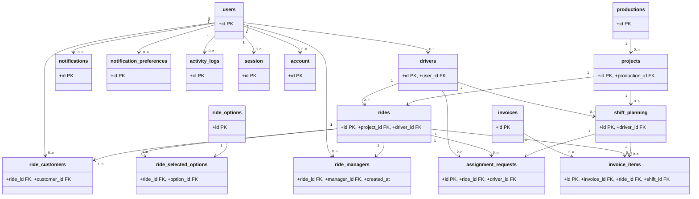
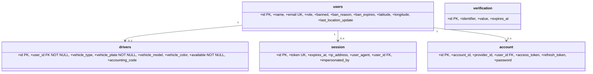
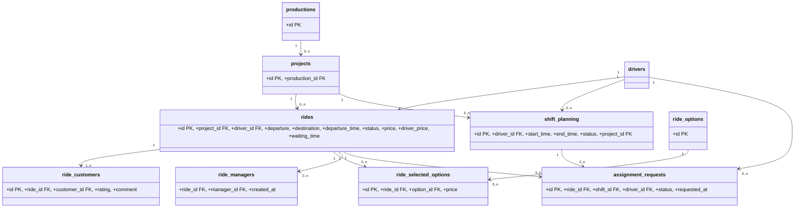

# Annexe #2 — Modèle de données : ERD (version A4, 2 pages)

> **Source de vérité** : `lib/db/schema.ts` @ `main` (SHA `bce57b7`, vérifié le 30/10/2026). Aucun champ inventé. Page 1 : carte relationnelle (synthèse sans attributs) puis comptes, rôles et authentification. Page 2 : cœur métier. La vue « facturation, notifications, audit », le détail des index et la vue exhaustive (écran / A4 paysage) restent dans le dépôt ; note : `invoices`/`invoice_items` sont au schéma sans FK d'écriture (module facturation non livré).

## Page 1 — Carte relationnelle + comptes, rôles, authentification

## Vue 0 — Carte relationnelle (synthèse, sans attributs — A4 portrait)

*La notation est « zéro attrait » : uniquement les tables et leurs liens — lisible à 100 % sur papier, elle raconte le modèle en un regard.*

## Vue 1 — Comptes, rôles et authentification (A4 portrait)

Tables : `users`, `drivers`, `session`, `account`, `verification`.

## Page 2 — Cœur métier : courses, shifts, assignations

## Vue 2 — Cœur métier : courses, shifts, assignations (A4 portrait)

Tables : `productions`, `projects`, `rides`, `shift_planning`, `ride_options`, `ride_selected_options`, `ride_customers`, `ride_managers`, `assignment_requests`.

*Types énumérés (5) : `user_role`, `ride_status`, `request_status`, `shift_status`, `invoice_status` — contraintes PostgreSQL `pgEnum`, voir § 5.2 du dossier.*
