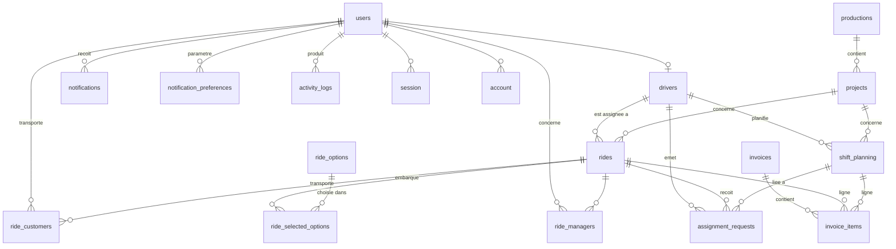
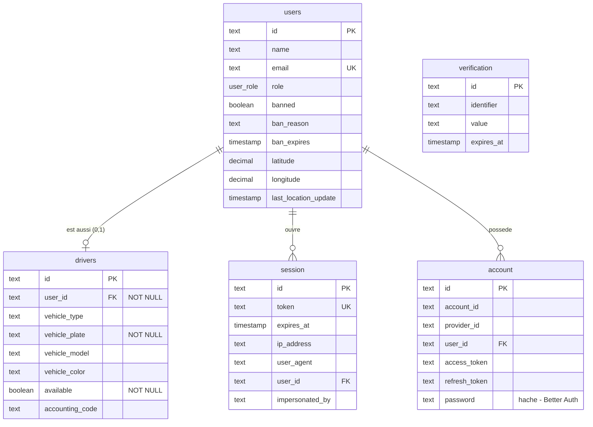
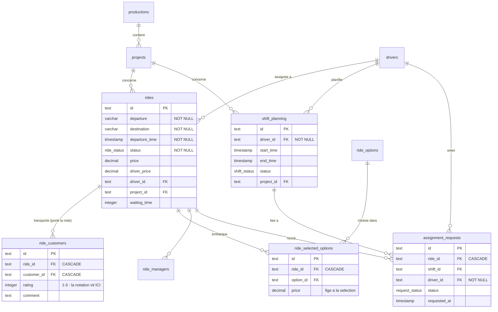
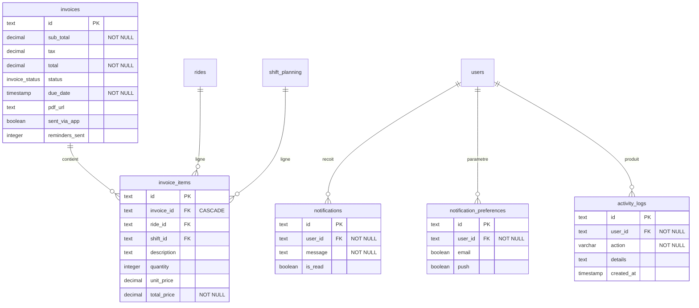
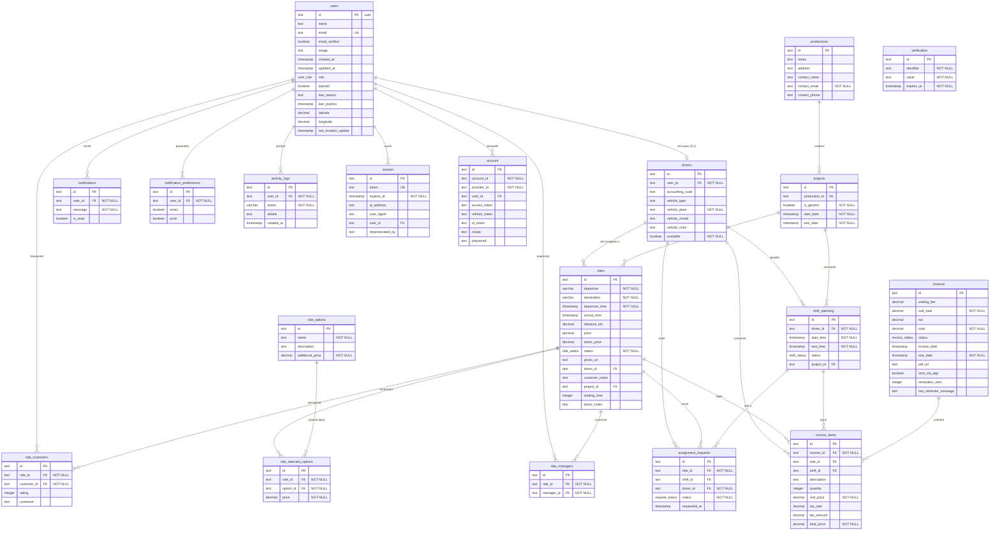

# Annexe #2 — Modèle de données : ERD exhaustif (adapté impression)

> **Source de vérité** : `lib/db/schema.ts` @ `main` (SHA `bce57b7`, vérifié le 30/10/2026). Aucun champ inventé.
> **Guide d'impression** : la **carte relationnelle** et les **trois vues de module** ci-dessous tiennent en A4 portrait — ce sont elles qui vont dans le dossier imprimé. La vue exhaustive complète (toutes colonnes, 19 tables) reste en fin de document : elle est **faite pour l'écran** (source de vérité, zoom) et peut être imprimée en A4 paysage ou simplement référencée.

## Vue 0 — Carte relationnelle (synthèse, sans attributs — A4 portrait)

*La notation est « zéro attrait » : uniquement les tables et leurs liens — lisible à 100 % sur papier, elle raconte le modèle en un regard.*

## Vue 1 — Comptes, rôles et authentification (A4 portrait)

Tables : `users`, `drivers`, `session`, `account`, `verification`.

## Vue 2 — Cœur métier : courses, shifts, assignations (A4 portrait)

Tables : `productions`, `projects`, `rides`, `shift_planning`, `ride_options`, `ride_selected_options`, `ride_customers`, `ride_managers`, `assignment_requests`.

## Vue 3 — Facturation, notifications, audit (A4 portrait)

Tables : `invoices`, `invoice_items`, `notifications`, `notification_preferences`, `activity_logs`.

*Note de cohérence (déjà dite § 3.4 du dossier) : `invoices`/`invoice_items` sont présentes au schéma mais **sans FK vers le reste** et sans code d'écriture — module non livré, table prêtée au futur. Les liens `invoice_items → rides/shift_planning` existent dans le schéma ; le reste du module n'existe pas encore dans l'application.*

## Enumérations (5)

| Enum | Valeurs |
| --- | --- |
| `user_role` | `admin` · `driver` · `customer` |
| `ride_status` | `pending` · `assigned` · `completed` · `cancelled` |
| `shift_status` | `planned` · `active` · `completed` · `cancelled` |
| `request_status` | `pending` · `approved` · `rejected` |
| `invoice_status` | `unpaid` · `paid` · `cancelled` |

## Index (tous mono-colonne — § 4.2 MPD)

| Table | Index |
| --- | --- |
| users | `email` · `role` |
| drivers | `userId` |
| productions | `name` |
| projects | `productionId` · `isGeneric` |
| rides | `driverId` · `projectId` · `status` |
| shift_planning | `driverId` · `projectId` |
| ride_options | `name` |
| ride_selected_options | `rideId` · `optionId` |
| ride_customers | `rideId` · `customerId` |
| ride_managers | `rideId` · `managerId` |
| assignment_requests | `rideId` · `driverId` |
| invoices | `status` |
| invoice_items | `invoiceId` · `rideId` · `shiftId` |
| notifications | `userId` · `isRead` |
| notification_preferences | `userId` |
| activity_logs | `userId` · `createdAt` |

## Améliorations planifiées (§ 4.2 — reprises)

Contrainte `CHECK` sur `ride_customers.rating` (1–5) · `UNIQUE` composites (`ride_id, customer_id`) et (`ride_id, option_id`) · index composite (`driver_id, status`) sur `rides` · nuance : plusieurs colonnes `NOT NULL` portent `ON DELETE SET NULL` — le `SET NULL` échouera à l'exécution si la ligne référencée est supprimée (dette connue, non bloquante).

## Vue exhaustive complète (pour l'écran / A4 paysage)

> 19 tables, toutes les colonnes. **À ne pas imprimer en A4 portrait** — c'est la source de vérité consultable dans le repo, et la pièce à sortir en soutenance sur écran si le jury creuse.

