# Annexe #2 — ERD exhaustif des 19 tables (généré depuis le code réel)

> **Source de vérité** : `amt-express/lib/db/schema.ts` @ `main` (SHA `bce57b7`, vérifié le 30/10/2026). Aucun champ inventé : chaque colonne ci-dessous existe dans le schéma Drizzle.
> **Rappel dossier § 4.2** : 19 tables (16 métier + 3 Better Auth), 5 `pgEnum`, FK `ON DELETE SET NULL`/`CASCADE`, index mono-colonne uniquement.

## Enumérations (5)

| Enum | Valeurs |
| --- | --- |
| `user_role` | `admin` · `driver` · `customer` (source : `USER_ROLES` dans `content/database_types`) |
| `ride_status` | `pending` · `assigned` · `completed` · `cancelled` |
| `shift_status` | `planned` · `active` · `completed` · `cancelled` |
| `request_status` | `pending` · `approved` · `rejected` |
| `invoice_status` | `unpaid` · `paid` · `cancelled` |

## Diagramme entité-relations (notation pattes-de-corneille)

```mermaid
erDiagram
    users ||--o| drivers : "est aussi (0,1)"
    users ||--o{ ride_customers : "transporte"
    users ||--o{ ride_managers : "supervise"
    users ||--o{ notifications : "recoit"
    users ||--o{ notification_preferences : "parametre"
    users ||--o{ activity_logs : "produit"
    users ||--o{ session : "ouvre"
    users ||--o{ account : "possede"
    productions ||--o{ projects : "contient"
    drivers ||--o{ rides : "est assignee a"
    drivers ||--o{ shift_planning : "planifie"
    drivers ||--o{ assignment_requests : "emet"
    drivers ||--o{ invoice_items : "concerne"
    projects ||--o{ rides : "concerne"
    projects ||--o{ shift_planning : "concerne"
    rides ||--o{ ride_customers : "transporte"
    rides ||--o{ ride_selected_options : "embarque"
    rides ||--o{ ride_managers : "concerne"
    rides ||--o{ assignment_requests : "recoit"
    rides ||--o{ invoice_items : "ligne"
    ride_options ||--o{ ride_selected_options : "choisie dans"
    shift_planning ||--o{ assignment_requests : "liee a"
    shift_planning ||--o{ invoice_items : "ligne"
    invoices ||--o{ invoice_items : "contient"

    users {
        text id PK
        text name
        text email UK
        boolean email_verified
        text image
        timestamp created_at
        timestamp updated_at
        user_role role
        boolean banned
        text ban_reason
        timestamp ban_expires
        decimal latitude
        decimal longitude
        timestamp last_location_update
    }
    drivers {
        text id PK
        text user_id FK "NOT NULL, SET NULL"
        text accounting_code
        text vehicle_type
        text vehicle_plate "NOT NULL"
        text vehicle_model
        text vehicle_color
        boolean available "NOT NULL"
    }
    productions {
        text id PK
        text name
        text address
        text contact_name
        text contact_email "NOT NULL"
        text contact_phone
    }
    projects {
        text id PK
        text production_id FK "SET NULL"
        boolean is_generic "NOT NULL"
        timestamp start_date "NOT NULL"
        timestamp end_date "NOT NULL"
    }
    rides {
        text id PK
        varchar departure "NOT NULL"
        varchar destination "NOT NULL"
        timestamp departure_time "NOT NULL"
        timestamp arrival_time
        decimal distance_km
        decimal price
        decimal driver_price
        ride_status status "NOT NULL, def pending"
        text photo_url
        text driver_id FK "SET NULL"
        text customer_notes
        text project_id FK "SET NULL"
        integer waiting_time "def 0"
        text driver_notes
    }
    shift_planning {
        text id PK
        text driver_id FK "NOT NULL, SET NULL"
        timestamp start_time "NOT NULL"
        timestamp end_time "NOT NULL"
        shift_status status "def planned"
        text project_id FK "SET NULL"
    }
    ride_options {
        text id PK
        text name "NOT NULL"
        text description
        decimal additional_price "NOT NULL, def 0"
    }
    ride_selected_options {
        text id PK
        text ride_id FK "NOT NULL, CASCADE"
        text option_id FK "NOT NULL, SET NULL"
        decimal price "NOT NULL - prix figé à la sélection"
    }
    ride_customers {
        text id PK
        text ride_id FK "NOT NULL, CASCADE"
        text customer_id FK "NOT NULL, CASCADE"
        integer rating "1-5 - la notation vit ICI"
        text comment
    }
    ride_managers {
        text id PK
        text ride_id FK "NOT NULL, CASCADE"
        text manager_id FK "NOT NULL, CASCADE"
    }
    assignment_requests {
        text id PK
        text ride_id FK "NOT NULL, CASCADE"
        text shift_id FK "SET NULL - absent des diagrammes du dossier"
        text driver_id FK "NOT NULL, SET NULL"
        request_status status "NOT NULL, def pending"
        timestamp requested_at
    }
    invoices {
        text id PK
        decimal waiting_fee "def 0"
        decimal sub_total "NOT NULL"
        decimal tax "def 0"
        decimal total "NOT NULL"
        invoice_status status "def unpaid"
        timestamp invoice_date
        timestamp due_date "NOT NULL"
        text pdf_url
        boolean sent_via_app "def false"
        integer reminders_sent "def 0"
        text last_reminder_message
    }
    invoice_items {
        text id PK
        text invoice_id FK "NOT NULL, CASCADE"
        text ride_id FK "SET NULL"
        text shift_id FK "SET NULL"
        text description
        integer quantity "def 1"
        decimal unit_price "NOT NULL"
        decimal tax_rate "def 0"
        decimal tax_amount "def 0"
        decimal total_price "NOT NULL"
    }
    notifications {
        text id PK
        text user_id FK "NOT NULL, SET NULL"
        text message "NOT NULL"
        boolean is_read "def false"
    }
    notification_preferences {
        text id PK
        text user_id FK "NOT NULL, SET NULL"
        boolean email "def true"
        boolean push "def true"
    }
    activity_logs {
        text id PK
        text user_id FK "NOT NULL, SET NULL"
        varchar action "NOT NULL"
        text details
        timestamp created_at
    }
    session {
        text id PK
        text token UK
        timestamp expires_at "NOT NULL"
        text ip_address
        text user_agent
        text user_id FK "SET NULL"
        text impersonated_by
    }
    account {
        text id PK
        text account_id "NOT NULL"
        text provider_id "NOT NULL"
        text user_id FK "SET NULL"
        text access_token
        text refresh_token
        text id_token
        text scope
        text password
    }
    verification {
        text id PK
        text identifier "NOT NULL"
        text value "NOT NULL"
        timestamp expires_at "NOT NULL"
    }
```

## Index (tous mono-colonne — confirmé § 4.2 MPD)

| Table | Index |
| --- | --- |
| users | `email` · `role` |
| drivers | `userId` |
| productions | `name` |
| projects | `productionId` · `isGeneric` |
| rides | `driverId` · `projectId` · `status` |
| shift_planning | `driverId` · `projectId` |
| ride_options | `name` |
| ride_selected_options | `rideId` · `optionId` |
| ride_customers | `rideId` · `customerId` |
| ride_managers | `rideId` · `managerId` |
| assignment_requests | `rideId` · `driverId` |
| invoices | `status` |
| invoice_items | `invoiceId` · `rideId` · `shiftId` |
| notifications | `userId` · `isRead` |
| notification_preferences | `userId` |
| activity_logs | `userId` · `createdAt` |
| session / account / verification | `userId`/`token`/`expiresAt` · `userId` · `identifier`/`expiresAt` |

## Améliorations planifiées (déjà notées § 4.2 — reprises ici pour l'exhaustivité)

- Contrainte `CHECK` sur `ride_customers.rating` (bornes 1–5) ;
- `UNIQUE` composite (`ride_id`, `customer_id`) sur `ride_customers` — idem (`ride_id`, `option_id`) sur `ride_selected_options` ;
- Index composite (`driver_id`, `status`) sur `rides` (filtre fréquent des vues chauffeur) ;
- Nuance constatée : plusieurs colonnes portent `NOT NULL` **et** `ON DELETE SET NULL` (`drivers.user_id`, `shift_planning.driver_id`, `assignment_requests.driver_id`, toutes les tables de notification/audit) — sous PostgreSQL, le `SET NULL` d'une ligne référencée échouera à l'exécution si la colonne est `NOT NULL`. Piste d'audit technique à part (le dossier n'a pas à le cacher, mais ce n'est pas bloquant pour le MVP).
