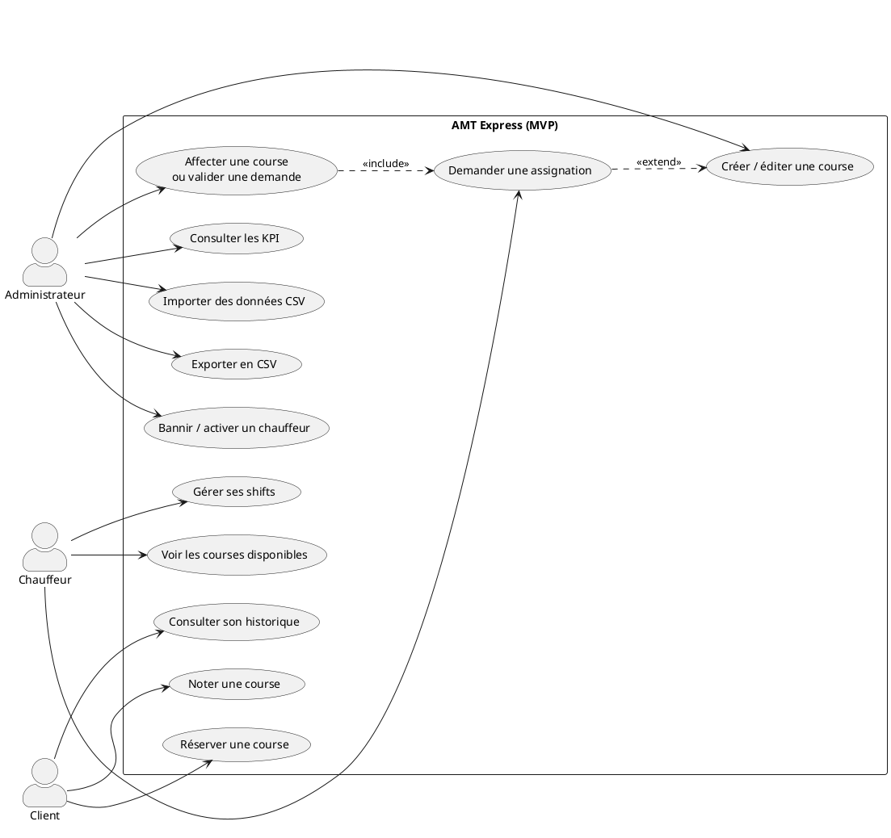

# Annexe #1 bis — UML canonique (sources PlantUML)

> Les diagrammes du dossier (§ 4.1) sont des **transcriptions Mermaid** — pratiques à maintenir, mais le jury attend un rendu UML canonique (acteurs en bonhommes, cas d'utilisation en ellipses, classes en rectangles compartimentés). Ce fichier donne les **sources PlantUML** à rendre en image pour l'annexe #1. Rendu : [plantuml.com](https://www.plantuml.com/plantuml) en ligne, ou l'extension VS Code *PlantUML* — exporter en **PNG** (300 dpi pour l'impression).

## Cas d'utilisation (acteurs Admin / Chauffeur / Client)



## Diagramme de classes (canonique, corrigé contre le schéma réel — 30/10)

```plantuml
@startuml
class User { +id : uuid
+role : user_role
+email
+banned }
class Driver { +id : uuid
+user_id : FK
+available : bool
+vehicle_plate }
class Production { +id : uuid
+name }
class Project { +id : uuid
+production_id : FK }
class Ride { +id : uuid
+project_id : FK
+driver_id : FK?
+status : ride_status
+price }
class RideCustomer { +ride_id : FK
+customer_id : FK
+rating : 1..5
+comment }
class RideOption { +id : uuid
+additional_price }
class RideSelectedOption { +ride_id : FK
+option_id : FK
+price (figé à la sélection) }
class AssignmentRequest { +ride_id : FK
+shift_id : FK?
+driver_id : FK
+status : request_status }
class ShiftPlanning { +driver_id : FK
+status : shift_status }

User "1" --> "0..1" Driver
Production "1" *-- "0..n" Project
Project "1" --> "0..n" Ride
Driver "0..1" --> "0..n" Ride : est assigné à
Ride "1" --> "1..n" RideCustomer : transporte (porte la note)
Ride "1" --> "0..n" RideSelectedOption : embarque
RideSelectedOption "0..n" --> "1" RideOption
Ride "1" --> "0..n" AssignmentRequest
AssignmentRequest "0..n" --> "1" Driver
ShiftPlanning "0..1" <-- "0..n" AssignmentRequest : lie un shift
Driver "1" --> "0..n" ShiftPlanning
User "0..n" <-- "1..n" RideCustomer
@enduml
```

*Corrections du 30/10 intégrées : la notation (1–5 + commentaire) vit dans `RideCustomer` (table associative `ride_customers`), pas dans `Ride` ; `AssignmentRequest.shift_id` (FK nullable vers `ShiftPlanning`) apparaît ; `RideSelectedOption` porte son prix figé. Cohérent avec l'ERD de l'annexe #2.*
