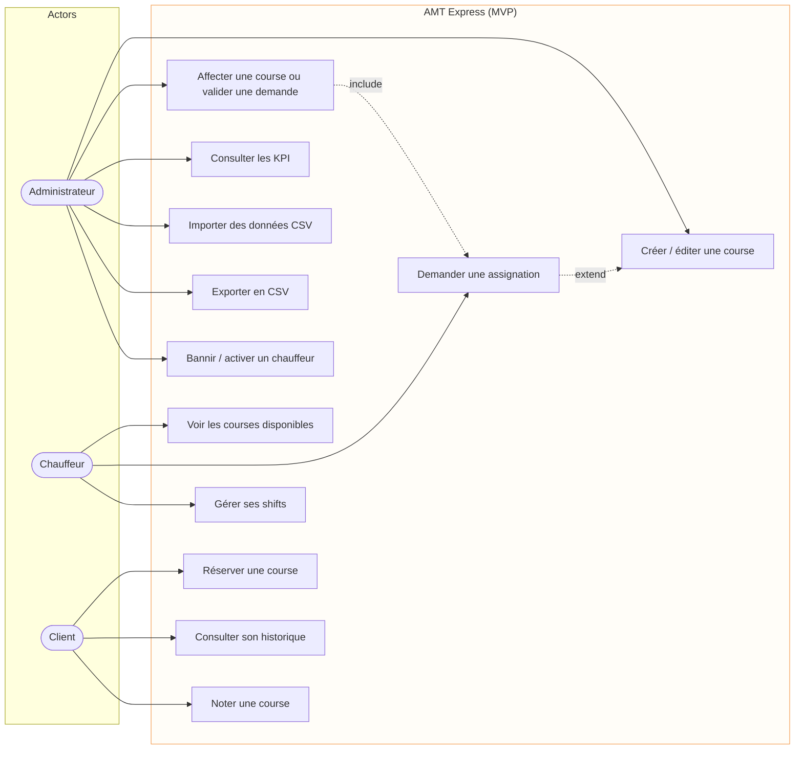
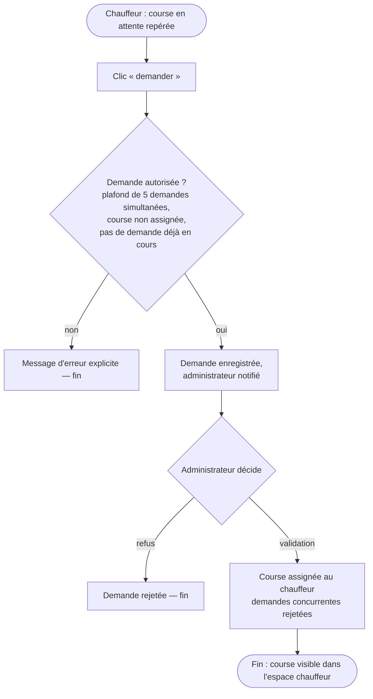
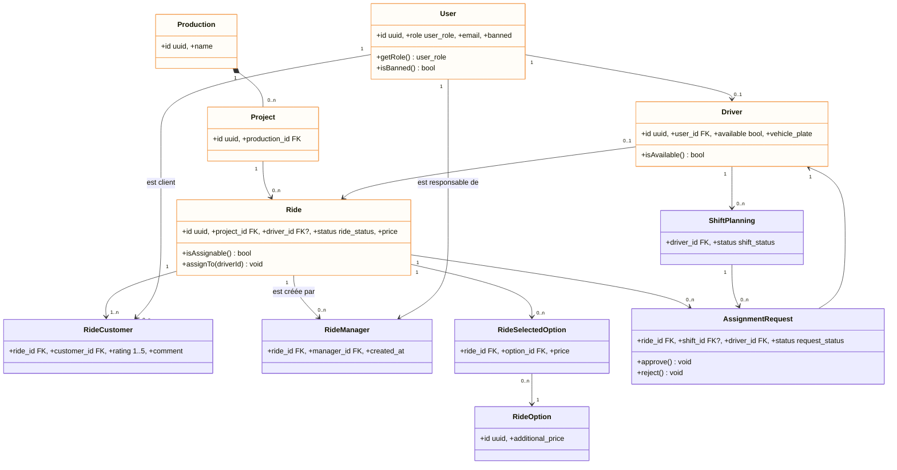

# Annexe #1 — UML : cas d'utilisation, activité, classes (version A4, 2 pages)

> Rendu de référence pour le § 5.1 du dossier. Diagrammes Mermaid, exportables en PNG 300 dpi via [Mermaid Live Editor](https://mermaid.live). Les sources PlantUML (pour un rendu canonique : acteurs en bonhommes, cas d'utilisation en ellipses, classes en rectangles compartimentés) restent dans l'historique du dépôt — à rendre en image avant l'impression finale.

## Page 1 — Cas d'utilisation et parcours d'activité

**Cas d'utilisation** — acteurs Admin / Chauffeur / Client :

**Diagramme d'activité** — parcours « demande d'assignation d'une course » :

*Version volontairement resserrée pour tenir sur une page A4 ; le déroulé technique complet (contrôle du rôle, transaction d'assignation, rejet des demandes concurrentes) est décrit en § 7.3 du dossier.*

## Page 2 — Diagramme de classes (modèle conceptuel des données)

