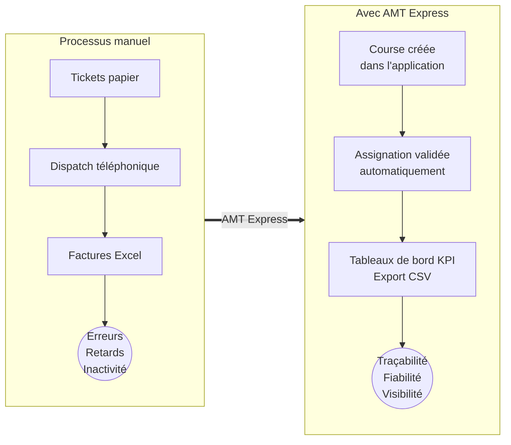

# Annexe 14 — Processus manuel vs avec AMT Express (format A4)

> Schéma comparatif cité en §3.1 du dossier. À imprimer en A4 pour le jury.

**Processus manuel** : tickets papier retranscrits à la main → dispatch téléphonique → factures Excel → erreurs de saisie, retards de paiement, jusqu'à 20 % de temps d'inactivité pour les chauffeurs et ~10 heures/semaine perdues en ressaisie.

**Avec AMT Express** : course créée dans l'application → assignation validée (rejet automatique des demandes concurrentes) → tableaux de bord KPI et export CSV → traçabilité, fiabilité, visibilité temps réel.

