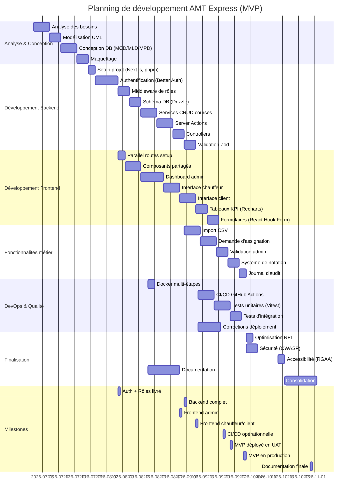

# Annexe #4 — Diagramme de Gantt

> **Source** : Planning réel du développement (juillet - novembre 2026)
> **Format** : Diagramme de Gantt en Mermaid pour visualisation Markdown. Pour impression, exporter via [Mermaid Live Editor](https://mermaid.live) en PNG 300dpi.

## Diagramme de Gantt complet

## Légende

| Symbole | Signification |
|---------|---------------|
| **:task:** | Tâche avec durée |
| **milestone** | Jalon important |
| **section** | Phase de développement |

## Chiffres clés du planning

| Phase | Durée | Tâches | Jalons |
|-------|-------|--------|--------|
| Analyse & Conception | 24 jours | 4 | 0 |
| Développement Backend | 47 jours | 8 | 1 |
| Développement Frontend | 42 jours | 7 | 2 |
| Fonctionnalités métier | 27 jours | 5 | 0 |
| DevOps & Qualité | 32 jours | 5 | 2 |
| Finalisation | 34 jours | 5 | 1 |
| **Total** | **206 jours** | **34** | **6** |

## Analyse du planning

**Développement en mode Agile** : Le projet a été mené selon une méthodologie itérative, avec des cycles de 2-3 semaines. Les phases se sont partiellement chevauchées pour optimiser le temps (ex: développement frontend a commencé alors que le backend était à 70% complet).

**Points bloquants identifiés** :
- **Semaine du 11/09** : 17 corrections de déploiement consécutives (CI/CD Vercel)
- **Semaine du 02/10** : Audit de sécurité et optimisation des performances
- **Semaine du 16/10** : Corrections d'accessibilité (RGAA)

**Temps de développement réel** : 5 mois (juillet - novembre 2026), avec une moyenne de 15-20 heures/semaine en temps partiel.

## Conseils pour l'impression

1. Exporter le diagramme via [Mermaid Live Editor](https://mermaid.live) en PNG 300dpi
2. Choisir un format paysage pour une meilleure lisibilité
3. Imprimer sur une page A3 ou deux pages A4 si nécessaire
4. Garder la légende et l'analyse à côté du diagramme pour contexte
