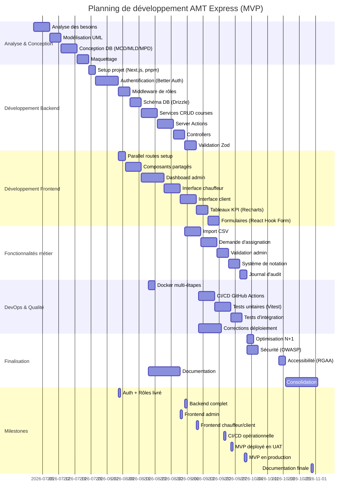

# Annexe #4 — Diagramme de Gantt

> **Source** : Planning réel du développement (juillet - novembre 2026)
> **Format** : Diagramme de Gantt en Mermaid pour visualisation Markdown. Pour impression, exporter via [Mermaid Live Editor](https://mermaid.live) en PNG 300dpi.

## Diagramme de Gantt complet

## Repères du planning

- **Semaine du 11/09** : 17 corrections de déploiement consécutives (CI/CD Vercel). **Semaine du 02/10** : audit sécurité / performances. **Semaine du 16/10** : accessibilité (RGAA).
- Développement solo en temps partiel : juillet → novembre 2026, ~15-20 h/semaine. 34 tâches, 6 jalons.
- Pour l'impression : exporter le diagramme en PNG 300 dpi, format paysage ([Mermaid Live Editor](https://mermaid.live)).
