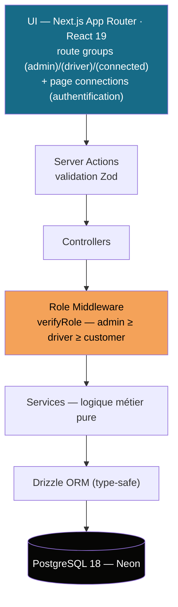
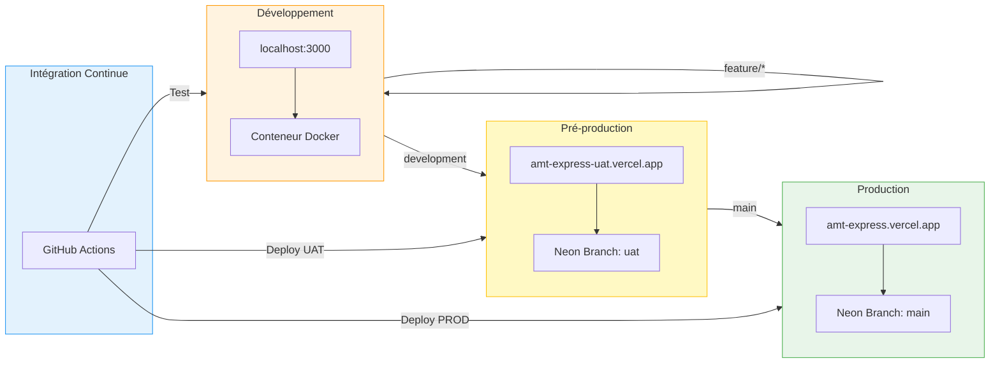
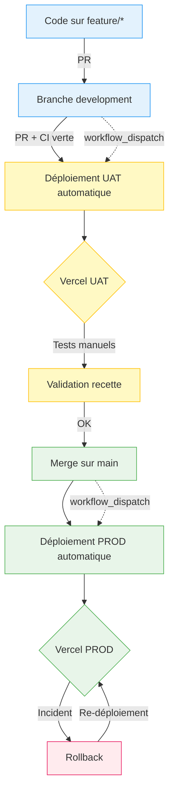
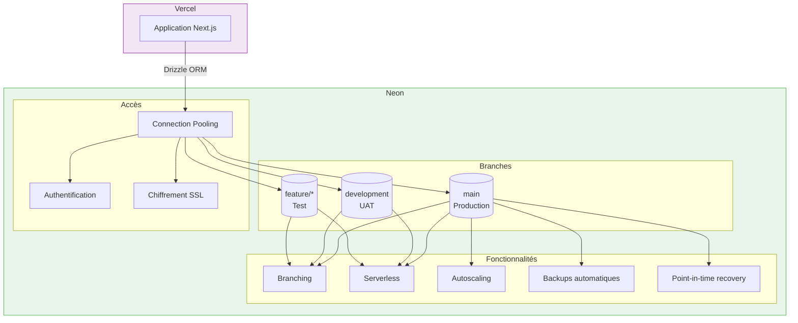

# Annexe #6 — Schéma d'infrastructure (version A4, 3 pages)

> Architecture de déploiement réelle (Vercel + Neon PostgreSQL). Pages 1-2 : architecture globale, couches logicielles et environnements ; page 3 : hébergement de la base et capacités. La sécurité (§ 6.2 du dossier), le rollback/backup (§ 9.4) et la configuration détaillée restent dans le dépôt.

## Page 1 — Architecture globale

## Architecture globale

```mermaid
flowchart TB
    subgraph Clients
        C1[Client Web<br/>(Browser)]
        C2[Client Mobile<br/>(PWA)]
    end
    
    subgraph Vercel
        direction TB
        subgraph Frontend
            F1[Next.js App Router]
            F2[React 19 + TypeScript]
            F3[Static Assets]
        end
        subgraph Backend
            B1[Server Actions]
            B2[Better Auth]
        end
    end
    
    subgraph Services Externes
        DB[(PostgreSQL<br/>Neon Serverless)]
        S1[Neon Branching]
        S2[Neon Backups]
        V1[Vercel Storage]
    end
    
    subgraph Développement
        Dev[Local Dev<br/>(Docker)]
        Git[GitHub]
        CI[GitHub Actions]
    end
    
    subgraph Surveillance
        Logs[Vercel Logs]
        Metrics[Vercel Metrics]
        Alerts[GitHub Dependabot]
    end
    
    C1 -->|HTTPS| F1
    C2 -->|HTTPS| F1
    F1 --> B1
    B1 -->|Drizzle ORM| DB
    B2 -->|Sessions| DB
    F3 -->|CDN| Vercel
    
    Dev -->|Docker| F1
    Dev -->|Docker| B1
    Dev -->|Drizzle| DB
    
    Git -->|Push| CI
    CI -->|Build + Test| Vercel
    CI -->|Deploy| Vercel
    
    DB --> S1
    DB --> S2
    
    Vercel --> Logs
    Vercel --> Metrics
    Git --> Alerts
    
    style Clients fill:#e3f2fd,stroke:#2196f3
    style Vercel fill:#f3e5f5,stroke:#9c27b0
    style Services Externes fill:#e8f5e9,stroke:#4caf50
    style Développement fill:#fff3e0,stroke:#ff9800
    style Surveillance fill:#fce4ec,stroke:#e91e63
```

## Page 2 — Couches logicielles et environnements

## Architecture logicielle en couches (§ 6.1 du dossier)



*Couches transverses : Better Auth (sessions, rôles, bannissements), `activity_logs` (journalisation), i18next (FR/EN). Le détail des responsabilités par couche figure en § 6.1 du dossier.*

## Environnements de déploiement

### Architecture multi-environnements



### Workflow de déploiement



## Page 3 — Hébergement PostgreSQL (Neon) et capacités

## Infrastructure PostgreSQL (Neon)

### Schéma d'hébergement de la base de données



### Capacités et limites

| Ressource | Free Tier | Utilisation actuelle | Seuil critique | Coût estimé si dépassement |
|-----------|-----------|---------------------|-----------------|-----------------------------|
| **Stockage DB** | 500 Mo | ~300 Mo | 80% | 0,10 €/Go/mois |
| **Bande passante** | 100 Go/mois | ~50 Go/mois | 50% | 0,10 €/Go |
| **Connexions** | 10 000/jour | ~5 000/jour | 50% | Variable |
| **Compute** | 3 000 CPU-sec/jour | ~1 500 | 50% | Variable |
| **Branches** | 3 branches | 3 utilisées | 100% | 0,05 €/branche/jour |

**Temps moyen de réponse** : ~50 ms (Neon Serverless)

**Coûts** : Vercel, Neon et GitHub en Free Tier suffisent aujourd'hui (0 €/mois) ; au-delà du quota, bascule estimée à ~45 €/mois vers 50 000 utilisateurs.
