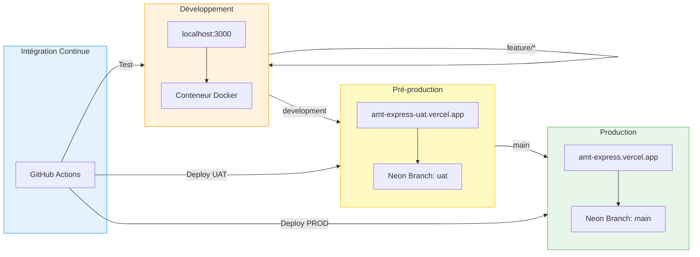
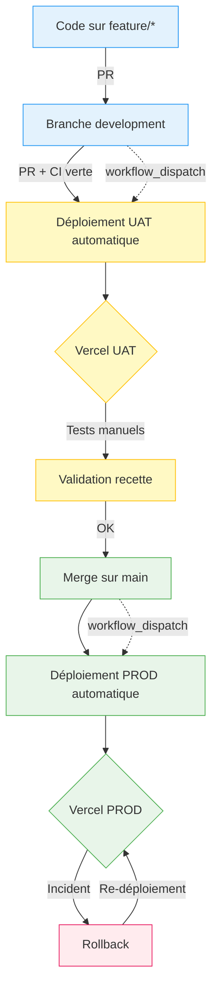
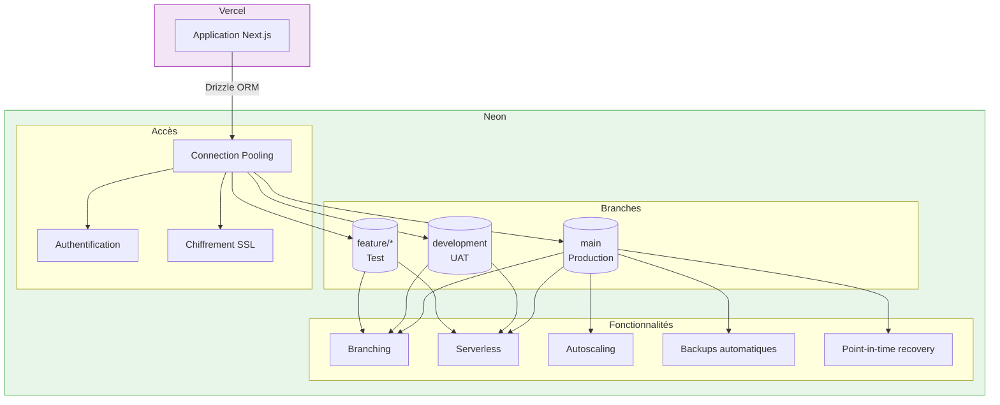
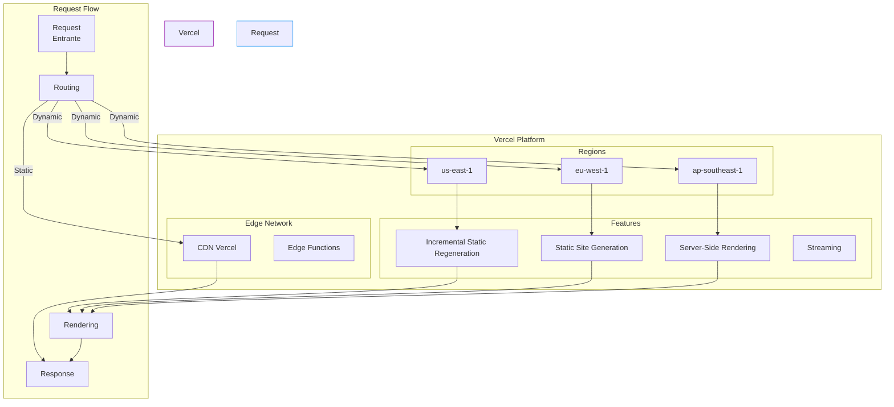
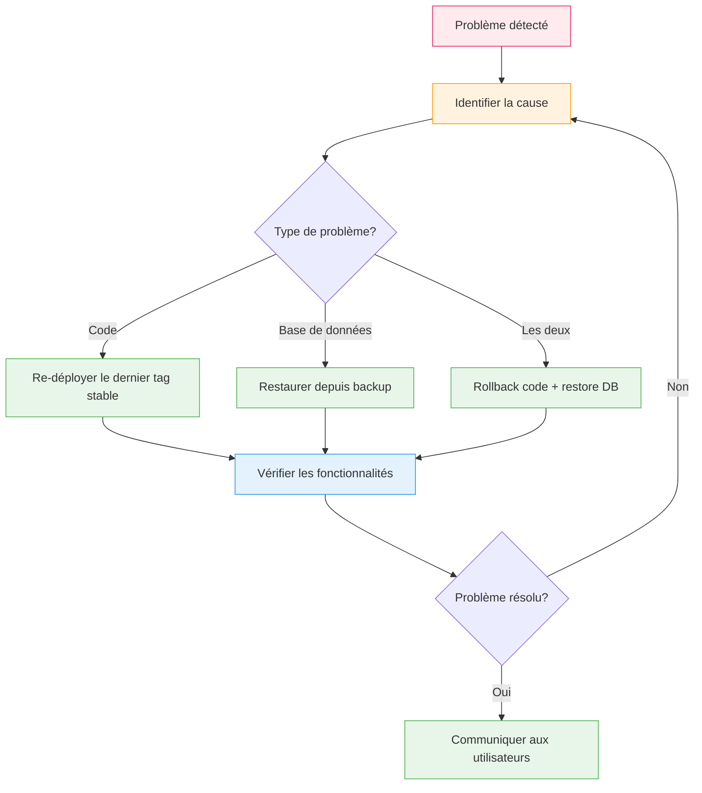

# Annexe #6 — Schéma d'infrastructure

> **Source** : Architecture de déploiement réelle (Vercel + Neon PostgreSQL)
> **Format** : Diagrammes en Mermaid pour visualisation Markdown. Pour rendu professionnel, exporter via [Mermaid Live Editor](https://mermaid.live) en PNG 300dpi.

## Architecture globale

```mermaid
flowchart TB
    subgraph Clients
        C1[Client Web<br/>(Browser)]
        C2[Client Mobile<br/>(PWA)]
    end
    
    subgraph Vercel
        direction TB
        subgraph Frontend
            F1[Next.js App Router]
            F2[React 19 + TypeScript]
            F3[Static Assets]
        end
        subgraph Backend
            B1[Server Actions]
            B2[Better Auth]
        end
    end
    
    subgraph Services Externes
        DB[(PostgreSQL<br/>Neon Serverless)]
        S1[Neon Branching]
        S2[Neon Backups]
        V1[Vercel Storage]
    end
    
    subgraph Développement
        Dev[Local Dev<br/>(Docker)]
        Git[GitHub]
        CI[GitHub Actions]
    end
    
    subgraph Surveillance
        Logs[Vercel Logs]
        Metrics[Vercel Metrics]
        Alerts[GitHub Dependabot]
    end
    
    C1 -->|HTTPS| F1
    C2 -->|HTTPS| F1
    F1 --> B1
    B1 -->|Drizzle ORM| DB
    B2 -->|Sessions| DB
    F3 -->|CDN| Vercel
    
    Dev -->|Docker| F1
    Dev -->|Docker| B1
    Dev -->|Drizzle| DB
    
    Git -->|Push| CI
    CI -->|Build + Test| Vercel
    CI -->|Deploy| Vercel
    
    DB --> S1
    DB --> S2
    
    Vercel --> Logs
    Vercel --> Metrics
    Git --> Alerts
    
    style Clients fill:#e3f2fd,stroke:#2196f3
    style Vercel fill:#f3e5f5,stroke:#9c27b0
    style Services Externes fill:#e8f5e9,stroke:#4caf50
    style Développement fill:#fff3e0,stroke:#ff9800
    style Surveillance fill:#fce4ec,stroke:#e91e63
```

## Environnements de déploiement

### Architecture multi-environnements



### Workflow de déploiement



## Infrastructure PostgreSQL (Neon)

### Schéma d'hébergement de la base de données



### Capacités et limites

| Ressource | Free Tier | Utilisation actuelle | Seuil critique | Coût estimé si dépassement |
|-----------|-----------|---------------------|-----------------|-----------------------------|
| **Stockage DB** | 500 Mo | ~300 Mo | 80% | 0,10 €/Go/mois |
| **Bande passante** | 100 Go/mois | ~50 Go/mois | 50% | 0,10 €/Go |
| **Connexions** | 10 000/jour | ~5 000/jour | 50% | Variable |
| **Compute** | 3 000 CPU-sec/jour | ~1 500 | 50% | Variable |
| **Branches** | 3 branches | 3 utilisées | 100% | 0,05 €/branche/jour |

**Temps moyen de réponse** : ~50 ms (Neon Serverless)

## Infrastructure Vercel

### Architecture de l'application



### Configuration spécifique AMT Express

```yaml
# vercel.json
{
  "version": 2,
  "builds": [
    {
      "src": "package.json",
      "use": "@vercel/next",
      "config": {
        "installCommand": "pnpm install",
        "zeroConfig": true
      }
    }
  ],
  "routes": [
    {
      "src": "/(.*)",
      "dest": "/",
      "headers": {
        "X-Frame-Options": "DENY",
        "X-Content-Type-Options": "nosniff",
        "Referrer-Policy": "strict-origin-when-cross-origin"
      }
    }
  ],
  "env": [
    {
      "name": "DATABASE_URL",
      "type": "encrypted",
      "target": ["production", "preview"]
    },
    {
      "name": "NEXTAUTH_SECRET",
      "type": "encrypted",
      "target": ["production", "preview"]
    }
  ]
}
```

## Sécurité de l'infrastructure

### Mesures de sécurité implémentées

```mermaid
flowchart TB
    subgraph Protection
        A1[Chiffrement HTTPS<br/>(TLS 1.3)]
        A2[Secrets chiffrés<br/>(Vercel Encrypted Env)]
        A3[Protection DDoS<br/>(Vercel)]
        A4[WAF<br/>(Vercel)]
        A5[Authentification forte<br/>(Better Auth)]
    end
    
    subgraph Surveillance
        B1[Logs centralisés]
        B2[Alertes en temps réel]
        B3[Audit des accès]
        B4[Scan de vulnérabilités]
    end
    
    subgraph Backup
        C1[Backups DB automatiques<br/>(Neon)]
        C2[Backups manuels<br/>(pnpm db:backup)]
        C3[Point-in-time recovery]
    end
    
    Request[Requête HTTP] --> A1
    A1 --> A2
    A2 --> A3
    A3 --> A4
    A4 --> Application
    
    Application --> B1
    Application --> B2
    Application --> B3
    
    DB --> C1
    DB --> C2
    DB --> C3
    
    style Protection fill:#e8f5e9,stroke:#4caf50
    style Surveillance fill:#fff3e0,stroke:#ff9800
    style Backup fill:#f3e5f5,stroke:#9c27b0
```

## Coûts et scalabilité

### Estimation des coûts (Free Tier)

| Service | Coût mensuel estimé | Statut |
|---------|---------------------|--------|
| **Vercel** | 0 € | Free Tier suffisant |
| **Neon PostgreSQL** | 0 € | Free Tier suffisant |
| **GitHub** | 0 € | Free Tier (public repo) |
| **Total** | **0 €** | ✅ Budget respecté |

### Scalabilité

| Trafic mensuel | Vercel | Neon | Coût estimé |
|---------------|--------|------|--------------|
| 10 000 utilisateurs | Free Tier | Free Tier | 0 € |
| 50 000 utilisateurs | Pro (20 €) | Pro (25 €) | ~45 € |
| 100 000 utilisateurs | Pro (20 €) | Pro (50 €) | ~70 € |
| 500 000 utilisateurs | Enterprise | Enterprise | ~250 € |

**Scalabilité verticale** : Neon permet de passer à des instances dédiées en cas de besoin.
**Scalabilité horizontale** : Vercel scale automatiquement avec le trafic.

## Procédures d'urgence

### Rollback



**Temps moyen de rollback** : < 15 minutes (code + base de données)

### Sauvegarde et restauration

```bash
# Sauvegarde manuelle
pnpm db:backup

# Restauration
pnpm db:restore backups/backup-2026-11-06.sql

# Sauvegarde automatique avant import
pnpm db:import-csv data.csv  # Backup automatique inclus
```

## Conseils pour l'impression

1. Exporter chaque diagramme via [Mermaid Live Editor](https://mermaid.live) en PNG 300dpi
2. Imprimer en format paysage pour les diagrammes larges
3. Garder les légendes et explications à côté des diagrammes
4. Utiliser du papier A3 pour les diagrammes complexes
5. Numéroter les pages pour référence facile
