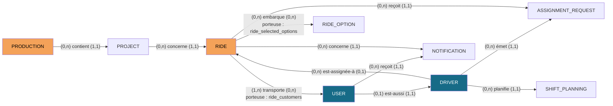

# Annexe 15 — Modèle Conceptuel de Données complet (format A4)

> MCD complet cité en §4.2 du dossier, en notation Merise (cardinalités portées par les liens). À imprimer en A4 pour le jury. La version miniaturisée du dossier ne montre que le cœur métier.

Les tables techniques (authentification Better Auth : `session`, `account`, `verification` ; journal d'audit `activity_logs` ; facturation `invoices` / `invoice_items`) ne sont pas représentées, conformément au MCD. Le modèle logique (MLD) et le modèle physique (MPD) figurent en §4.2 du dossier ; le dictionnaire de données complet est en annexe #2 bis et l'ERD des 19 tables en annexe #2.
