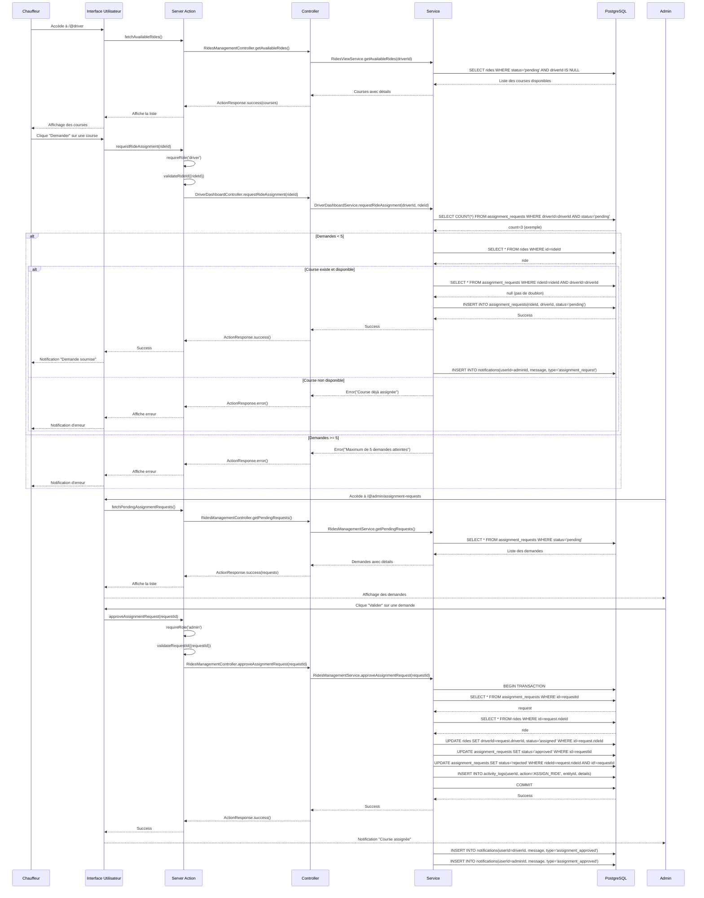

# Annexe #5 — Diagramme de séquence

> **Source** : Parcours réel "Demande d'assignation d'une course" implémenté dans AMT Express
> **Format** : Diagramme de séquence en Mermaid. Pour rendu UML canonique, utiliser PlantUML (voir version alternative ci-dessous).

## Diagramme de séquence : Parcours "Demande d'assignation"

Ce diagramme illustre **l'interaction complète** entre les acteurs et les composants du système lors du parcours "Un chauffeur demande l'assignation d'une course, l'admin valide la demande".



## Version PlantUML (pour rendu canonique)

> **À exporter en PNG** via [plantuml.com](https://www.plantuml.com/plantuml) pour l'annexe imprimée.

```plantuml
@startuml
left to right direction
skinparam sequence {
    ParticipantBackgroundColor #FFFDF8
    ParticipantBorderColor #F4A259
    ActorBackgroundColor #176B87
    ActorBorderColor #060605
}

actor "Chauffeur" as Driver
actor "Administrateur" as Admin
participant "Interface Utilisateur" as UI
participant "Server Action" as SA
participant "Controller" as Ctrl
participant "Service" as Svc
database "PostgreSQL" as DB

== Étape 1: Liste des courses ===
Driver -> UI: Accède à /@driver
UI -> SA: fetchAvailableRides()
SA -> Ctrl: getAvailableRides()
Ctrl -> Svc: getAvailableRides(driverId)
Svc -> DB: SELECT rides WHERE status='pending'
DB --> Svc: Courses disponibles
Svc --> Ctrl: Courses avec détails
Ctrl --> SA: ActionResponse.success()
SA --> UI: Affiche la liste

== Étape 2: Demande d'assignation ===
Driver -> UI: Clique "Demander"
UI -> SA: requestRideAssignment(rideId)
SA -> SA: verifyRole('driver')
SA -> SA: validateRideId()
SA -> Ctrl: requestRideAssignment()
Ctrl -> Svc: requestRideAssignment(driverId, rideId)

== Étape 3: Vérifications métier ===
Svc -> DB: COUNT(pending requests for driver)
DB --> Svc: count=3
alt Demandes < 5
    Svc -> DB: SELECT ride WHERE id=rideId
    DB --> Svc: ride
    alt Course disponible
        Svc -> DB: INSERT assignment_requests
        DB --> Svc: Success
        Svc --> Ctrl: Success
        Ctrl --> SA: Success
        SA --> UI: Success
        UI --> Driver: "Demande soumise"
        Svc -> DB: INSERT notification (admin)
    else Course non disponible
        Svc --> Ctrl: Error
        Ctrl --> SA: Error
        SA --> UI: Error
        UI --> Driver: Erreur
    end
else Demandes >= 5
    Svc --> Ctrl: Error("Max 5 demandes")
    Ctrl --> SA: Error
    SA --> UI: Error
    UI --> Driver: Erreur
end

== Étape 4: Validation par admin ===
Admin -> UI: Accède à /@admin
UI -> SA: fetchPendingRequests()
SA -> Ctrl: getPendingRequests()
Ctrl -> Svc: getPendingRequests()
Svc -> DB: SELECT requests WHERE status='pending'
DB --> Svc: Demandes en attente
Svc --> Ctrl: Demandes avec détails
Ctrl --> SA: Success
SA --> UI: Affiche la liste

== Étape 5: Approbation ===
Admin -> UI: Clique "Valider"
UI -> SA: approveAssignmentRequest(requestId)
SA -> SA: verifyRole('admin')
SA -> Ctrl: approveAssignmentRequest()
Ctrl -> Svc: approveAssignmentRequest()

== Étape 6: Transaction ACID ===
Svc -> DB: BEGIN TRANSACTION
Svc -> DB: UPDATE rides SET driverId=..., status='assigned'
Svc -> DB: UPDATE requests SET status='approved'
Svc -> DB: UPDATE requests SET status='rejected' (autres)
Svc -> DB: INSERT activity_logs
Svc -> DB: COMMIT
DB --> Svc: Success
Svc --> Ctrl: Success
Ctrl --> SA: Success
SA --> UI: Success
UI --> Admin: "Course assignée"
Svc -> DB: INSERT notifications (driver + admin)

@enduml
```

## Légende et explications

### Acteurs
| Acteur | Rôle | Description |
|--------|------|-------------|
| **Chauffeur** | Utilisateur | Initie la demande d'assignation |
| **Administrateur** | Utilisateur | Valide ou rejette la demande |
| **Interface Utilisateur** | Frontend | Affiche les données et capte les interactions |
| **Server Action** | Backend | Point d'entrée, validation, contrôle d'accès |
| **Controller** | Backend | Orchestration de la logique |
| **Service** | Backend | Logique métier pure |
| **PostgreSQL** | Base de données | Stockage persistant |

### Points clés du parcours

1. **Sécurité à chaque couche** : Vérification du rôle (`verifyRole`) avant toute opération sensible
2. **Validation des données** : Vérification de l'ID de la course avant traitement
3. **Règles métier** : Limite de 5 demandes simultanées, pas de doublon
4. **Transaction atomique** : Toutes les mises à jour sont regroupées dans une transaction
5. **Rejet automatique** : Les autres demandes pour la même course sont automatiquement rejetées
6. **Traçabilité** : Journal d'audit (`activity_logs`) pour toutes les actions
7. **Notifications** : Le chauffeur et l'admin sont notifiés des changements

### Complexité temporelle
- **Demande d'assignation** : O(1) pour les vérifications + O(1) pour l'insertion
- **Approbation** : O(1) pour la sélection + O(n) pour le rejet des autres demandes (où n = nombre de demandes concurrentes)
- **Global** : O(n) dans le pire cas (beaucoup de demandes concurrentes)

## Correspondance avec le dossier principal

| Étape du diagramme | Section du dossier | Extrait de code |
|---------------------|-------------------|-----------------|
| Étape 2 | §7.3 | Extrait 3 (createRide action) |
| Étape 3 | §7.6 | Extrait (requestRideAssignment service) |
| Étape 6 | §7.4 | Extrait 5 (Transaction ACID) |
| Vérification rôle | §7.5 | Extrait 1 (verifyRole middleware) |
