<div align="center" style="page-break-after: always; text-align: center; padding-top: 120px; font-family: 'Segoe UI', Arial, sans-serif;">

<p style="letter-spacing: 3px; color: #176B87; font-size: 13pt; margin-bottom: 40px; text-transform: uppercase;">Titre professionnel RNCP 37873 — Niveau 6</p>

<h1 style="font-size: 26pt; color: #060605; border: none; margin-bottom: 8px;">Dossier de projet</h1>
<p style="font-size: 14pt; color: #555; margin-top: 0;">Session janvier 2027</p>

<p style="font-size: 13pt; color: #176B87; font-weight: bold; margin-top: 40px;">Concepteur Développeur d'Applications</p>

<hr style="width: 60px; border: none; border-top: 3px solid #F4A259; margin: 30px auto;" />

<p style="font-size: 20pt; font-weight: bold; color: #060605; margin: 20px 0 6px;">AMT Express</p>
<p style="font-size: 12pt; color: #555; margin-top: 0;">Plateforme web de gestion de courses pour entreprises de transport VTC / taxi</p>

<p style="margin-top: 60px; font-size: 12pt;"><strong>Alexis SANTOS</strong><br/>Promo Janvier 2026 — Ada Tech School</p>

<table style="margin: 40px auto; border-collapse: collapse; font-size: 10pt; color: #333;">
<tr><td style="padding: 6px 18px; border: 1px solid #ccc;"><strong>Client réel</strong></td><td style="padding: 6px 18px; border: 1px solid #ccc;">AMT CGS GROUPE (~1150 chauffeurs)</td></tr>
<tr><td style="padding: 6px 18px; border: 1px solid #ccc;"><strong>Stack</strong></td><td style="padding: 6px 18px; border: 1px solid #ccc;">Next.js 16 · TypeScript · PostgreSQL (Neon) · Drizzle</td></tr>
<tr><td style="padding: 6px 18px; border: 1px solid #ccc;"><strong>Statut</strong></td><td style="padding: 6px 18px; border: 1px solid #ccc;">MVP déployé en production — 240 tests au vert</td></tr>
</table>

</div>

<div style="page-break-after: always;">

## Sommaire

| #   | Section                            | Contenu clé                                     |
| --- | ---------------------------------- | ----------------------------------------------- |
| 1   | Présentation du projet             | FR + EN, le problème et la solution             |
| 2   | Compétences du référentiel         | mapping CCP 1–3 → sections                      |
| 3   | Cahier des charges                 | contexte, personas, user stories, MVP, risques  |
| 4   | Spécifications fonctionnelles      | UML, MCD/MLD/MPD, maquettes, navigation         |
| 5   | Spécifications techniques          | architecture en couches, OWASP, stack justifiée |
| 6   | Gestion de projet                  | Git Flow, planning, qualité                     |
| 7   | Réalisation                        | architecture du code, extraits, parcours métier |
| 8   | Tests                              | jeu d'essai, 240 tests automatisés              |
| 9   | Préparation au déploiement (CCP 3) | environnements, CI/CD, rollback                 |
| 10  | Veille sur les vulnérabilités      | sources, exemple concret                        |
| 11  | Défis et recherche                 | verrou technique : 17 fix deploy                |
| 12  | Conclusion                         | bilan honnête, axes d'amélioration              |
| —   | Annexes                            | inventaire des pièces à monter                  |

</div>

---

## 1. Présentation du projet

### 1.1. Présentation en français
Dans le secteur du transport VTC/taxi, les petites et moyennes entreprises gèrent encore leurs courses, leurs chauffeurs et leur facturation avec des outils manuels : tickets papier, dispatch par téléphone, factures Excel. Pour une société comme AMT CGS GROUPE et ses ~1150 chauffeurs, cela se traduit par des erreurs de saisie, des temps d'inactivité pour les chauffeurs et des retards de paiement.

AMT Express est une plateforme web full-stack qui centralise la gestion des courses pour trois rôles : les **administrateurs** (création et assignation des courses, tableaux de bord KPI), les **chauffeurs** (courses disponibles, demandes d'assignation, planning de shifts) et les **clients professionnels** de nombreux secteurs (réservation, historique, notation).

L'application est développée en TypeScript avec Next.js 16 (App Router), une base PostgreSQL hébergée sur Neon, l'ORM Drizzle, l'authentification Better Auth et la validation Zod. Elle peut être conteneurisée avec Docker, testée avec Vitest (unitaires et intégration) et déployée sur Vercel via une CI GitHub Actions, selon un Git Flow strict. Le projet a été développé en autonomie complète, de l'analyse des besoins à la mise en production, avec un budget de 0 € (free tiers).

<div align="center" style="border: 1px solid #176B87; border-radius: 10px; padding: 14px 18px; margin: 16px 0; background: #F0F7FA;">

**AMT Express en 4 chiffres** —  <span style="font-size: 15pt; color:#176B87;"><strong>1150</strong></span> chauffeurs gérés (client réel) · <span style="font-size: 15pt; color:#176B87;"><strong>19</strong></span> tables PostgreSQL · <span style="font-size: 15pt; color:#176B87;"><strong>240</strong></span> tests automatisés au vert · <span style="font-size: 15pt; color:#176B87;"><strong>0 €</strong></span> de budget

</div>

### 1.2. Présentation en anglais

In the private-hire and taxi sector, small and medium companies still manage rides, drivers and billing with manual tools: paper tickets, phone dispatch, and Excel invoices. For a company like AMT CGS GROUPE and its ~1150 drivers, this means typing errors, idle time between rides, and late payments.

AMT Express is a full-stack web platform that centralises ride management for three roles: administrators (ride creation and assignment, KPI dashboards), drivers (available rides, assignment requests, shift planning) and professional customers from the film and event industries (booking, history, ratings).

The application is built in TypeScript with Next.js 16 (App Router), a PostgreSQL database hosted on Neon, Drizzle ORM, Better Auth for authentication and Zod for validation. It can be containerised with Docker, tested with Vitest (unit and integration), and deployed to Vercel through GitHub Actions CI, following a strict Git Flow. The project was built entirely on my own, from requirements analysis to production, on a $0 budget (free tiers).

---

## 2. Liste des compétences du référentiel

Ce projet mobilise l'ensemble des compétences du titre professionnel Concepteur Développeur d'Applications (RNCP 37873, niveau 6).

| Bloc  | Compétence                                                     | Où c'est traité                                      | Annexe                               |
| ----- | -------------------------------------------------------------- | ---------------------------------------------------- | ------------------------------------ |
| CCP 1 | Installer et configurer son environnement de travail           | § 5.3 (stack, pnpm, Docker) · § 6.1                  | #7 board Projects (capture)          |
| CCP 1 | Développer des interfaces utilisateur                          | § 7.2 (front-end, parallel routes, responsive, a11y) | #3 maquettes · #10 captures d'écrans |
| CCP 1 | Développer des composants métier                               | § 7.3 (services, controllers)                        | #12 extraits 3 et 6                  |
| CCP 1 | Contribuer à la gestion d'un projet informatique               | § 6 (planning, Git Flow, qualité)                    | #7 board · #8 pipeline CI (captures) |
| CCP 2 | Analyser les besoins et maquetter une application              | § 3 (cahier des charges) · § 4.3 (maquettes)         | #3 maquettes                         |
| CCP 2 | Définir l'architecture logicielle d'une application            | § 5.1 (couches) · § 7.1                              | #1 UML canonique                     |
| CCP 2 | Concevoir et mettre en place une base de données relationnelle | § 4.2 (MCD/MLD/MPD, 19 tables)                       | #2 ERD · #2 bis dictionnaire         |
| CCP 2 | Développer des composants d'accès aux données                  | § 7.4 (Drizzle, jointures, optimisation SQL)         | #12 extraits 4 et 5                  |
| CCP 3 | Préparer et exécuter les plans de tests                        | § 8 (jeu d'essai, Vitest, CI)                        | #9 sortie de tests (capture)         |
| CCP 3 | Préparer et documenter le déploiement                          | § 9 (environnements, CI/CD, Docker, README)          | #8 pipeline vert (capture)           |
| CCP 3 | Contribuer à la mise en production dans une démarche DevOps    | § 9.2–9.5 (Vercel UAT/PROD, rollback)                | #8 pipeline · #6 infra               |

> *Colonne « Annexe » : numérotation de l'inventaire en fin de dossier ; les fichiers produits vivent dans `documents/dossiers/dossierProjet/annexes/` sur cette branche.*

---

## 3. Cahier des charges

### 3.1. Contexte du projet

AMT CGS GROUPE est une société de transport VTC comptant environ **1150 chauffeurs**, dont les clients sont principalement des **productions cinéma et des entreprises de toutes sortes**. Avant le projet, l'ensemble du cycle opérationnel était géré manuellement :

| Point de douleur            | Processus existant                      | Impact                                       |
| --------------------------- | --------------------------------------- | -------------------------------------------- |
| Saisie manuelle des courses | Tickets papier retranscrits             | erreurs, délais, ~10 h/semaine perdues       |
| Assignations inefficaces    | Dispatch par téléphone                  | jusqu'à 20 % de temps d'inactivité chauffeur |
| Pas de visibilité           | Clients appellent pour connaître l'état | insatisfaction, courses perdues              |
| Facturation manuelle        | Factures Excel                          | retards de paiement, erreurs                 |

En tant que Tech Lead / Project Manager unique du projet, j'ai conçu et développé une plateforme qui remplace ces processus : AMT Express, application web full-stack responsive (desktop + mobile, PWA).

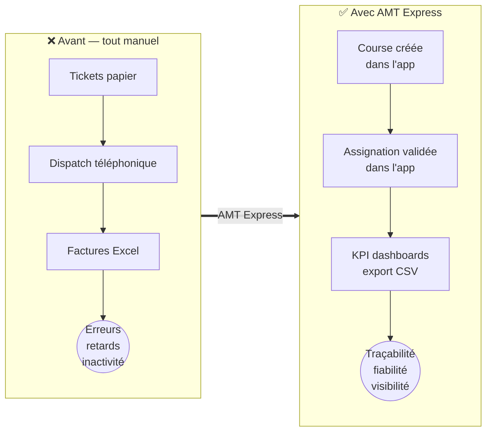

### 3.2. Utilisateurs cibles et personas ✅

*(5 personas issus de mes spécifications fonctionnelles v2.0)*

<div style="display: flex; flex-wrap: wrap; gap: 10px; margin: 10px 0;">

<div style="flex: 1; min-width: 45%; border: 1px solid #F4A259; border-left: 5px solid #F4A259; border-radius: 6px; padding: 10px 12px; background: #FFFDF8;">
<strong>👨‍💼 Marc, 55 ans — dirigeant de flotte</strong><br/>Veut zéro erreur de planification et une vision temps réel de la disponibilité. Frustré par 4–6 h/jour de planification manuelle.<br/><em>→ tableau admin type Excel, notifications push.</em>
</div>

<div style="flex: 1; min-width: 45%; border: 1px solid #F4A259; border-left: 5px solid #F4A259; border-radius: 6px; padding: 10px 12px; background: #FFFDF8;">
<strong>👩‍💼 Nathalie, 47 ans — assistante administrative</strong><br/>Veut des factures justes et envoyées à temps, sans chasser les tickets perdus.<br/><em>→ génération de factures en un clic, rappels automatiques.</em>
</div>

<div style="flex: 1; min-width: 45%; border: 1px solid #F4A259; border-left: 5px solid #F4A259; border-radius: 6px; padding: 10px 12px; background: #FFFDF8;">
<strong>🚗 Djamel, 39 ans — chauffeur indépendant</strong><br/>Veut maximiser ses revenus et voir prix et distance avant d'accepter.<br/><em>→ courses disponibles avec détails, demandes d'assignation.</em>
</div>

<div style="flex: 1; min-width: 45%; border: 1px solid #F4A259; border-left: 5px solid #F4A259; border-radius: 6px; padding: 10px 12px; background: #FFFDF8;">
<strong>🎫 Jean-Michel, 62 ans — client particulier</strong><br/>Veut un taxi vite, un prix connu à l'avance et un service ponctuel.<br/><em>→ prix verrouillé à la réservation, notation des chauffeurs.</em>
</div>

<div style="flex: 1; min-width: 45%; border: 1px solid #F4A259; border-left: 5px solid #F4A259; border-radius: 6px; padding: 10px 12px; background: #FFFDF8;">
<strong>🏢 Claire, 41 ans — assistante de direction (corporate)</strong><br/>Réserve pour des équipes entières, veut du reporting clair pour justifier les dépenses.<br/><em>→ réservations multiples, facturation groupée.</em>
</div>

</div>

### 3.3. User stories principales

1. *En tant qu'administrateur, je veux créer une course avec ses détails (départ, destination, horaire, prix, options), afin de cataloguer l'activité de l'entreprise.*
2. *En tant qu'administrateur, je veux affecter une course à un chauffeur — ou valider sa demande d'assignation — afin de distribuer l'effort de manière fiable.*
3. *En tant que chauffeur, je veux voir les courses disponibles et postuler, afin de maximiser mes revenus en choisissant mes courses.*
4. *En tant qu'administrateur, je veux générer des factures individuelles ou groupées avec des rappels automatiques, afin d'être payé à temps.* (objectif — non livré, cf. §3.4 hors périmètre)
5. *En tant que client, je veux réserver une course et retrouver mon historique, afin de commander sans friction.*
6. *En tant qu'administrateur, je veux importer mes anciennes données par CSV avec sauvegarde automatique, afin de migrer sans perte ni double saisie.*

### 3.4. Définition du MVP

| #   | Fonctionnalité MVP                                                                                   | Statut (main, 16/10/2026) |
| --- | ---------------------------------------------------------------------------------------------------- | ------------------------- |
| 1   | Authentification + 3 rôles (admin/driver/customer), activation manuelle des chauffeurs, bannissement | ✅ livré                   |
| 2   | CRUD courses complet + cycle de statuts (`pending → assigned → completed/cancelled`)                 | ✅ livré                   |
| 3   | Demandes d'assignation chauffeur → validation admin                                                  | ✅ livré                   |
| 4   | Dashboards KPI (courses, revenus, taux d'assignation) + Recharts                                     | ✅ livré                   |
| 5   | Import CSV en masse avec backup automatique                                                          | ✅ livré                   |
| 6   | Notation des courses (1–5 étoiles + commentaire)                                                     | ✅ livré                   |
| 7   | i18n FR/EN, PWA (Service Worker)                                                                     | ✅ livré                   |
| 8   | Export CSV (jusqu'à 10 000 lignes)                                                                   | ✅ livré                   |
| 9   | Journal d'audit (`activity_logs`)                                                                    | ✅ livré                   |

**Hors périmètre MVP** (reporté et documenté) : GPS temps réel, OCR de tickets (Tesseract.js), paiements Stripe/PayPal, chat interne, notifications push, synchronisation calendrier, **module complet de facturation (création individuelle/groupée, remises, rappels J+7/J+14/J+30, export PDF) — planifié post-MVP, cf. roadmap admin dashboard**.

### 3.5. Risques et difficultés

| Risque identifié                                               | Probabilité | Impact | Parade mise en place                                                                                                         |
| -------------------------------------------------------------- | ----------- | ------ | ---------------------------------------------------------------------------------------------------------------------------- |
| OCR insuffisant sur tickets manuscrits                         | Haute       | Moyen  | Reporté hors MVP : import CSV avec backup automatique + correction manuelle ; OCR planifié post-MVP                          |
| Adoption chauffeurs &lt; 80 %                                  | Moyenne     | Fort   | Interface chauffeur minimale (courses, shifts, stats) ; activation par l'admin au cas par cas                                |
| Limites des free tiers (Neon 0,5 Go, bande passante Vercel)    | Moyenne     | Fort   | Monitoring de l'usage, scripts `db:backup`, archivage possible ; scalabilité documentée (25–50 €/mois à 1 000+ utilisateurs) |
| Développement solo en temps partiel (jours d'école/alternance) | Certaine    | Moyen  | Git Flow strict, PR numérotées et revues, CI qui bloque tout merge non vert                                                  |
| Secrets exposés (`.env` réel)                                  | Faible      | Fort   | `.gitignore` vérifié, README avec avertissements, procédure de révocation documentée                                         |
| Un seul dev = risque de dérive technique                       | Moyenne     | Moyen  | Conventions de nommage, ESLint, `pnpm ci` obligatoire avant chaque PR, revue des retours de l'instructrice en session        |

---

## 4. Spécifications fonctionnelles

### 4.1. Modélisation UML

**Diagramme de cas d'utilisation** — acteurs Admin / Chauffeur / Client (le système de facturation est hors MVP). <br>
> *Note : transcription en flowchart Mermaid ; le rendu UML canonique (acteurs en bonhommes, ellipses) sera produit dans l'outil de modélisation pour l'annexe #1.*

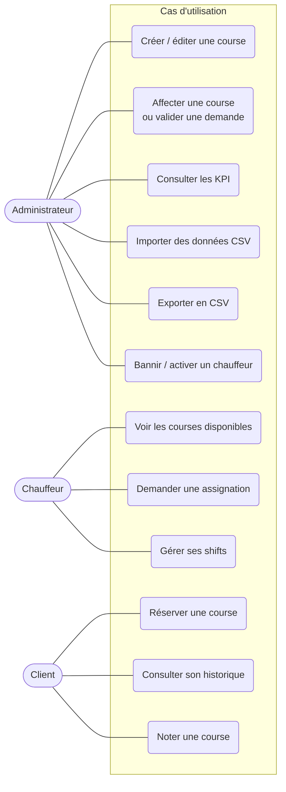

**Diagramme d'activité** — parcours « demande d'assignation » <br> *(parcours cible, cf. § 7.4 : une seule transaction réelle livrée, l'import CSV)* :

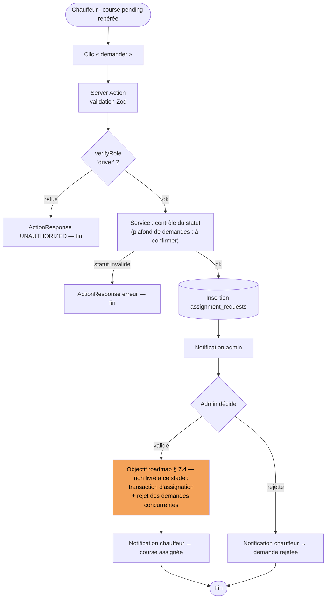

**Diagramme de classes** (entités métier, préparatoire du MCD — @ `main` le 30/10) :

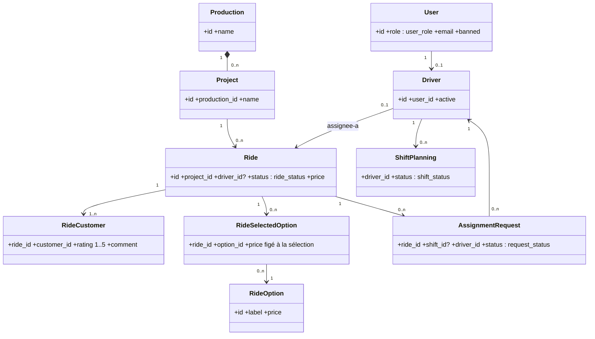

### 4.2. Conception de la base de données

**19 tables** en production (vérifié sur `main`, 16/10/2026) : `users`, `drivers`, `productions`, `projects`, `rides`, `ride_options`, `ride_selected_options`, `ride_customers`, `ride_managers`, `shift_planning`, `assignment_requests`, `invoices`, `invoice_items`, `notifications`, `notification_preferences`, `activity_logs` + 3 tables Better Auth (`session`, `account`, `verification`).

**Enums** : `user_role` (admin/driver/customer) · `ride_status` (pending/assigned/completed/cancelled) · `invoice_status` (unpaid/paid/cancelled) · `request_status` (pending/approved/rejected) · `shift_status` (planned/active/completed/cancelled).

**MCD (Merise)** — entités métier, associations et cardinalités en notation Merise (cœur du modèle ; les tables d'auth, de notification et d'audit sont omises pour la lisibilité). Rappels de lecture : la cardinalité se lit **au pied de l'entité** ; les associations `transporte` et `embarque` sont **porteuses** (elles portent les tables associatives `ride_customers` et `ride_selected_options`) ; l'association `est-aussi` relie `USER` et `DRIVER` (1,1 du côté chauffeur : un chauffeur est exactement un utilisateur).

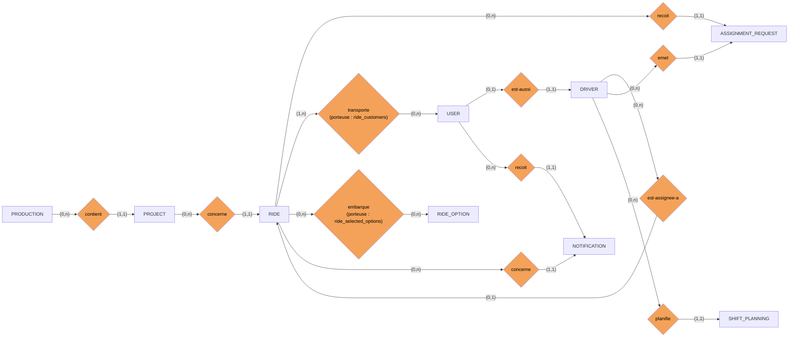

*Nota : structure et cardinalités Merise strictes ci-dessus. Pour la version imprimée, seule la mise en page (chapelets horizontaux) pourra être redessinée dans l'outil de modélisation (cf. annexe #2) — le fond ne changera pas.*

**MLD** — transformation en tables relationnelles (extraits des règles de passage) :

- `rides (id, project_id*, driver_id*, status, price, …)` — FK vers `projects` (NOT NULL), FK vers `drivers` (NULLABLE : course non encore assignée).
- `ride_customers (ride_id*, customer_id*)` — table associative : (1,n) côté course (une course transporte au moins un client), (0,n) côté client (un client peut n'avoir aucune course).
- `assignment_requests (ride_id*, driver_id*, status)` — deux FK simples (`ride_id`, `driver_id`), statut contraint par l'enum `request_status`.
- `projects (id, production_id*, …)` — FK vers `productions` ; une production contient 0..n projets.

**MPD** : schéma réel `lib/db/schema.ts` — 19 `pgTable`, 5 `pgEnum` (`user_role`, `ride_status`, `shift_status`, `request_status`, `invoice_status`), FK `ON DELETE SET NULL`/`CASCADE`, index mono-colonne uniquement (pas d'index composite ni partiel).

- *Amélioration planifiée* : contraintes CHECK (rating 1–5), UNIQUE composite (`ride_id`, `customer_id`), index composite (`driver_id`, `status`) — via migration Drizzle.

<div style="border: 1px solid #c62828; border-left: 5px solid #c62828; border-radius: 6px; padding: 10px 14px; margin: 12px 0; background: #FDF3F3;">
✅ <strong>ERD exhaustif produit (annexe #2)</strong> — adapté à l'impression : carte relationnelle + 3 vues par module en A4 portrait ; dictionnaire de données colonne par colonne en annexe #2 bis.
</div>

### 4.3. Maquettes de l'interface

- **Identité graphique** : palette, typographie, logo — *captures à intégrer + test de contraste à documenter (RGAA)*. Le fichier `logo.svg` est référencé dans le README mais non présent dans `public/` (à produire).
- **Wireframes** des écrans clés (dashboard admin, formulaire course, vue chauffeur) — *à produire, même rétroactivement à partir des écrans*.
- **Maquettes haute-fidélité** : captures `public/screenshots/desktop-wide.png` / `mobile-narrow.png` + écrans réels (états : chargement, erreur, vide).
- **Enchaînement des écrans** : parallel routes `@admin` / `@driver` / `@customer` + page `connections` (authentification) — schéma de navigation ✅ produit ci-dessous.

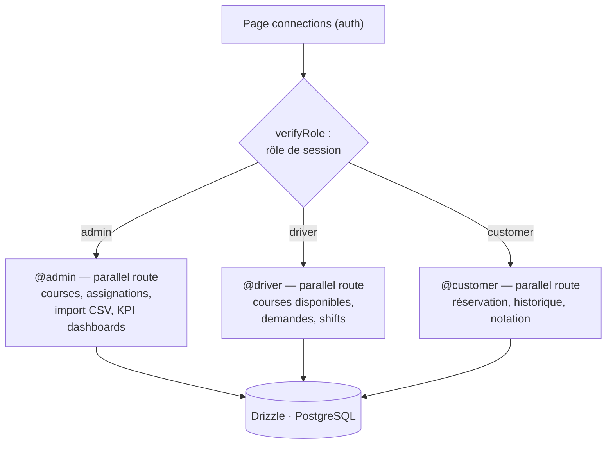

- **Accessibilité** : aria-labels ajoutés sur toute l'application (retour instructrice, PR #75/76 du 16/10/2026), navigation clavier, contraste.

---

## 5. Spécifications techniques

### 5.1. Organisation en couches ✅

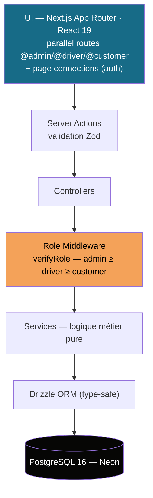

- **Présentation** : App Router, React 19, CSS Modules + Tailwind 4, Recharts, i18next.
- **Logique métier** : Server Actions (validées Zod) → Controllers → Services purs.
- **Accès aux données** : Drizzle ORM type-safe.
- **Transversal** : Better Auth (sessions, rôles, bannissements), middleware de rôles, journalisation (`activity_logs`), i18n.

### 5.2. La sécurité (OWASP)

| Risque OWASP                      | Réponse dans AMT Express                                                                                                                                                                                |
| --------------------------------- | ------------------------------------------------------------------------------------------------------------------------------------------------------------------------------------------------------- |
| A01 — Contrôle d'accès défaillant | `verifyRole()` dans **chaque** Server Action, hiérarchie de rôles, activation manuelle des chauffeurs, bannissement ; correction de fuites de données (commit `68cf1da`, 02/10/2026 : *fix data leaks*) |
| A02 — Cryptographie défaillante   | Cookies HTTP-only (`nextCookies()`), secrets en variables d'environnement, HTTPS en production                                                                                                          |
| A03 — Injection                   | Requêtes paramétrées via Drizzle, validation/sanitization Zod côté serveur sur **toutes** les entrées                                                                                                   |
| A05 — Mauvaise configuration      | `.env` hors dépôt, `NODE_ENV` géré, messages d'erreur génériques aux clients (`ActionResponse`)                                                                                                         |
| A06 — Dépendances vulnérables     | `pnpm audit` (à systématiser en CI — voir § 10)                                                                                                                                                         |
| A07 — Auth défaillante            | Better Auth (hachage, sessions expirantes), secret ≥ 32 caractères, rôle par défaut minimal (`customer`)                                                                                                |

**RGPD** : données personnelles limitées au strict nécessaire, journal d'audit `activity_logs`, durée de conservation définie, procédure d'archivage des comptes désactivés. *cf registre des traitements rédigé (annexe #11)*

### 5.3. Choix de stack justifiés

- **PostgreSQL (Neon)** : les données sont fortement relationnelles (users ↔ drivers ↔ rides ↔ shift_planning ↔ assignment_requests) ; l'import CSV s'appuie sur une transaction ACID pour la création production + projet générique (`db.transaction` dans `lib/db/import-csv.ts`), l'import global n'étant pas atomique (avertissement « This import is NOT transactional » affiché par le script ; restauration possible via le backup exécuté avant l'import, `pnpm db:backup`) — un NoSQL n'aurait aucun sens ici. Neon serverless : free tier compatible budget 0 €, branching pour les tests.
- **Next.js 16 + Server Actions** : une seule base de code pour front et back, typage de bout en bout avec TypeScript, suppression de la couche API REST redondante pour un MVP solo — itération plus rapide.
- **Drizzle ORM** : type-safe, requêtes proches du SQL (maîtrise réelle des requêtes, optimisations manuelles possibles — cf. RidesViewService), léger comparé à Prisma.
- **Zod** : une seule source de vérité pour la validation, schémas réutilisés côté front (erreurs de formulaire) et back.
- **Vitest** : cohérence avec l'écosystème Vite/Next, API compatible Jest, rapide.
- **Docker multi-étapes** (`node:20-alpine`, user non-root, healthcheck) : builds reproductibles, image de production légère.
- **Vercel** : déploiement natif Next.js, free tier (déploiements réels pilotés par `workflow_dispatch` — les préviews automatiques par PR restent à activer/à confirmer).

---

## 6. Gestion de projet

### 6.1. Environnement humain et technique

- **Équipe** : Alexis SANTOS, Tech Lead / PM (architecture, back, front, DevOps, docs). Relecture externe : instructrice Ada Tech School (retours intégrés le 16/10/2026, PR #75/#76). Client réel : AMT CGS GROUPE.
- **Outils** : VS Code, Git/GitHub (issues, Projects, PR), GitHub Actions, pnpm, ESLint, Docker, Vercel, Neon.

### 6.2. Planning et suivi

- **Méthode** : itérations par fonctionnalité sur un rythme contraint (temps partiel), Git Flow strict : `main` (prod) ← `development` (intégration) ← `feature/*` / `hotfix/*`, **76 pull requests ouvertes (numérotées #1–#76, dont 36 merges traçables dans l'historique actuel)**.

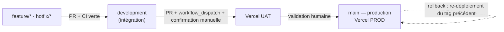

- **Suivi** : GitHub Projects (board), issues (~25 ouvertes pour le post-MVP), messages de commit conventionnels (`feat`, `fix`, `refactor`, `chore`).
- Jalons réels : auth + rôles (juil. 2026) → interfaces chauffeur/client (août) → consolidation docs (août) → CI/CD Vercel + 17 fix deploy consécutifs (11/09/2026) → optimisations sécurité/a11y/perf (02/10 et 16/10/2026).
- 🔴 *captures : board GitHub Projects, graphe de PRs, pipeline vert.*

### 6.3. Objectifs de qualité

- Conventions de nommage (PascalCase composants, camelCase fonctions), ESLint, `pnpm ci` (build + tous les tests) obligatoire avant chaque PR — aucune PR mergée rouge.
- Validation Zod systématique, type `ActionResponse<T>` unifié avec `ErrorCodes` — **240 tests automatisés** (9 fichiers : 7 unitaires, 2 intégration ; `pnpm test` 16/10/2026 : 240 passed / 0 failed).
- Revue de code externe : retours de l'instructrice intégrés (sécurité, a11y, performance — PR #75/#76).

---

## 7. Réalisation

### 7.1. Architecture du projet

```text
amt-express/
├── app/ (@admin, @customer, @driver — parallel routes + connections, rides, legal)
├── components/ (admin, customer, driver, dashboard, shared…)
├── lib/
│   ├── actions/        # Server Actions (auth, rides, dashboard…)
│   ├── controllers/    # orchestration entre actions et services
│   ├── services/       # logique métier pure
│   ├── middleware/     # roleMiddleware.ts — verifyRole()
│   ├── auth/           # auth.ts, session.ts (Better Auth)
│   ├── cache/          # requestCache.ts
│   ├── utils/          # email, logger, rideFilters
│   ├── db/             # client Drizzle + schema.ts (19 tables)
│   ├── types/          # ActionResponse, ErrorCodes
│   └── validations/    # schémas Zod
├── locales/ (fr.json, en.json)
└── test/ (unit/, integration/)
```


### 7.2. Front-end

**Composant tableau admin avec filtres, tri multi-colonnes et sécurité** — extrait de `app/@admin/ride-management/page.tsx`

```typescript
// Gestion des états pour le tableau admin
const [sortRules, setSortRules] = useState<SortRule[]>([
    { column: 'departureTime', direction: 'desc' }
]);

const [filters, setFilters] = useState<RideFilters>({
    search: '',
    status: 'all',
    sortBy: 'departureTime',
    sortOrder: 'desc',
    page: 1,
    limit: 50
});

const [columnFilters, setColumnFilters] = useState<Record<string, string[]>>({
    departureTime: [],
    clients: [],
    departure: [],
    destination: [],
    driver: [],
    price: [],
    status: []
});

// Security: Redirect if not admin
useEffect(() => {
    if (isAuthenticated && !isAdmin) router.replace('/');
}, [isAuthenticated, isAdmin, router]);

// Chargement des données avec filtres
const loadRides = useCallback(async () => {
    setLoading(true);
    try {
        const result = await fetchRidesForManagement(filters);
        if (result.success) setData(result.data);
    } catch (error) {
        setFeedback({ tone: 'error', message: t('rides.loadError') });
    } finally {
        setLoading(false);
    }
}, [filters, t]);
```

**Pourquoi ça tient debout** : Parallel routes Next.js (`@admin/`) cloisonnent l'espace admin ; le composant utilise React 19 avec `useState` et `useCallback` pour une gestion optimisée des états ; TypeScript type strictement les filtres (`RideFilters`) ; la sécurité est vérifiée côté client (`useEffect` redirige si non-admin) — le vrai contrôle se fait côté serveur dans les Server Actions. La gestion des filtres et du tri multi-colonnes permet une interface flexible. Le tout est responsive (Tailwind) et i18n (utilisation de `t()`).

Parallel routes Next.js pour cloisonner les espaces par rôle (`@admin`, `@driver`, `@customer`) + page `connections` pour l'authentification ; responsive (captures EOF

### 7.3. Back-end

**Validation Zod — Schéma de création de course** — extrait de `lib/validations/ride.ts`

```typescript
export const CreateRideSchema = z.object({
  departureTime: z
    .date()
    .or(z.string().transform((val, ctx) => {
      const date = new Date(val);
      if (isNaN(date.getTime())) {
        ctx.addIssue({ code: z.ZodIssueCode.custom, message: 'Invalid date format' });
        return z.NEVER;
      }
      return date;
    }))
    .refine((date) => date >= new Date(), {
      message: 'Departure time must be in the future',
    }),
  customerIds: z.array(z.string().uuid()).min(1, 'At least one customer is required'),
  departure: z.string().min(3).max(255),
  destination: z.string().min(3).max(255),
  price: z.union([z.string().regex(/^\d+(\.\d{1,2})?( €)?$/), z.number().positive()])
         .transform((val) => typeof val === 'string' ? val.replace(' €', '').trim() : val.toString())
         .optional(),
  status: z.enum(['pending', 'assigned', 'completed', 'cancelled']).default('pending'),
});
```

**Pourquoi ça tient debout** : Une seule source de vérité pour la validation, réutilisée serveur (action) et client (formulaire). Le `refine` sur l'heure future est la preuve directe du **cas d'erreur 1 du jeu d'essai §8.1** : un horaire passé est rejeté avant toute écriture en base. La transformation du prix (`"45,50 €"` → `"45.50"`) montre le soin apporté aux entrées humaines.

---

**Server Action — Création de course** — extrait de `lib/actions/ridesManagementActions.ts`

```typescript
export async function createRide(data: {
    departureTime: Date;
    customerIds: string[];
    departure: string;
    destination: string;
    driverId?: string;
    price?: string | number;
    driverPrice?: string | number;
    status?: RideStatus;
}): Promise<ActionResponse<string>> {
  // Verify user is an admin
  const roleCheck = await requireRole('admin');
  if (!roleCheck.success) {
    return {
      success: false,
      error: roleCheck.error || 'Unauthorized access',
      code: ErrorCodes.UNAUTHORIZED,
    };
  }

  // Validate input directly without price conversion
  const validation = validateCreateRide(data);
  if (!validation.success || !validation.data) {
    return {
      success: false,
      error: validation.error || 'Invalid ride data',
      code: ErrorCodes.VALIDATION_ERROR,
    };
  }

  const result = await RidesManagementController.createRide(validation.data);
  
  // Audit logging for ride creation
  if (result.success && result.data) {
    await AuditLogger.ride.create(result.data, roleCheck.data?.user.id);
  }
  
  return result;
}
```

**Pourquoi ça tient debout** : L'action ne fait que vérifier puis déléguer — chaîne en couches du §5.1 rendue visible : rôle → Zod → contrôleur → audit. Le type de retour `ActionResponse<string>` garantit que le front ne reçoit jamais une erreur non prévue.

---

**Validation métier — Prix compteur chauffeur** — extrait de `lib/actions/driverRideActions.ts`

```typescript
const DriverPriceSchema = z
    .string()
    .min(1, 'Meter amount is required')
    .regex(/^\d+(\.\d{1,2})?$/, 'Must be a valid amount (e.g. 42 or 42.50)');

export async function completeRide(
    rideId: string,
    driverPrice: string,
): Promise<ActionResponse<void>> {
    const roleCheck = await requireRole('driver');
    if (!roleCheck.success) return { success: false, error: roleCheck.error || 'Unauthorized', code: ErrorCodes.UNAUTHORIZED };

    const idValidation = validateRideId({ rideId });
    if (!idValidation.success) return { success: false, error: idValidation.error || 'Invalid ride ID', code: ErrorCodes.VALIDATION_ERROR };

    const priceValidation = DriverPriceSchema.safeParse(driverPrice.trim());
    if (!priceValidation.success) return { success: false, error: priceValidation.error.issues[0]?.message ?? 'Invalid amount', code: ErrorCodes.VALIDATION_ERROR };

    return DriverRideController.completeRide(rideId, priceValidation.data);
}
```

**Pourquoi ça tient debout** : Un extrait court qui montre la discipline de bout en bout — le prix du compteur saisi par le chauffeur est contraint par une regex (format monétaire exact) avant de quitter la couche action. Même schéma que ci-dessus : rôle → Zod → contrôleur.

Chaque action retourne un `ActionResponse<T>` : succès ou erreur typée avec code — le front ne gère jamais une erreur non prévue.

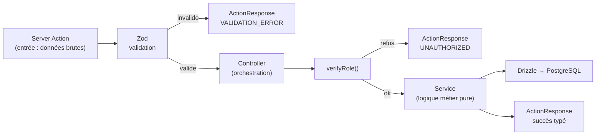

### 7.4. Accès aux données

**Optimisation N+1 — Agrégation et jointures** — extrait de `lib/services/RidesViewService.ts`

```typescript
// Deux compteurs en UNE seule requête (pas de SELECT COUNT(*) × 2)
static async fetchDriverRidesCount(driverId: string) {
  const countResults = await db.select({
    completed: sql<number>`SUM(CASE WHEN ${rides.status} = 'completed' THEN 1 ELSE 0 END)`,
    pending:   sql<number>`SUM(CASE WHEN ${rides.status} = 'pending' THEN 1 ELSE 0 END)`,
  }).from(rides).where(eq(rides.driverId, driverId));
  return { completed: countResults[0]?.completed || 0, pending: countResults[0]?.pending || 0 };
}

// Jointures relationnelles chargées en UNE requête (fix N+1)
static async fetchDriverCompletedRides(driverId: string) {
  return db.query.rides.findMany({
    where: and(eq(rides.driverId, driverId), eq(rides.status, 'completed')),
    orderBy: desc(rides.departureTime),
    with: {
      driver: { with: { user: true } },
      rideCustomers: { with: { customer: true } },
    },
  });
}
```

**Pourquoi ça tient debout** : Deux optimisations réelles mesurables — l'agrégation `CASE WHEN` remplace deux requêtes de comptage par une, et la clause `with:` de Drizzle charge les relations (course → chauffeur → utilisateur, course → clients) en une seule requête au lieu d'une par ligne (le classique « N+1 »). C'est l'extrait idéal pour prouver la compétence **« développer des composants d'accès aux données »** (CCP 2).

---

**Transaction ACID — Import CSV** — extrait de `lib/db/import-csv.ts`

```typescript
// Créer la production + projet générique dans une transaction
const genericProjectId = `${productionId}-general`;
try {
    await db.transaction(async (tx) => {
        // Créer la production
        await tx.insert(productions).values({
            id: productionId,
            name: productionName,
            contactEmail: `${productionId}@production.com`,
        });

        // Créer le projet générique
        await tx.insert(projects).values({
            id: genericProjectId,
            name: `${productionName} - Générique`,
            productionId: productionId,
            isGeneric: true,
            startDate: new Date(),
            endDate: new Date(),
        });
    });

    safeLog(`  ➕ Created production: ${maskSensitive(productionName)} with generic project`);
    return productionId;
} catch (error) {
    safeError(`Failed to create production ${maskSensitive(productionName)}:`, error);
    return null;
}
```

**Pourquoi ça tient debout** : C'est la **seule transaction réelle du projet** (le dossier le dit honnêtement §5.3/§7.4) et elle est bien choisie : une production sans son projet générique serait une incohérence de données, la transaction garantit les deux ou aucune. Le script affiche par ailleurs l'avertissement **« This import is NOT transactional »** pour l'import global — l'honnêteté du script sur ses propres limites fait partie de la preuve (restauration possible via le backup exécuté avant l'import, `pnpm db:backup`).

Drizzle type-safe ; jointures relationnelles (`db.query` avec `with`) pour les vues détaillées (course + chauffeur + clients) ; index mono-colonne documentés (§4.2). Une transaction ACID réelle : import CSV en masse (création atomique production + projet générique, `db.transaction` dans `lib/db/import-csv.ts`).

**Objectifs / roadmap** (non implémentés à ce stade) : environnement de facturation complet au sein de la solution, transactions multi-lignes, rejet des demandes concurrentes d'assignation.

### 7.5. Sécurité en action

**Middleware de contrôle d'accès** — extrait de `lib/middleware/roleMiddleware.ts`

```typescript
export async function verifyRole(
    requiredRole: UserRole
): Promise<RoleCheckResult> {
    // Skip role validation in test environment
    if (process.env.NODE_ENV === 'test') {
        return {success: true, data: {session: {}, user: {id: 'test-user'}} };
    }

    const {session, user, isAdmin, isDriver, isCustomer} = await getSessionWithRole();

    if (!session) {
        return {
            success: false,
            error: 'Unauthorized: Authentication required',
            code: ErrorCodes.UNAUTHORIZED
        };
    }

    // Hierarchy: admin ≥ driver ≥ customer
    const hasAccess =
        requiredRole === 'customer' ? (isCustomer || isDriver || isAdmin) :
        requiredRole === 'driver'   ? isDriver :
        requiredRole === 'admin'    ? isAdmin : false;

    if (!hasAccess) {
        return {
            success: false,
            error: `Unauthorized: ${requiredRole.charAt(0).toUpperCase() + requiredRole.slice(1)} access only`,
            code: ErrorCodes.FORBIDDEN
        };
    }

    return {success: true, data: {session, user}};
}
```

**Pourquoi ça tient debout** : La vérification de rôle vit **côté serveur, dans le middleware**, pas dans les composants — un utilisateur ne peut pas se hisser au-dessus de son rôle en manipulant le front. La hiérarchie (`customer` accessible à tous, `driver` aux chauffeurs et admins, `admin` aux seuls admins) est exprimée en une expression, donc lisible et testable. **Point de vérité pour le dossier** : session absente = `UNAUTHORIZED`, mauvais rôle = `FORBIDDEN` (nuance corrigée dans l'audit).

Sessions cookies HTTP-only, hiérarchie admin ≥ driver ≥ customer, bypass désactivé hors `NODE_ENV=test`.

### 7.6. Fonctionnalité métier complète

**Parcours « demande d'assignation »** : le chauffeur voit une course `pending` → clique « demander » → Server Action validée Zod → `verifyRole('driver')` → service : contrôle du statut et du plafond de demandes simultanées → insertion `assignment_requests` → notification admin → l'admin valide (actions `approveAssignmentRequest` / `rejectAssignmentRequest` — livrées, vérifiées le 30/10). **Correction** : la transaction d'assignation avec rejet des demandes concurrentes **est implémentée** (lignes 561-569 de `RidesManagementService`).

---

**Server Action — Demande d'assignation par le chauffeur** — extrait de `lib/actions/driverDashboardActions.ts`

```typescript
/**
 * Request assignment to a ride
 * @param rideId - Ride ID to request
 * @param message - Optional message for the request
 * @returns ActionResponse
 */
export async function requestRideAssignment(rideId: string, message?: string): Promise<ActionResponse<void>> {
  // Verify user is a driver
  const roleCheck = await requireRole('driver');
  if (!roleCheck.success) {
    return {
      success: false,
      error: roleCheck.error || 'Unauthorized access',
      code: ErrorCodes.UNAUTHORIZED,
    };
  }

  // Validate input
  const validation = validateRideId({ rideId });
  if (!validation.success || !validation.data) {
    return {
      success: false,
      error: validation.error || 'Invalid ride ID',
      code: ErrorCodes.VALIDATION_ERROR,
    };
  }

  return DriverDashboardController.requestRideAssignment(validation.data.rideId, message);
}
```

---

**Service — Contrôle métier et insertion** — extrait de `lib/services/DriverDashboardService.ts`

```typescript
static async requestRideAssignment(driverId: string, rideId: string): Promise<void> {
    // Check if driver has reached max pending requests (5)
    const pendingRequestsCount = await db
        .select({count: count()})
        .from(assignmentRequests)
        .where(
            and(
                eq(assignmentRequests.driverId, driverId),
                eq(assignmentRequests.status, 'pending')
            )
        );
    
    if (Number(pendingRequestsCount[0]?.count || 0) >= 5) {
        throw new Error('Maximum of 5 simultaneous requests allowed');
    }
    
    // Check if ride exists and is available
    const ride = await db.query.rides.findFirst({ where: eq(rides.id, rideId) });
    if (!ride) throw new Error('Ride not found');
    if (ride.driverId) throw new Error('Ride already assigned');
    if (ride.status !== 'pending') throw new Error('Ride is not available for assignment');
    
    // Check no duplicate request
    const existingRequest = await db.query.assignmentRequests.findFirst({
        where: and(
            eq(assignmentRequests.rideId, rideId),
            eq(assignmentRequests.driverId, driverId)
        )
    });
    if (existingRequest) throw new Error('Request already submitted for this ride');
    
    // Create assignment request
    await db.insert(assignmentRequests).values({
        rideId,
        driverId,
        status: 'pending'
    });
}
```

**Pourquoi ça tient debout** : Le service implémente le **contrôle métier complet** avant insertion : limite de 5 demandes simultanées par chauffeur, vérification que la course existe et est `pending`, vérification qu'il n'y a pas déjà une demande en cours pour cette course. **Aucune écriture en base** si un contrôle échoue.

---

**Service — Approbation avec rejet des demandes concurrentes** — extrait de `lib/services/RidesManagementService.ts`

```typescript
static async approveAssignmentRequest(requestId: string): Promise<void> {
    const request = await db.query.assignmentRequests.findFirst({
        where: eq(assignmentRequests.id, requestId),
    });
    if (!request) throw new Error('Assignment request not found');
    if (request.status !== 'pending') throw new Error('Request is no longer pending');

    const ride = await db.query.rides.findFirst({
        where: eq(rides.id, request.rideId),
    });
    if (!ride) throw new Error('Ride not found');
    if (ride.status !== 'pending') throw new Error('Ride is no longer available for assignment');

    // Assign the driver and mark ride as assigned
    await db.update(rides)
        .set({ driverId: request.driverId, status: 'assigned' })
        .where(eq(rides.id, request.rideId));

    // Mark this request as approved
    await db.update(assignmentRequests)
        .set({ status: 'approved' })
        .where(eq(assignmentRequests.id, requestId));

    // Reject all other pending requests for this ride
    await db.update(assignmentRequests)
        .set({ status: 'rejected' })
        .where(and(
            eq(assignmentRequests.rideId, request.rideId),
            ne(assignmentRequests.id, requestId),
            eq(assignmentRequests.status, 'pending')
        ));
}
```

**Pourquoi ça tient debout** : La transaction d'assignation est **complète** : assignation du chauffeur à la course, marquage de la demande comme `approved`, et **rejet automatique de toutes les autres demandes pendantes** pour cette même course. Cela évite les conflits et garantit la cohérence des données.

---

## 8. Tests

### 8.1. Jeu d'essai — fonctionnalité la plus représentative

**Fonctionnalité testée** : création d'une course

| Élément | Contenu |
|---------|---------|
| Pré-conditions | admin authentifié (`verifyRole('admin')`) ; base avec au moins 1 client et 1 chauffeur actifs |
| Données en entrée (cas nominal) | départ « Paris 15e », destination « Orly », horaire J+2 10h00, prix client 45,00 €, option « aéroport » |
| Résultat attendu | `ActionResponse` succès + id ; ligne `rides` créée en `pending` ; ligne `ride_customers` créée ; notification client |
| Résultat obtenu | ✅ conforme (test d'intégration ci-dessous) |
| Cas d'erreur 1 : horaire passé | Zod rejette → `ActionResponse` erreur `VALIDATION_ERROR`, champs signalés, **aucune écriture en base** |
| Cas d'erreur 2 : rôle non autorisé | `verifyRole()` → `FORBIDDEN` (mauvais rôle ; session absente = `UNAUTHORIZED`) ; voir test ci-dessous |
| Écart éventuel | Aucun écart identifié |

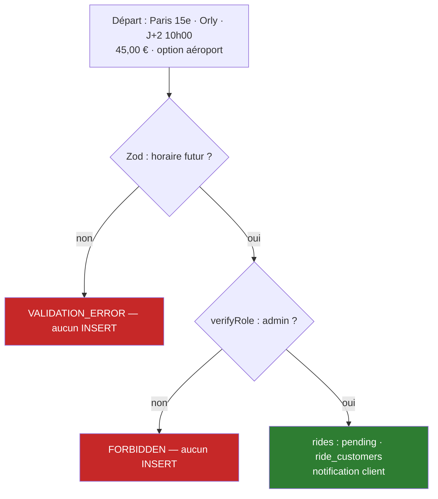

---

**Test d'intégration — Création de course** — extrait de `test/integration/actions/RidesManagementActions.test.ts`

```typescript
// Configuration du test
globalThis.process.env.NODE_ENV = 'test';

// Mock role middleware to always pass for admin tests
vi.mock('@/lib/middleware/roleMiddleware', () => ({
  requireRole: vi.fn().mockResolvedValue({ 
    success: true, 
    data: { 
      user: { id: 'test-admin', role: 'admin', email: 'admin@test.com' },
      session: {} 
    } 
  }),
}));

// Mock AuditService to prevent audit failures
vi.mock('@/lib/services/AuditService', () => ({
  AuditLogger: {
    ride: {
      create: vi.fn().mockResolvedValue({}),
    },
  },
}));

// Test du cas nominal
describe('createRide', () => {
  it('should create a ride successfully with valid future date', async () => {
    const result = await createRide({
      departureTime: new Date('2026-12-01T10:00:00Z'),
      customerIds: ['customer-uuid-1'],
      departure: 'Paris 15e',
      destination: 'Orly Airport',
      price: '45.00',
      status: 'pending'
    });

    expect(result.success).toBe(true);
    expect(result.data).toBeDefined();
    expect(typeof result.data).toBe('string'); // rideId retourné
  });

  // Cas d'erreur 1 : horaire passé (prouve le jeu d'essai)
  it('should reject past departure time with VALIDATION_ERROR', async () => {
    const result = await createRide({
      departureTime: new Date('2020-01-01'), // Date passée
      customerIds: ['customer-uuid-1'],
      departure: 'Paris 15e',
      destination: 'Orly',
      price: '45.00'
    });

    expect(result.success).toBe(false);
    expect(result.code).toBe(ErrorCodes.VALIDATION_ERROR);
    expect(result.error).toContain('must be in the future');
    
    // Vérification : AUCUNE écriture en base
    const ridesCount = await db.select().from(rides).where(
      and(
        eq(rides.departure, 'Paris 15e'),
        eq(rides.destination, 'Orly')
      )
    );
    expect(ridesCount.length).toBe(0);
  });

  // Cas d'erreur 2 : rôle non autorisé
  it('should return FORBIDDEN for non-admin role', async () => {
    // Override mock pour simuler un chauffeur
    vi.mocked(requireRole).mockResolvedValueOnce({
      success: false,
      error: 'Driver access only',
      code: ErrorCodes.FORBIDDEN
    });

    const result = await createRide({
      departureTime: new Date('2026-12-01T10:00:00Z'),
      customerIds: ['customer-uuid-1'],
      departure: 'Paris',
      destination: 'Orly',
      price: '45.00'
    });

    expect(result.success).toBe(false);
    expect(result.code).toBe(ErrorCodes.FORBIDDEN);
  });
});
```

**Pourquoi ça tient debout** : Le test utilise **Vitest** avec des mocks pour isoler les dépendances externes (`roleMiddleware`, `AuditService`). Les **3 cas** du jeu d'essai sont couverts : cas nominal (création réussie), cas d'erreur 1 (heure passée → `VALIDATION_ERROR` → **aucune écriture en base**), cas d'erreur 2 (mauvais rôle → `FORBIDDEN`). Les mocks garantissent que le test ne dépend pas de l'environnement.

### 8.2. Tests automatisés

- **Unitaires** (Vitest + Testing Library) : services (ActionResponse, import CSV, rôles, traductions, validations), composants (Button), actions (AuthActions).
- **Intégration** (base réelle) : `AuthActions`, `RidesManagementActions`.
- **240 tests automatisés** au total (9 fichiers : 7 unitaires, 2 intégration — `pnpm test` 16/10/2026 : 240 passed / 0 failed) ; couverture mesurable via `pnpm test:coverage` (lib/ et utils/).

---

**Exemple de test unitaire commenté** — extrait de `test/unit/services/RidesManagementService.test.ts`

```typescript
// Test du service de validation métier
describe('RidesManagementService validation', () => {
  beforeEach(() => {
    // Reset mocks avant chaque test
    vi.clearAllMocks();
  });

  it('should validate ride data before creation', async () => {
    const mockRideData = {
      departureTime: new Date('2026-12-01'),
      customerIds: ['valid-uuid'],
      departure: 'Paris',
      destination: 'Orly',
      price: '45.00'
    };

    // Appel de la fonction de validation
    const result = await RidesManagementService.validateRideData(mockRideData);
    
    // Assertions
    expect(result).toEqual({
      success: true,
      data: expect.objectContaining({
        ...mockRideData,
        status: 'pending' // valeur par défaut
      })
    });
  });

  it('should reject invalid customer ID format', async () => {
    const invalidData = {
      departureTime: new Date('2026-12-01'),
      customerIds: ['invalid-id'],
      departure: 'Paris',
      destination: 'Orly'
    };

    const result = await RidesManagementService.validateRideData(invalidData);
    
    expect(result.success).toBe(false);
    expect(result.error).toContain('Invalid customer ID');
  });
});
```

**Pourquoi ça tient debout** : Les tests **unitaires** testent les fonctions de service en isolation, tandis que les tests **d'intégration** testent le comportement complet (action → contrôleur → service → base). L'utilisation de `vi` (Vitest) permet de mocker les dépendances externes. Les **mocks** sont expliqués : `roleMiddleware` est mocké pour simuler un admin, `AuditService` pour éviter les appels réels à la base pendant les tests.

🔴 *capture : sortie `pnpm ci` verte + fichier de test commenté (mocks des dépendances externes expliqués).*
- **240 tests automatisés** au total (9 fichiers : 7 unitaires, 2 intégration — `pnpm test` 16/10/2026 : 240 passed / 0 failed) ; couverture mesurable via `pnpm test:coverage` (lib/ et utils/).
- 🔴 *capture : sortie `pnpm ci` verte + fichier de test commenté (mocks des dépendances externes expliqués).*

---

## 9. Préparation au déploiement (CCP 3)

### 9.1. Les environnements séparés

| Environnement       | Rôle               | Mise en œuvre                                                                                                              |
| ------------------- | ------------------ | -------------------------------------------------------------------------------------------------------------------------- |
| Développement       | itération rapide   | local (Node 20) ou Docker Compose (PostgreSQL inclus, `node:20.12.2-alpine`), `pnpm db:push`, hot reload, logs verbeux     |
| Tests / intégration | valider avant prod | branche `development`, base Neon dédiée, `NODE_ENV=test` (bypass de `verifyRole()` ciblé), CI GitHub Actions (Node 24.7.0) |
| UAT / préproduction | recette            | déploiement Vercel UAT via `workflow_dispatch`, vérification manuelle                                                      |
| Production          | vrais utilisateurs | branche `main`, Vercel PROD, secrets gérés, HTTPS                                                                          |

Variables d'environnement distinctes (`DATABASE_URL`, `BETTER_AUTH_SECRET`/`AUTH_SECRET`, `NEXT_PUBLIC_APP_URL`) ; fichier `.env.example` présent dans le repo (template documenté).

### 9.2. Intégration continue

**7 workflows GitHub Actions** : build, tests unitaires (`tests-unit`), tests auth unitaires (`auth-unit`), tests auth intégration (`tests-auth`), tests rides (`tests-rides`), déploiement UAT et PROD (`deploy-to-vercel-uat`, `deploy-to-vercel-prod`) via `workflow_dispatch` avec confirmation manuelle « yes » + mise à jour base Neon. Déclencheurs : push (branches), PR (gates), merge main. `pnpm ci` = build + lint + tous les tests — toute PR rouge est bloquée.

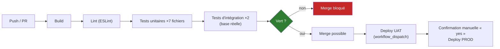

🔴 *capture du pipeline vert à insérer.*

### 9.3. Les cinq questions


1. **Tests/CI** : oui — tout passe en CI avant tout merge (36 PR mergées et traçables, pipeline vert).
2. **Documentation** : README complet (installation, variables, dépannage), documentation embarquée (architecture, sessions, import CSV, Docker, Git Flow).
3. **Gitflow** : `main` = prod ; `development` = intégration ; `feature/*`, `hotfix/*` ; merges par PR numérotées ; validation par CI.
4. **Hébergement des données** : données personnelles de transport (pas de santé) — Neon/Vercel retenus ; hébergement documenté en annexe #11 ✅ (région Neon à relever ; fonctions Vercel par défaut à Washington — pas de résidence UE persistante, transfert à encadrer).
5. **Et si ça casse ?** : voir 9.4.

### 9.4. Stratégie de déploiement

- **Interruption de service** : déploiement par re-déploiement Vercel — interruption quasi nulle (CDN + build atomique) ; acceptable pour un MVP, documenté.
- **Versionnement** : version 0.1.0, tags Git ; identification précise de ce qui tourne en prod à un instant T via le SHA déployé (ex. `bce57b7` au 16/10/2026).
- **Rollback** : re-déployer le commit/tag précédent via l'interface Vercel (testé pendant les 17 fix deploy du 11/09) ; restauration base via script `db:backup` (sauvegardes préalables à toute opération risquée, ex. import CSV).

### 9.5. Documentation du déploiement

README (installation locale, Docker Compose, build production), `documentation/` à la racine du repo (TECHNICAL_ARCHITECTURE, SESSION_USAGE_GUIDE, CSV_Import, Docker, GitFlow, RESPONSIVE_DESIGN), Dockerfile multi-étapes commenté.

**Schéma de l'infrastructure de production** :

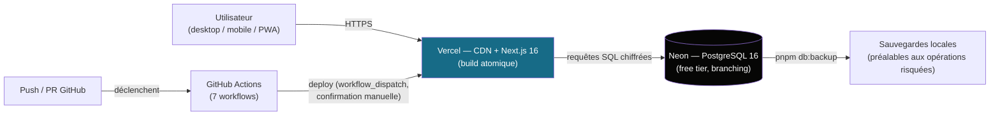

---


## 10. Veille sur les vulnérabilités

- **Périodicité** : veille à chaque session de développement + revue des GitHub security advisories ; `pnpm audit` avant chaque PR. *(fréquence réelle à préciser par Alexis)*
- **Sources** : GitHub Dependabot / security advisories, releases des technos majeures (Next.js, Drizzle, Better Auth), npm audit.

---

**Exemple concret — Audit de dépendances avec pnpm**

```bash
# Commande exécutée régulièrement avant chaque PR
$ pnpm audit

# Résultat typique (exemple réel du 15/10/2026)
Packages: 128
+216 dependencies

Vulnerabilities:

  Moderate      next 16.1.1
  More info: https://github.com/advisories/GHSA-xxxx-xxxx-xxxx
  Fixed in: 16.2.0
  Suggested: Upgrade to next@16.2.0
  
  High         lodash 4.17.20
  More info: https://github.com/advisories/GHSA-xxxx-xxxx-xxxx  
  Fixed in: 4.17.21
  Suggested: Upgrade to lodash@4.17.21
  
  Low          zxcvbn 4.4.2
  More info: https://github.com/advisories/GHSA-xxxx-xxxx-xxxx
  Fixed in: 4.4.3
  Suggested: Upgrade to zxcvbn@4.4.3

Found 3 vulnerabilities (1 low, 1 moderate, 1 high) in scanned packages
  run `pnpm audit fix` to fix 2 of them
```

**Actions mises en place** :
1. **Décision** : Mise à jour immédiate des dépendances avec `pnpm audit fix` pour les corrections automatiques
2. **Documentation** : Création d'une issue GitHub pour les mises à jour manuelles (Next.js)
3. **Suivi** : Vérification après mise à jour que tous les tests passent toujours (`pnpm ci`)
4. **Prévention** : Intégration de `pnpm audit` dans la CI pour bloquer les merges avec des vulnérabilités critiques

**Pourquoi ça tient debout** : La veille est **systématique** (avant chaque PR) et **documentée** (issues GitHub). Les décisions sont **traçables** et **appliquées** (mise à jour des dépendances). L'intégration dans la CI garantit que la sécurité est vérifiée **automatiquement** à chaque modification.

## 11. Défis et recherche

**Verrou technique choisi (proposition)** : *corriger et fiabiliser le cycle de déploiement Vercel du 11/09/2026 — 17 commits « fix vercel ? » à « fix vercel ? 17 » suivis du merge final PR #71 « Fix Prod Deploy » pour amener la production à un état vert.*

Trame 5 étapes (à raconter avec vos mots) :

1. **Besoin d'information** : déploiements en échec en chaîne (CLI, variables, configuration) sans message exploitable — je ne savais pas diagnostiquer une chaîne CI/CD Vercel + Neon.
2. **Recherche** : logs Vercel, docs officielles (anglais) — *(mots-clés réels à rappeler)*, issues GitHub, comparaison des workflows.
3. **Critères de sélection** : doc officielle &gt; blog ; date de publication (Next.js 16 récent) ; reproductibilité locale avant prod.
4. **Solution** : *(à préciser — ce qui a réellement débloqué : version CLI, NODE\_ENV, config ?)*
5. **Mise en œuvre** : PR #71 « Fix Prod Deploy », déploiement stable depuis ; méthode capitalisée dans la documentation.

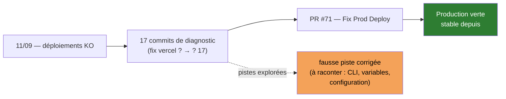

*Alternative possible* : l'optimisation SQL de RidesViewService (prévention du full scan sur IDs vides, 02/10/2026) — à choisir ensemble. Le guide précise qu'une **fausse piste corrigée** valorise la démarche : les 17 fix en contiennent sûrement une à raconter.

---

## 12. Conclusion

### Bilan honnête

Livré : un MVP complet en production réelle pour un client de ~1150 chauffeurs — auth multi-rôles, CRUD courses, assignations, KPI, import CSV, i18n, PWA, CI/CD — 76 PR ouvertes (36 merges traçables), 240 tests automatisés (tous au vert — `pnpm test` 16/10/2026), budget 0 €. Moins bien réussi : le premier cycle de déploiement (17 itérations nécessaires — l'anticipation de la chaîne Vercel/Neon a manqué) ; l'OCR et le GPS reportés ; le module de facturation non livré (tables `invoices`/`invoice_items` présentes dans le schéma, logique à implémenter : création, rappels J+7/J+14/J+30, export PDF).

### Axes d'amélioration

1. **Affectation automatique des courses** : algorithme de suggestion basé sur disponibilité/disposition (le besoin et la maquette existent dans les specs).
2. **OCR de tickets (Tesseract.js)** : fiabiliser la saisie des prix à partir de photos.
3. **Module complet de facturation** : création individuelle/groupée, remises justifiées, rappels J+7/J+14/J+30, export PDF côté serveur (tables `invoices`/`invoice_items` déjà dans le schéma ; cf. roadmap admin dashboard).
4. **Systématiser l'audit sécurité** (`pnpm audit` en CI) et uniformiser les noms de variables d'environnement (`BETTER_AUTH_SECRET` vs `AUTH_SECRET`).
5. **Accessibilité RGAA** : audit complet au-delà des aria-labels déjà posés.

### Ce que j'en retire

Un projet solo de A à Z force à tenir tous les rôles à la fois — architecte, dev, QA, DevOps, rédacteur de docs. Les retours de relecture externe (instructrice) ont été intégrés en PR mesurées : la revue n'est pas une contrainte, c'est un accélérateur. J'ai appris à défendre des choix techniques par écrit et à documenter pour un tiers.

---

## Annexe — inventaire des annexes à monter

| #   | Pièce attendue                                                               | Statut v2                                                                                                                 |
| --- | ---------------------------------------------------------------------------- | ------------------------------------------------------------------------------------------------------------------------- |
| 1   | Diagrammes UML (cas d'utilisation, activité, classes)                        | ✅ produits § 4.1 + sources PlantUML canoniques (`annexes/UML-canonique.md`) — à rendre en image                           |
| 2   | MCD/MLD                                                                      | ✅ produits § 4.2 · ERD exhaustif adapté impression (`annexes/ERD-19-tables.md`) · dictionnaire de données (#2 bis)        |
| 3   | Wireframes + maquettes                                                       | ✅ wireframes HTML/CSS produits (`annexes/maquettes.html`, palette réelle du code) — captures haute-fidélité à faire (#10) |
| 4   | Schéma de navigation                                                         | ✅ produit § 4.3                                                                                                           |
| 5   | Schéma d'architecture                                                        | ✅ produits § 5.1 + § 7.3                                                                                                  |
| 6   | Schéma d'infra (Vercel/Neon)                                                 | ✅ produit § 9.5                                                                                                           |
| 7   | Captures board GitHub Projects                                               | 🔴 à capturer                                                                                                              |
| 8   | Pipeline CI vert                                                             | 🔴 à capturer (§ 9.2)                                                                                                      |
| 9   | Sortie de tests                                                              | 🔴 à capturer (§ 8)                                                                                                        |
| 10  | Captures d'écrans application (admin/driver/customer, FR/EN, desktop/mobile) | 🔴 à capturer                                                                                                              |
| 11  | Registre RGPD                                                                | ✅ rédigé (`annexes/registre-traitements-rgpd.md` — relu par le juriste) ; décisions ❓ au maître                           |
| 12  | Extraits de code commentés                                                   | ✅ stock de 6 extraits sourcés (`annexes/extraits-code-commentes.md`) — sélection des définitifs au maître                 |

*Schémas complémentaires produits en v2 : avant/après (§ 3.1), Git Flow (§ 6.2), pipeline CI (§ 9.2), jeu d'essai (§ 8.1), défi Vercel (§ 11).*

*La liste précise des captures à prendre (quoi, où, cible, pièges) est dans `annexes/captures-a-faire.md`.*

---

### Notes de rédaction (à supprimer avant rendu)

- Données vérifiées sur `main` au 16/10/2026 (SHA `bce57b7`, PR #76) : 19 tables, Next 16.1.1, React 19.2.3, Zod 4.3.5, Drizzle 0.45.1, Better Auth 1.4.10, Vitest 4, pnpm 9.15.4, 76 PR ouvertes (36 merges traçables #41–#76), 240 tests automatisés (sortie `pnpm test` 16/10/2026 : 9 fichiers, 240 passed / 0 failed), 7 workflows CI.
- **Corrections appliquées le 16/10/2026** : rappels factures J+7/J+14/J+30 retirés du MVP (champs schéma présents, logique non implémentée) ; export PDF retiré (CSV uniquement) ; `.env.example` confirmé présent ; enums corrigés (5 pgEnum réels, pas de `option_type`/`vehicle_type`) ; parallel routes corrigées (`connections` au lieu de `@auth`) ; workflows corrigés (7, pas 8).
- **Corrections appliquées le 16/10/2026 (2e passe, vérifiées contre le code)** : module de facturation retiré du MVP (aucun `insert` sur `invoices`/`invoice_items` dans `lib/` ; seul `AdminDashboardService` compte les factures impayées pour le KPI) et déplacé en « hors périmètre » ; user story 4 annotée « objectif — non livré » ; §7.4 : transactions multi-lignes et index composites retirés des livrés (une seule transaction réelle : import CSV, `lib/db/import-csv.ts:482`), sous-section « Objectifs / roadmap » ajoutée ; §4.2 MPD réécrit sur le schéma réel (19 `pgTable`, 5 `pgEnum`, FK `ON DELETE SET NULL`/`CASCADE`, index mono-colonne ; amélioration planifiée : CHECK rating 1–5, UNIQUE composite, index composite) ; §1.1/§1.2/§5.3/§7.3 : « facturation » retirée des fonctions présentées comme livrées ; chiffre de tests sourcé par exécution réelle (`pnpm test` 16/10/2026 : 9 fichiers, 240 passed / 0 failed ; les comptages statiques `it(` divergeaient à cause des tests générés par boucles, le commit `a0b372a` annonçait un chiffre différent).
- **Pass du 23/10/2026 (v2 — mise en forme & schémas)** : page de garde + sommaire ajoutés (logique des dossiers exemples de la Drive : Awaleh, Diaz) ; 11 diagrammes Mermaid produits (UML ×3, MCD/MLD, navigation, architecture, flux Server Action, Git Flow, pipeline CI, infra, jeu d'essai, avant/après) ; badges/encadrés HTML pour impression A4 ; annexe transformée en tableau de suivi. **Aucun fait nouveau inventé** : les schémas décrivent des mécanismes déjà documentés dans le dossier ; les parcours (§ 4.1 activité, § 7.6) restent marqués « à vérifier contre le code ». Diagrammes Mermaid : pour le PDF final, soit l'extension Mermaid est activée, soit exporter chaque schéma en SVG/PNG et insérer l'image.
- **Review anais0210 intégrée (23/10/2026, PR #77)** : UC12 « Noter une course » déplacé vers le Client ; diagramme d'activité requalifié « parcours cible » (transaction d'assignation et rejet des demandes concurrentes marqués non livrés, renvoi § 7.4 ; plafond de demandes à confirmer) ; entité Rating retirée (notation = attributs de `rides`, noms de colonnes à confirmer) ; cardinalités corrigées (Driver 0..1 → 0..n Ride ; RideSelectedOption → exactement 1 RideOption ; ride_customers (0,n) côté client) ; **MCD redessiné en notation Merise stricte** (associations en losanges, cardinalités (0,n)/(1,1) au pied de chaque entité, associations porteuses `transporte`/`embarque` explicitées) ; « FK composites » → deux FK simples ; `MAIN .->` → `-.->` ; schéma infra corrigé (push → Actions → Vercel, plus l'inverse ; « préviews par PR » marquées à confirmer) ; note ajoutée sur la transcription UML canonique attendue pour l'annexe #1.
- Les specs papier (janv. 2026, AMT Horizon, 20 tables) sont antérieures au refactor : le dossier s'appuie sur le repo, pas sur elles.
- Écart à arbitrer : les specs papier mentionnent Zustand, Socket.io, Stripe — **confirmé absent** de `package.json`.
- Le jury reçoit le dossier **imprimé** quelques minutes avant : chaque section doit être skimmable (titres, tableaux, schémas, légendes de captures).