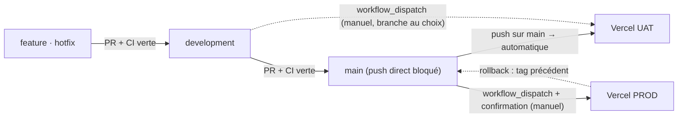
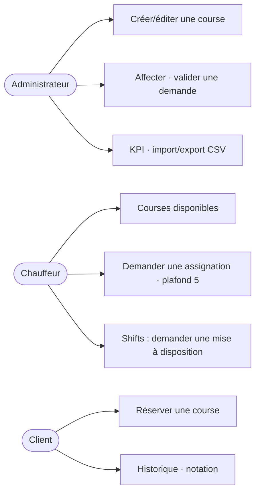
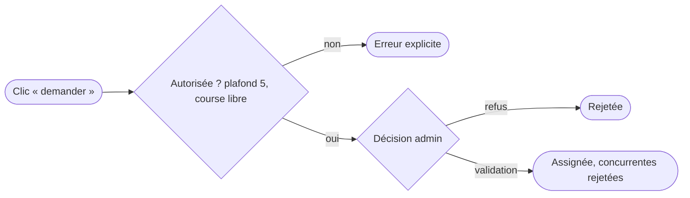
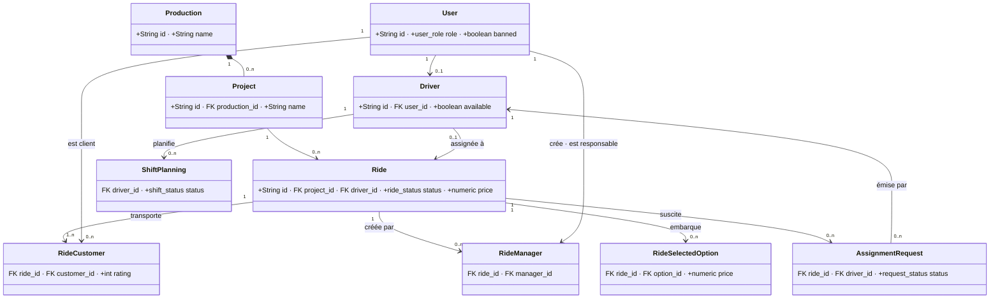
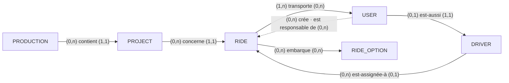
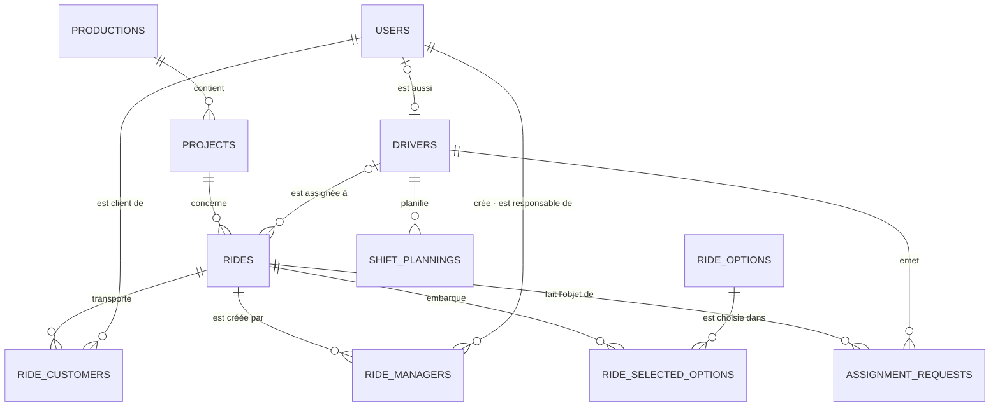
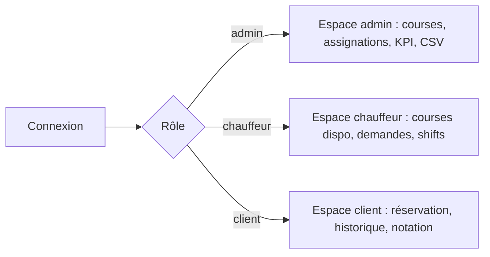
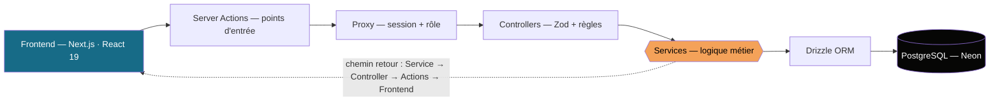
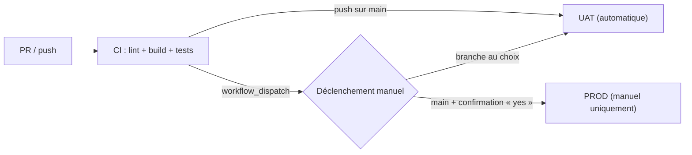

<div align="center" style="page-break-after: always; text-align: center; padding-top: 120px; font-family: 'Segoe UI', Arial, sans-serif;">

<p style="letter-spacing: 3px; color: #176B87; font-size: 13pt; margin-bottom: 40px; text-transform: uppercase;">Titre professionnel RNCP 37873 — Niveau 6</p>

<h1 style="font-size: 26pt; color: #060605; border: none; margin-bottom: 8px;">Dossier de projet</h1>
<p style="font-size: 14pt; color: #555; margin-top: 0;">Session janvier 2027</p>

<p style="font-size: 13pt; color: #176B87; font-weight: bold; margin-top: 40px;">Concepteur Développeur d'Applications</p>

<hr style="width: 60px; border: none; border-top: 3px solid #F4A259; margin: 30px auto;" />

<p style="font-size: 20pt; font-weight: bold; color: #060605; margin: 20px 0 6px;">AMT Express</p>
<p style="font-size: 12pt; color: #555; margin-top: 0;">Plateforme web de gestion de courses pour entreprises de transport VTC / taxi</p>

<p style="margin-top: 60px; font-size: 12pt;"><strong>Alexis SANTOS</strong><br/>Promo Janvier 2026 — Ada Tech School</p>

</div>

<div style="page-break-after: always;">

## Sommaire

| #   | Section                       | Contenu clé                                                                                 |
| --- | ----------------------------- | ------------------------------------------------------------------------------------------- |
| 1   | Présentation du projet        | Contexte, problème, solution et chiffres clés                                               |
| 2   | Compétences du référentiel    | Tableau officiel France Compétences et localisation dans le dossier                         |
| 3   | Cahier des charges            | Analyse des besoins, rôles utilisateurs, user stories, MVP, risques                         |
| 4   | Gestion de projet             | Méthodologie, planning, suivi qualité, workflows CI/CD                                      |
| 5   | Spécifications fonctionnelles | UML, MCD/MLD/MPD, maquettes, organisation des espaces                                       |
| 6   | Spécifications techniques     | Architecture en couches, sécurité OWASP, choix de la stack                                  |
| 7   | Réalisation                   | Deux réalisations personnelles (front-end, back-end), extraits commentés au gabarit attendu |
| 8   | Tests                         | Jeu d'essai représentatif, tests automatisés (244 au total)                                 |
| 9   | Préparation au déploiement    | Environnements, CI/CD, rollback, documentation                                              |
| 10  | Veille sur les vulnérabilités | Processus de veille, sources, exemple concret                                               |
| 11  | Défis et recherche            | Résolution d'un verrou technique majeur                                                     |
| 12  | Conclusion                    | Bilan du projet, axes d'amélioration, perspectives                                          |
| —   | Annexes                       | Inventaire des pièces jointes                                                               |

</div>

---

## 1. Présentation du projet

### 1.1. Présentation en français

J'ai choisi de répondre à un besoin réel : celui d'AMT CGS GROUPE, une société de transport VTC d'environ 1 150 chauffeurs indépendants dont tout le cycle opérationnel — saisie des courses, dispatch des chauffeurs, facturation — est encore géré au papier, au téléphone et sur Excel.

AMT Express est la plateforme web full-stack que j'ai conçue, développée et mise en pré-production pour cette entreprise. Elle centralise la gestion des courses autour de trois espaces cloisonnés par rôle : l'espace administrateur (création, gestion et assignation des courses, tableaux de bord), l'espace chauffeur (courses disponibles, demandes d'assignation, plannings, réalisation) et l'espace client professionnel (réservation, historique, notation).

J'ai mené ce projet seul, de l'analyse des besoins au déploiement en production, sur un budget de 0 € en m'appuyant sur les offres gratuites des plateformes d'hébergement. Le MVP est aujourd'hui déployé, avec une suite de tests automatisés exécutée à chaque livraison. Les choix techniques sont présentés et justifiés en section 6 ; l'analyse du besoin est détaillée en section 3.

### 1.2. Présentation en anglais

I chose to address a real need: that of AMT CGS GROUPE, a french private-hire transportation company with approximately 1,150 independent drivers, whose entire operational cycle—from entering ride requests to dispatching drivers and invoicing—is still managed using paper, phone calls, and Excel, right up to the invoicing software.

AMT Express is the full-stack web platform that I designed, developed, and deployed in pre-production for this company. It centralizes ride management across three role-based areas: the administrator area (ride creation, management, and assignment; dashboards), the driver area (available rides, assignment requests, schedules, and ride completion), and the business customer area (bookings, history, and ratings).

I managed this project single-handedly, from requirements analysis to production deployment, on a budget of €0 by leveraging free hosting platform offerings. The MVP is now deployed, with a suite of automated tests run after each release. The technical choices are presented and justified in Section 6; the requirements analysis is detailed in Section 3.

---

## 2. Compétences du référentiel mobilisées

Le projet AMT Express illustre les compétences du titre professionnel **Concepteur Développeur d'Applications** (RNCP 37873, niveau 6). Le tableau officiel des compétences est reproduit ci-dessous depuis le référentiel France Compétences (source de vérité), avec pour chacune la section du dossier où elle est illustrée.

<div style="padding: 10px 14px; margin: 12px 0;">

| Activité type                                                                    | Compétence professionnelle                                       | Section du dossier                                              |
| -------------------------------------------------------------------------------- | ---------------------------------------------------------------- | --------------------------------------------------------------- |
| **AT1 — Développer une application sécurisée**                                   | Installer et configurer son environnement de travail             | §6.3 (stack, pnpm, Docker) · §4.1                               |
|                                                                                  | Développer des interfaces utilisateur dynamiques et ergonomiques | §7.2 (React, parallel routes, responsive, a11y)                 |
|                                                                                  | Développer des composants métier réutilisables                   | §7.3 (Server Actions, controllers, services)                    |
|                                                                                  | Contribuer à la gestion d'un projet informatique                 | §4 (Scrum, Git Flow, planning, qualité)                         |
| **AT2 — Concevoir et développer une application sécurisée organisée en couches** | Analyser les besoins et maquetter une application                | §3 (cahier des charges) · §5.3 (maquettes, espaces par rôle)    |
|                                                                                  | Définir l'architecture logicielle d'une application              | §6.1 (architecture en couches) · §7.1                           |
|                                                                                  | Concevoir et mettre en place une base de données relationnelle   | §5.2 (MCD / MLD / MPD)                                          |
|                                                                                  | Développer des composants d'accès aux données SQL et NoSQL       | §7.3 (chaîne complète, transactions) · §11.1 (optimisation N+1) |
| **AT3 — Préparer le déploiement d'une application sécurisée**                    | Préparer et exécuter les plans de tests d'une application        | §8 (jeu d'essai, 244 tests automatisés, CI)                     |
|                                                                                  | Préparer et documenter le déploiement d'une application          | §9 (environnements, CI/CD, backup, documentation)               |
|                                                                                  | Contribuer à la mise en production dans une démarche DevOps      | §9.2-9.4 (pipeline, déploiement, rollback)                      |

> *Les annexes sont disponibles ci-jointes en versions papier ou numériquement dans le dossier `documents/dossiers/dossierProjet/annexes/` de ce dépôt. Chaque pièce est référencée par son numéro dans l'inventaire en fin de document.*

</div>

<div style="page-break-after: always;"></div>

## 3. Cahier des charges

### 3.1. Contexte et problématique

**Contexte client** : AMT CGS GROUPE est une entreprise de transport VTC basée en France, comptant environ **1 150 chauffeurs indépendants**. Ses clients principaux sont des productions cinématographiques, des sociétés d'événementiel et des entreprises de divers secteurs.

**Problématique identifiée** : Avant la mise en place d'AMT Express, l'ensemble du cycle opérationnel de l'entreprise était géré manuellement, entraînant les difficultés suivantes :

| Problème identifié          | Processus existant                       | Impact mesuré                                                        |
| --------------------------- | ---------------------------------------- | -------------------------------------------------------------------- |
| Saisie manuelle des courses | Tickets papier retranscrits manuellement | Erreurs fréquentes, délais de traitement, ~10 heures/semaine perdues |
| Assignations inefficaces    | Dispatch téléphonique                    | Jusqu'à 20 % de temps d'inactivité pour les chauffeurs               |
| Manque de visibilité        | Clients appellent pour connaître l'état  | Insatisfaction client, perte de courses                              |
| Facturation manuelle        | Factures Excel générées manuellement     | Retards de paiement, erreurs de facturation                          |

**Solution proposée** : AMT Express est une **application web full-stack responsive** (compatible desktop, mobile et PWA) qui remplace ces processus manuels par un système automatisé et centralisé. Le schéma comparatif « processus manuel / avec AMT Express » est reproduit en format A4 en <u>**annexe**</u> pour être lisible par le jury.

### 3.2. Personas et rôles utilisateurs

L'analyse du besoin, menée avec le client **AMT CGS GROUPE**, a produit **cinq personas**. Ils sont rappelés ici en synthèse ; leurs portraits complets — contexte de vie, citations, usage numérique, impact produit — sont réunis dans l'**<u>annexe #17</u>**.

| Persona                                           | Ce qu'il vit aujourd'hui                                                                                              | Ce qui lui manque                                                                             | Rôle applicatif    |
| ------------------------------------------------- | --------------------------------------------------------------------------------------------------------------------- | --------------------------------------------------------------------------------------------- | ------------------ |
| **Marc, 55 ans**<br>manager de flotte             | Tout au papier : agenda imprimé de cinq kilos, courses notées à la main, coordination par téléphone.                  | Une seule source de vérité : savoir en continu qui roule pour qui, sans recopier ni rappeler. | **Administrateur** |
| **Nathalie, 47 ans**<br>secrétaire administrative | Recopie chaque matin l'agenda papier dans Excel, relance les chauffeurs au téléphone et les clients pour les impayés. | Une seule saisie, et des relances qui ne reposent plus sur elle.                              | **Administrateur** |
| **Djamel, 39 ans**<br>chauffeur indépendant       | Vit dans sa voiture ; toutes les informations passent par le dispatch.                                                | Ne manquer aucune course, et communiquer directement avec le client.                          | **Chauffeur**      |
| **Jean-Michel, 62 ans**<br>client régulier        | Réserve par téléphone ; le prix est clair (tarification préfectorale), mais une fois la course demandée, plus rien.   | Savoir que sa course est enregistrée, assignée, et où en est son chauffeur.                   | **Client**         |
| **Claire, 41 ans**<br>assistante de direction     | Pilote les déplacements des cadres par e-mails en série (environ dix-huit messages par course).                       | Un écran unique : statut des courses en direct, facture plus rapide.                          | **Client**         |

**Des personas aux rôles applicatifs.** L'application, volontairement resserrée, ne gère pas cinq profils mais **un rôle de base et deux extensions** : `customer` (le client, socle de tous les comptes), étendu par `driver` (le chauffeur), lui-même étendu par `admin` (l'administrateur). Chaque persona est affilié à un rôle, et plusieurs personas peuvent partager le même rôle lorsque leurs droits sont identiques :

| Rôle applicatif    | Personas couverts                                        | Besoin commun que le rôle résout                                                                                                                  |
| ------------------ | -------------------------------------------------------- | ------------------------------------------------------------------------------------------------------------------------------------------------- |
| **Administrateur** | Marc (pilotage), Nathalie (saisie et relances)           | Créer et assigner les courses et les mises à disposition (shifts), valider les demandes des chauffeurs, importer les données CSV, consulter les KPI, exporter en CSV — **et toutes les actions du rôle client** |
| **Chauffeur**      | Djamel                                                   | Voir les courses et mises à disposition (shifts) disponibles, demander une assignation (plafond de 5 demandes), réaliser les prestations — **et toutes les actions du rôle client** |
| **Client**         | Jean-Michel (usage individuel), Claire (usage corporate) | Réserver une course, consulter l'historique, noter les prestations (rôle de base, commun à tous les comptes) |

**Tarification** : dans la quasi-totalité des cas, la course est facturée **au compteur**, sur la base du prix au kilomètre fixé par les préfectures. Certains tarifs spéciaux (ex. aéroport) sont à **prix verrouillé**, complétés par les options et le temps d'attente du chauffeur (`waiting_time`, facturé via `waiting_fee` — voir §5.2) ; les mises à disposition (shifts) sont facturées au **tarif horaire**.

Ce regroupement est un choix d'architecture **assumé** : pour un MVP, la granularité à trois rôles couvre les objectifs de tous les personas — Marc et Nathalie partagent la même vue d'administration, Jean-Michel et Claire partagent la même vue de réservation. Les besoins non couverts par ce regroupement (facturation automatisée de Nathalie, suivi GPS et notifications en temps réel de Jean-Michel et Claire) sont inscrits au backlog post-MVP (voir §3.3). Cette lecture est cohérente partout : cinq personas dans l'analyse, trois rôles dans les user stories (§3.3), trois acteurs dans le diagramme de cas d'utilisation (§5.1) et trois espaces cloisonnés dans l'application (§5.3). Dans le code, cette lecture « en extension » se traduit par la hiérarchie `admin > driver > customer` (§6.2 et §7.3) : chaque rôle supérieur hérite des actions du rôle client.

### 3.3. User Stories

**Comment les besoins ont été pilotés.** Sur ce projet, chaque tâche de développement a été gérée comme une **issue GitHub** : le dépôt en compte 41, dont 16 fermées (livrées dans le MVP) et 25 ouvertes (backlog post-MVP). Au moment du lancement du projet, je ne pratiquais pas encore le formalisme des user stories ; les issues ont donc d'abord été rédigées comme des tâches techniques. Pour ce dossier, je les ai formalisées a posteriori sous forme de user stories — c'est le langage attendu pour exprimer le besoin : qui, quoi, pourquoi — et elles vivent désormais dans le dépôt comme **issues dédiées (#89 à #96)**, labellisées `user-story` / `mvp`, chacune reliée aux issues de travail d'origine.

**User stories livrées dans le MVP** (issue GitHub d'origine entre parenthèses) :

| #   | User story                                                                                                                                                           | Issue US (travail d'origine) |
| --- | -------------------------------------------------------------------------------------------------------------------------------------------------------------------- | ---------------------------- |
| US1 | En tant qu'administrateur, je veux créer un compte et me connecter, afin de gérer la plateforme en sécurité                                                          | #89 (#1, #5)                 |
| US2 | En tant qu'utilisateur, je veux créer mon compte en autonomie (rôle client, sans validation préalable), afin de réserver directement ; l'élévation au rôle chauffeur se fait sur demande auprès d'un administrateur | #90 (#1, #7)                 |
| US3 | En tant qu'administrateur, je veux créer une course avec ses détails (départ, destination, horaire, prix, options), afin de cataloguer l'activité de l'entreprise    | #91 (#10)                    |
| US4 | En tant qu'administrateur, je veux affecter une course à un chauffeur ou valider sa demande d'assignation, afin de distribuer l'effort de manière fiable et traçable | #92 (#13)                    |
| US5 | En tant que chauffeur, je veux voir les courses disponibles et demander une assignation, afin de maximiser mes revenus en choisissant mes courses                    | #93 (#13)                    |
| US6 | En tant que client, je veux réserver une course et consulter mon historique, afin de commander sans friction et suivre mes déplacements                              | #94 (#14)                    |
| US7 | En tant qu'administrateur, je veux consulter les statistiques des courses sur un tableau de bord, afin de piloter l'activité                                         | #95 (#17, #19)               |
| US8 | En tant qu'administrateur, je veux importer les anciennes données par CSV avec sauvegarde automatique, afin de migrer sans perte ni double saisie                    | #96 (#2, #4)                 |

**User stories du backlog post-MVP** (extrait ; la liste complète vit dans les issues GitHub ouvertes) : facturation (création, groupée, envoi, relances — issues #20 à #23), notifications temps réel (#24 à #26), géolocalisation (#27, #29), chat interne (#28), OCR d'import de courses (#11), notation des chauffeurs (#16), mots de passe oubliés (#6), **administration des rôles** : un client demande son élévation au rôle chauffeur auprès d'un administrateur (mail ou autre canal), qui la valide via une interface dédiée à venir ; l'élévation au rôle administrateur exigera une double validation (modalités en cours de définition). La hiérarchie de rôles et sa vérification sont déjà en place côté code : seul l'écran d'administration manque.

Le suivi de ce backlog s'est fait sur le board **GitHub Projects** du dépôt (capture ci-dessous) : chaque issue y passe par les colonnes Backlog → In Progress → Done, ce qui a servi de plan de sprint hebdomadaire pendant tout le développement.

Vous trouverez en <u>**annexe #7**</u> la capture d'écran du board GitHub Projects, avec les issues du MVP et celles du backlog post-MVP.

<!-- CAPTURE à produire : issue GitHub #92 (US4 — affecter une course / valider une demande d'assignation), vue complète : titre, labels user-story / mvp, lien vers l'issue de travail #13. Déposer le fichier dans documents/dossiers/dossierProjet/annexes/screenshots/ sous le nom user-story-issue-92.png -->
<div align="center" style="border: 1px solid #ddd; border-radius: 6px; padding: 10px; margin: 14px 0; background: #fafafa;">

<p style="font-size: 9pt; color: #555; margin: 6px 0 0;">Fig. — La user story US4 telle qu'elle vit dans le dépôt : issue #92, labels <code>user-story</code> / <code>mvp</code>, reliée à l'issue de travail d'origine #13.</p>
</div>

### 3.4. Périmètre du MVP

Le **Minimum Viable Product** déployé en production comprend les fonctionnalités suivantes :

| #   | Fonctionnalité                   | Statut | Détails                                                                                                      |
| --- | -------------------------------- | ------ | ------------------------------------------------------------------------------------------------------------ |
| 1   | **Authentification multi-rôles** | Livré  | 3 rôles (admin/driver/customer) vérifiés à chaque action serveur. Inscription libre côté client ; bannissement porté par la couche d'authentification Better Auth |
| 2   | **CRUD courses complet**         | Livré  | Création, lecture, mise à jour, suppression avec cycle de statuts (pending → assigned → completed/cancelled) |
| 3   | **Gestion des assignations**     | Livré  | Demandes d'assignation par les chauffeurs, validation par l'admin                                            |
| 4   | **Tableaux de bord KPI**         | Livré  | Visualisation des courses, revenus, taux d'assignation avec Recharts                                         |
| 5   | **Import CSV massif**            | Livré  | Import des anciennes données avec sauvegarde automatique préalable                                           |
| 6   | **Système de notation**          | Livré  | Notation des courses (1-5 étoiles) avec commentaires                                                         |
| 7   | **Internationalisation**         | Livré  | Support FR/EN complet, PWA (Service Worker)                                                                  |
| 8   | **Export CSV**                   | Livré  | Export des données jusqu'à 10 000 lignes                                                                     |
| 9   | **Journal d'audit**              | Livré  | Traçabilité complète des actions via `activity_logs`                                                         |

**Fonctionnalités hors périmètre MVP** (reportées) :
- GPS temps réel des véhicules
- OCR de tickets (intégration Tesseract.js)
- Paiements en ligne (Stripe/PayPal)
- Chat interne entre utilisateurs
- Notifications push
- Synchronisation avec les calendriers
- **Module complet de facturation** : création individuelle/groupée, gestion des remises, rappels automatiques, export PDF — les tables correspondantes existent dans le schéma de données (voir §5.2), mais la logique métier n'a pas été livrée dans le MVP

### 3.5. Analyse des risques

| Risque identifié                                                | Probabilité | Impact | Mesures de mitigation                                                                                                                           |
| --------------------------------------------------------------- | ----------- | ------ | ----------------------------------------------------------------------------------------------------------------------------------------------- |
| **OCR insuffisant sur tickets manuscrits**                      | Haute       | Moyen  | Solution alternative : import CSV avec backup automatique + correction manuelle. OCR planifié pour une version post-MVP                         |
| **Taux d'adoption des chauffeurs < 80 %**                       | Moyenne     | Fort   | Interface chauffeur simplifiée (courses, shifts, stats). Intégration progressive via l'import CSV des données existantes                                            |
| **Limites des free tiers** (Neon 0,5 Go, bande passante Vercel) | Moyenne     | Fort   | Monitoring de l'usage, scripts de backup (`pnpm db:backup`), archivage possible. Scalabilité documentée (25-50 €/mois pour 1 000+ utilisateurs) |
| **Développement solo en temps partiel**                         | Certaine    | Moyen  | Méthodologie Git Flow stricte, PR numérotées et revues, CI bloquante sur les tests rouges                                                       |
| **Exposition des secrets**                                      | Faible      | Fort   | `.gitignore` vérifié et maintenu, README avec avertissements, procédure de révocation documentée                                                |
| **Risque de dérive technique**                                  | Moyenne     | Moyen  | Conventions de nommage strictes, ESLint configuré, `pnpm ci` obligatoire avant chaque PR, revues de code externes                               |

---

## 4. Gestion de projet

### 4.1. Contexte humain et technique

**Équipe projet** :
- **Développeur/Tech Lead** : Alexis SANTOS (architecture, développement backend/frontend, DevOps, documentation)
- **Relecture externe** : Instructrice Ada Tech School (retours intégrés le 16/10/2026)
- **Client final** : AMT CGS GROUPE (société de transport VTC avec ~1 150 chauffeurs)

**Environnement technique** :
- **Éditeur** : VS Code
- **Gestion de code** : Git/GitHub (issues, Projects, Pull Requests)
- **CI/CD** : GitHub Actions
- **Gestion des dépendances** : pnpm
- **Linting** : ESLint
- **Conteneurisation** : Docker
- **Hébergement** : Vercel (frontend), Neon (base de données)
- **Stack applicative** : Next.js · React 19 · TypeScript · Drizzle ORM · Better Auth · Zod · PostgreSQL (détail et justifications en §6.3)

### 4.2. Méthodologie et suivi

**Processus de développement** :
Le projet a été développé selon une démarche inspirée du framework **Scrum** (product backlog, sprints courts, revues), adaptée aux contraintes réelles d'un développement solo en temps partiel. Le workflow Git Flow suivant a été strictement respecté :



> *Vous retrouvez la version A4 (cycle de déploiement complet) dans l'<u>**annexe #6**</u>.*

**Détail du workflow** :
1. **Branches de feature** : `feature/*` pour les nouvelles fonctionnalités, `hotfix/*` pour les corrections
2. **Intégration** : La branche `development` sert de branche d'intégration
3. **Validation CI** : Toute PR doit passer la CI (build + tests) avant d'être mergée
4. **Déploiement UAT** : mise à jour **automatique à chaque push sur `main`** — donc à chaque PR mergée, le push direct sur `main` étant bloqué par les règles de protection ; un déploiement **manuel** reste possible depuis n'importe quelle branche via `workflow_dispatch`
5. **Validation manuelle** : tests de recette sur l'UAT avant passage en production
6. **Production** : déploiement **toujours manuel** (`workflow_dispatch` avec confirmation « yes »), **uniquement depuis `main`**

**Suivi du projet** :
- **~245 commits** et **39 Pull Requests mergées**, chacun relié à une issue et passé par la CI avant merge
- **Jalons principaux** :
  - Juillet 2026 : Authentification + rôles
  - Août 2026 : Interfaces chauffeur/client, consolidation de la documentation
  - 11/09/2026 : CI/CD Vercel + **17 corrections de déploiement consécutives** (voir §11.2)
  - 02/10/2026 et 16/10/2026 : Optimisations sécurité, accessibilité et performance

<!-- CAPTURE à produire : board GitHub Projects du dépôt (colonnes Backlog / In Progress / Done), large. Déposer le fichier dans documents/dossiers/dossierProjet/annexes/ sous le nom board-github.png (c'est aussi l'annexe #7) -->
<div align="center" style="border: 1px solid #ddd; border-radius: 6px; padding: 10px; margin: 14px 0; background: #fafafa;">

<p style="font-size: 9pt; color: #555; margin: 6px 0 0;">Fig. — Le board GitHub Projects, plan de sprint hebdomadaire du projet (version large en <u>**annexe #7**</u>).</p>
</div>

<div style="border: 1px solid #F4A259; border-left: 5px solid #F4A259; border-radius: 6px; padding: 10px 14px; margin: 12px 0; background: #FFFDF8;">
> ** À PRODUIRE POUR LE JURY**
>
> Cette section nécessite les **captures d'écran** suivantes pour illustrer concrètement la gestion de projet :
>
> 1. **Board GitHub Projects** : Montrer l'organisation Kanban des tâches (Backlog, In Progress, Done)
> 2. **Graphe des contributions** : Visualiser l'activité sur le dépôt via GitHub Insights
> 3. **Pipeline CI vert** : Capturer la sortie complète d'une exécution réussie
>
> *Ces éléments seront ajoutés avant la soumission finale. Voir aussi la capture du pipeline en §9.2.*
</div>

### 4.3. Assurance qualité

**Processus qualité mis en place** :

| Pratique                   | Outil/Technologie                              | Impact                                             |
| -------------------------- | ---------------------------------------------- | -------------------------------------------------- |
| **Conventions de nommage** | PascalCase (composants), camelCase (fonctions) | Code cohérent et lisible                           |
| **Linting automatique**    | ESLint                                         | Détection des erreurs de style avant commit        |
| **Validation CI**          | `pnpm ci` (build + tous les tests)             | Aucune PR mergée si la CI est rouge                |
| **Validation des entrées** | Zod                                            | Prévention des injections et des données invalides |
| **Typage strict**          | TypeScript                                     | Réduction des erreurs à la compilation             |
| **Revue de code**          | Revue externe (instructrice)                   | Amélioration de la qualité du code                 |

**Résultats** :
- **244 tests automatisés** au total
  - 10 fichiers de test : 8 unitaires, 2 d'intégration
  - Exécution : `pnpm test` (dernière mesure le 27/11/2026 : 244 passed / 0 failed, 25,6 s)
  - Couverture : Mesurable via `pnpm test:coverage` (lib/ et utils/)
- **Aucune PR mergée avec des tests en échec**

---


## 5. Spécifications fonctionnelles

### 5.1. Modélisation UML

**Objectif** : La modélisation UML permet de représenter visuellement les fonctionnalités et les interactions du système. Les diagrammes suivants décrivent les cas d'usage, les activités et les classes qui composent l'application.

**Diagramme de cas d'utilisation** — Acteurs et fonctionnalités principales

> *Note : Transcription en flowchart Mermaid pour ce dossier. Le rendu UML canonique (acteurs en bonhommes, ellipses) est disponible dans l'<u>**annexe #1**</u>.*



**Diagramme d'activité** — Parcours « demande d'assignation d'une course » (vue métier)

> *Ce diagramme décrit le parcours métier validé avec le client. Les contrôles techniques correspondants (vérification du rôle, validation des données, transaction d'assignation avec rejet des demandes concurrentes) sont détaillés en section 7.*




> *Vous retrouvez la version A4 de ce parcours (diagramme d'activité) dans l'<u>**annexe #1**</u>.*

**Diagramme de classes** — Modèle conceptuel des données

> *Ce diagramme présente les entités métier principales et leurs relations. Il a servi de base à la conception du schéma de base de données (voir §5.2).*



> *Diagramme volontairement compacté (demi-page) : seuls les clés et statuts sont portés. Les méthodes métier (`isAssignable()`, `assignTo()`, `approve()`… implémentées dans les services, voir §7.3) et les classes compartimentées complètes vivent dans l'<u>**annexe #1**</u> ; l'ERD des 19 tables dans l'<u>**annexe #2**</u>.*

### 5.2. Conception de la base de données

**Contexte** : La base de données est le cœur du système. Elle doit supporter des relations complexes entre les entités tout en garantissant l'intégrité et la performance.

La base de données comprend **19 tables** (16 tables métier + 3 tables d'authentification Better Auth), détaillées dans le dictionnaire de données (**<u>annexe #2 bis</u>**) et le diagramme entités-relations (**<u>annexe #2</u>**). Les types énumérés ci-dessous contraignent les statuts directement côté PostgreSQL.

**Types énumérés (pgEnum)** :
- `user_role` : admin, driver, customer
- `ride_status` : pending, assigned, completed, cancelled
- `invoice_status` : unpaid, paid, cancelled
- `request_status` : pending, approved, rejected
- `shift_status` : planned, active, completed, cancelled

**Modèle Conceptuel de Données (MCD)** — Notation Merise

Le MCD complet (toutes les entités et associations, cardinalités portées par les liens, conformes à la notation Merise) est reproduit **en format A4 en <u>annexe</u>** pour rester lisible. Le schéma ci-dessous n'en montre que le cœur métier :



> *Vous retrouvez la version A4 du MCD complet (toutes les entités et associations, notation Merise) dans l'<u>**annexe #15**</u>.*

**Modèle Logique de Données (MLD)** — Règles de passage

- `rides (id, project_id*, driver_id*, status, price, …)` — Clé étrangère vers `projects` (NOT NULL), clé étrangère vers `drivers` (NULLABLE pour les courses non encore assignées)
- `ride_customers (ride_id*, customer_id*)` — Table associative : cardinalité (1,n) côté course, (0,n) côté client
- `ride_managers (ride_id*, manager_id*)` — Table associative : l'utilisateur qui crée/est responsable de la course (relation plusieurs-à-plusieurs User ↔ Ride)
- `assignment_requests (ride_id*, driver_id*, shift_id, status)` — Clés étrangères vers rides, drivers et shift_planning (nullable), statut contraint par l'enum `request_status`
- `projects (id, production_id*, …)` — Clé étrangère vers `productions` ; une production contient 0..n projets

**MLD — schéma relationnel du cœur métier** (transformation visuelle des règles ci-dessus) :



**Modèle Physique de Données (MPD)** — Implémentation réelle

Le modèle physique est représenté sous deux formes :

1. **Le diagramme complet** des 19 tables et de leurs relations figure en **<u>annexe 2</u>** (ERD). Il s'agit de la représentation visuelle de référence.
2. **Un extrait du DDL correspondant** est donné ci-dessous pour illustrer l'implémentation physique effective, sur trois tables représentatives : la table centrale `rides`, la table de jointure `ride_customers` (relation *many-to-many* entre courses et clients, avec note et évaluation), et la table `assignment_requests` (proposition d'affectation d'un chauffeur à une course).

```sql
-- Types énumérés (extrait) — générés à partir de pgEnum
CREATE TYPE "ride_status" AS ENUM ('pending', 'assigned', 'completed', 'cancelled');
CREATE TYPE "request_status" AS ENUM ('pending', 'approved', 'rejected');

-- Table centrale des courses
CREATE TABLE "rides" (
  "id" text PRIMARY KEY,
  "departure" varchar(255) NOT NULL,
  "destination" varchar(255) NOT NULL,
  "departure_time" timestamp NOT NULL,
  "arrival_time" timestamp,
  "price" numeric(10, 2),
  "driver_price" numeric(10, 2),
  "status" ride_status NOT NULL DEFAULT 'pending',
  "driver_id" text REFERENCES "drivers"("id") ON DELETE SET NULL,
  "project_id" text REFERENCES "projects"("id") ON DELETE SET NULL,
  "waiting_time" integer DEFAULT 0,
  "created_at" timestamp NOT NULL DEFAULT now(),
  "updated_at" timestamp NOT NULL
);
CREATE INDEX "rides_driverId_idx" ON "rides" ("driver_id");
CREATE INDEX "rides_projectId_idx" ON "rides" ("project_id");
CREATE INDEX "rides_status_idx" ON "rides" ("status");

-- Table de jointure : une course peut concerner plusieurs clients
CREATE TABLE "ride_customers" (
  "id" text PRIMARY KEY,
  "ride_id" text NOT NULL REFERENCES "rides"("id") ON DELETE CASCADE,
  "customer_id" text NOT NULL REFERENCES "users"("id") ON DELETE CASCADE,
  "rating" integer,
  "comment" text,
  "created_at" timestamp NOT NULL DEFAULT now()
);
CREATE INDEX "rideCustomers_rideId_idx" ON "ride_customers" ("ride_id");
CREATE INDEX "rideCustomers_customerId_idx" ON "ride_customers" ("customer_id");

```
La table assignment_requests (propositions d'affectation d'un chauffeur à une course) suit le même modèle : clés étrangères vers rides, drivers et shift_planning avec ON DELETE, statut énuméré (request_status) et index sur ride_id / driver_id — DDL complet en <u>**annexe #2**</u>.


> Le schéma physique complet comprend : **19 tables** `pgTable`, **5 types énumérés** `pgEnum`, des clés étrangères avec comportement `ON DELETE SET NULL` ou `CASCADE`, et des **index mono-colonne** uniquement.

> **Fichier source de vérité** : `lib/db/schema.ts` — le DDL et le diagramme ci-dessus en sont la transcription fidèle ; en cas de divergence, c'est ce fichier qui fait foi. Avantage en soutenance : le MPD est **engendré à partir du code**, non dessiné à la main ; il ne peut donc pas dériver de l'implémentation.

### 5.3. Maquettes de l'interface utilisateur

**Objectif** : Concevoir une interface intuitive, responsive et accessible pour les trois types d'utilisateurs.

**Éléments produits** :
- **Identité graphique** : Palette de couleurs, typographie, logo
- **Wireframes** : Maquettes fonctionnelles des écrans clés (dashboard admin, formulaire de course, vue chauffeur)
- **Maquettes haute-fidélité** : Captures d'écran disponibles dans `public/screenshots/`

> *Note de traçabilité : pendant la phase de conception, le projet a porté le nom temporaire **« AMT Horizon »**, encore visible dans certains documents internes (cahier des charges, spécifications) et sur les premières maquettes. Le nom final **« AMT Express »** a été arrêté au démarrage du développement — c'est pourquoi certaines maquettes de l'<u>**annexe #3**</u> diffèrent de l'identité visuelle de l'application livrée, le design ayant été retravaillé après le changement de nom.*


**Organisation des espaces par rôle** (UX)

L'interface cloisonne chaque rôle dans son espace dédié : après connexion, l'utilisateur arrive directement dans l'espace correspondant à son rôle, sans jamais voir les écrans des autres rôles. C'est une décision d'UX autant que de sécurité (le contrôle des droits reste effectué côté serveur, voir §7.3).




> *Cette organisation repose sur les « parallel routes » de Next.js : techniquement, chaque espace est une route parallèle dédiée. L'implémentation est décrite en §6.1 et §7.1. Vous pouvez retrouver les maquettes des trois espaces (admin, chauffeur, client, états vides et erreur) dans l'<u>**annexe #3**</u>.*

**Accessibilité** :
- Ajout systématique de `aria-labels` sur toute l'application
- Navigation clavier complète
- Respect des contrastes (validé via audit RGAA)

<div style="border: 1px solid #F4A259; border-left: 5px solid #F4A259; border-radius: 6px; padding: 10px 14px; margin: 12px 0; background: #FFFDF8;">
> ** À PRODUIRE POUR LE JURY**
>
> Pour compléter cette section sur les **maquettes et l'accessibilité**, les éléments suivants sont nécessaires :
>
> 1. **Logo de l'application** : Fichier `logo.svg` à placer dans `public/`
> 2. **Captures d'écran des maquettes** :
>    - Dashboard admin (vue complète avec KPI)
>    - Formulaire de création de course (tous champs remplis)
>    - Vue des courses disponibles pour le chauffeur
>    - Interface de réservation côté client
>    - **États spécifiques** : chargement, erreur, vide
> 3. **Preuves de conformité RGAA** : Documentation des tests de contraste
>
> *Ces éléments illustreront concrètement l'interface utilisateur et l'accessibilité du projet.*
</div>

---

## 6. Spécifications techniques

### 6.1. Architecture logicielle en couches

**Objectif** : Structurer l'application selon une architecture claire et maintenable, qui sépare les responsabilités et facilite l'évolution du code.

**Architecture adoptée** : une **clean architecture hexagonale** (architecture en ports et adaptateurs) servie par les **Server Actions** de Next.js — le domaine métier (Services) au cœur de l'hexagone, entouré de ses adaptateurs (Server Actions, Proxy, Controllers, Drizzle). Chaque couche a un rôle unique et la dépendance est unidirectionnelle : le front déclenche, le serveur décide.

<div align="center">



</div>

> *Vous retrouvez la version A4 (infrastructure complète : couches, environnements, hébergement) dans l'<u>**annexe #6**</u>.*

**Trois garde-fous traversent toutes les couches** : **AUTORISER** — Better Auth + `requireRole` vérifient identité et permissions (`admin ≥ driver ≥ customer`) · **VALIDER** — Zod contrôle le format à chaque frontière, avant toute opération sensible · **TRACER** — `AuditLogger` conserve la preuve de chaque action critique dans `activity_logs`.

**Détail des couches** :

| Couche                | Technologie                                           | Responsabilité                                                     |
| --------------------- | ----------------------------------------------------- | ------------------------------------------------------------------ |
| **Présentation**      | Next.js App Router, React 19, CSS Modules, Tailwind 4 | Interface utilisateur, gestion des états locaux, responsive design |
| **Actions Serveur**   | Server Actions (Next.js)                              | Points d'entrée du backend, validation des données avec Zod        |
| **Contrôleurs**       | Fichiers `*Controller.ts`                             | Orchestration entre actions et services, délégation des tâches     |
| **Middleware**        | `roleMiddleware.ts`                                   | Vérification des droits d'accès, contrôle d'autorisation           |
| **Services**          | Fichiers `*Service.ts`                                | Logique métier pure, indépendante de la technologie de persistence |
| **Accès aux données** | Drizzle ORM                                           | Requêtes type-safe vers la base de données                         |
| **Base de données**   | PostgreSQL 18 (Neon)                                  | Stockage des données, garantie de l'intégrité                      |

**Couches transverses** :
- **Authentification** : Better Auth (gestion des sessions, rôles, bannissements)
- **Journalisation** : `activity_logs` pour la traçabilité des actions
- **Internationalisation** : i18next (FR/EN)

### 6.2. Sécurité selon OWASP

**Contexte** : La sécurité a été une priorité dès la conception du projet. Chaque risque OWASP a été identifié et traité avec des solutions adaptées au contexte technique.

| Risque OWASP                           | Catégorie                                  | Solution mise en œuvre dans AMT Express                                                                                                                                                                         |
| -------------------------------------- | ------------------------------------------ | --------------------------------------------------------------------------------------------------------------------------------------------------------------------------------------------------------------- |
| **A01 — Contrôle d'accès défaillant**  | Broken Access Control                      | Vérification systématique des rôles via `verifyRole()` dans chaque Server Action. Hiérarchie de rôles stricte (admin > driver > customer). Bannissement porté par la couche d'authentification Better Auth. |
| **A02 — Cryptographie défaillante**    | Cryptographic Failures                     | Cookies HTTP-only (via `nextCookies()`), secrets stockés dans des variables d'environnement, HTTPS imposé en production.                                                                                        |
| **A03 — Injection**                    | Injection                                  | Requêtes SQL paramétrées via Drizzle ORM, validation et sanitization systématique avec Zod côté serveur sur toutes les entrées utilisateur.                                                                     |
| **A05 — Mauvaise configuration**       | Security Misconfiguration                  | Fichier `.env` exclu du dépôt (`.gitignore`), gestion des environnements (`NODE_ENV`), messages d'erreur génériques côté client via `ActionResponse`.                                                           |
| **A06 — Dépendances vulnérables**      | Vulnerable and Outdated Components         | Exécution régulière de `pnpm audit`. Intégration prévue dans la CI (voir §10).                                                                                                                                  |
| **A07 — Authentification défaillante** | Identification and Authentication Failures | Better Auth pour le hachage sécurisé, sessions expirantes, secret d'au moins 32 caractères, rôle par défaut minimal (`customer`).                                                                               |

**Conformité RGPD — ce qui est collecté, où, et pourquoi** :

| Donnée conservée | Table | Base légale / justification |
| --- | --- | --- |
| Nom, e-mail, mot de passe haché (Better Auth), rôle | `users` | Exécution du contrat — authentification et gestion des rôles |
| Véhicule (plaque, modèle), disponibilité | `drivers` | Exécution du contrat — mise en relation course / chauffeur |
| Token de session, expiration, adresse IP, user-agent | `session` | Intérêt légitime (sécurité) — durée de la session |
| Journal des actions (utilisateur, action, horodatage) | `activity_logs` | Intérêt légitime (sécurité) — conservé **6 mois** |

- Aucune donnée sensible n'est collectée : les champs du schéma (`lib/db/schema.ts`), source de vérité, en font foi
- Comptes désactivés : archivage 6 mois ; **suppression à la demande** : PII effacée, courses conservées anonymisées (« utilisateur supprimé ») pour préserver l'intégrité référentielle, factures maintenues avec les noms (obligation comptable, 10 ans — art. L123-22)
- Durées de conservation détaillées par traitement : registre en <u>**annexe #16**</u>

> *Voir le registre des traitements complet en <u>**annexe #16**</u>.*

### 6.3. Justification des choix technologiques

**PostgreSQL (Neon)** :
Les données du projet sont **fortement relationnelles** : les utilisateurs sont liés aux chauffeurs, qui sont liés aux courses, elles-mêmes liées aux clients, aux options, aux demandes d'assignation, etc. Un modèle NoSQL serait inadapté pour représenter ces relations complexes.

Le projet a démarré sur **PostgreSQL 16**, la version proposée par Neon au moment du choix initial. L'instance s'exécute aujourd'hui sur **PostgreSQL 18**, la version stable courante : évolution opérée par l'hébergeur, sans migration de notre part — la version 16 restant maintenue jusqu'en novembre 2028 si un retour arrière était nécessaire. Aucune ressource n'a donc été consacrée à une migration en cours de projet : la mise en production du MVP primait.

<div style="border: 1px solid #F4A259; border-left: 5px solid #F4A259; border-radius: 6px; padding: 10px 14px; margin: 12px 0; background: #FFFDF8;">
> **Versions vérifiées** le 18/11/2026 contre `amt-express/package.json` et `.nvmrc` (branche `development`) : Node.js **24.7.0**, Next.js **16.1.1**, React **19.2.3**, TypeScript **^5**, PostgreSQL **18** (instance Neon), Drizzle ORM **^0.45.1**, Better Auth **^1.4.10**, Zod **^4.6.7**, Vitest **^4.0.16**, pnpm **9**. L'image Docker cible `node:20.12.2-alpine` pour des builds reproductibles.
</div>

Le choix de Neon (PostgreSQL serverless) permet de bénéficier de :
- **Compatibilité avec le budget 0 €** : Free tier compatible avec les besoins du projet
- **Branching** : Création de branches de base de données pour les tests
- **Transaction ACID** : L'import CSV utilise une transaction pour la création atomique d'une production + son projet générique (voir §11.3 et §9.3). Une sauvegarde préalable est effectuée (`pnpm db:backup`)

**Next.js 16 + Server Actions** :
- **Unification du code** : Une seule base de code pour le frontend et le backend
- **Typage de bout en bout** : TypeScript permet un typage complet de l'application
- **Élimination de la couche API REST redondante** : Les Server Actions remplacent avantageusement une API REST pour un MVP
- **Itération rapide** : Développement et déploiement simplifiés

**Drizzle ORM** :
- **Type-safe** : Requêtes typées, prévention des erreurs à la compilation
- **Proche du SQL** : Maîtrise réelle des requêtes, optimisations manuelles possibles
- **Léger** : Moins lourd que Prisma, adapté aux besoins du projet

**Zod** :
- **Une seule source de vérité** : Les schémas sont réutilisés côté serveur (validation des actions) et côté client (affichage des erreurs de formulaire)
- **Intégration native avec TypeScript** : Génération automatique des types

**Vitest** :
- **Cohérence avec l'écosystème** : Vite/Next.js
- **API compatible Jest** : Migration facile depuis Jest
- **Rapide** : Exécution optimisée

**Docker multi-étapes** :
- **Builds reproductibles** : Environnement identique entre développement et production
- **Image légère** : Utilisation de `node:20-alpine`
- **Sécurité** : Exécution avec un utilisateur non-root
- **Healthcheck** : Vérification de la santé du conteneur

**Vercel** :
- **Déploiement natif** : Intégration parfaite avec Next.js
- **Free tier** : Compatible avec le budget du projet
- **Déploiements pilotés** : Via `workflow_dispatch` avec confirmation manuelle

---

## 7. Réalisation

### 7.1. Architecture du code

L'application est organisée selon une **architecture modulaire claire**, qui facilite la maintenance, l'évolution et le test du code :

```text
amt-express/
├── app/                    # Routes Next.js (App Router)
│   ├── @admin/             # Espace administrateur (parallel route)
│   ├── @driver/           # Espace chauffeur (parallel route)
│   ├── @customer/         # Espace client (parallel route)
│   ├── connections/       # Authentification
│   └── rides/             # Pages publiques (détails des courses)
├── components/             # Composants React réutilisables (admin/, customer/, driver/, dashboard/, shared/)
├── lib/                    # Logique métier
│   ├── actions/           # Server Actions (points d'entrée backend)
│   ├── controllers/       # Contrôleurs (orchestration)
│   ├── services/          # Services (logique métier pure)
│   ├── middleware/        # Middleware (vérification des rôles)
│   ├── auth/              # Authentification (Better Auth)
│   ├── db/                # Base de données (client Drizzle, schema)
│   └── validations/       # Schémas Zod
├── test/                   # Tests automatisés (unit/, integration/)
└── public/                # Assets statiques
```

<div style="border: 1px solid #F4A259; border-left: 5px solid #F4A259; border-radius: 6px; padding: 10px 14px; margin: 12px 0; background: #FFFDF8;">
> ** CAPTURE À INSÉRER** : capture d'écran réelle de l'IDE (VS Code) ouverte sur le projet, explorateur de fichiers visible, à insérer à côté de l'arborescence ci-dessus.
</div>

<!-- CAPTURE à produire : VS Code ouvert sur amt-express/, explorateur de fichiers visible (app/, components/, lib/), un fichier de service ouvert. Déposer le fichier dans documents/dossiers/dossierProjet/annexes/screenshots/ sous le nom vscode-arborescence.png -->
<div align="center" style="border: 1px solid #ddd; border-radius: 6px; padding: 10px; margin: 14px 0; background: #fafafa;">

<p style="font-size: 9pt; color: #555; margin: 6px 0 0;">Fig. — L'arborescence réelle du projet dans VS Code : les dossiers <code>app/</code>, <code>components/</code> et <code>lib/</code> (actions, controllers, services) visibles.</p>
</div>

**Lecture de l'arborescence** : les **parallel routes** (@admin/, @driver/, @customer/) cloisonnent chaque espace par rôle ; les **Server Actions** remplacent une couche API REST et servent de points d'entrée backend ; les **contrôleurs** orchestrent entre actions et services ; les **services** portent la logique métier pure, testables unitairement ; le **middleware** vérifie les droits d'accès avant toute opération sensible. *Avantage* : maintenance et évolutivité facilitées.

### 7.2. Réalisation personnelle front-end : composant React avec gestion d'état

> *Fichier source : app/@admin/ride-management/page.tsx (lignes 44-80). Ce composant est le cœur du tableau de bord administrateur : il montre la gestion des filtres et du tri avec une vérification de sécurité intégrée.*

```tsx
// États TypeScript pour les filtres et le tri
const [sortRules, setSortRules] = useState<SortRule[]>([
    { column: 'departureTime', direction: 'desc' }
]);

const [filters, setFilters] = useState<RideFilters>({
    search: '', status: 'all',
    sortBy: 'departureTime', sortOrder: 'desc',
    page: 1, limit: 50
});

// Sécurité : Redirection si l'utilisateur n'est pas administrateur
useEffect(() => {
    if (isAuthenticated && !isAdmin) router.replace('/');
}, [isAuthenticated, isAdmin, router]);
```

**Explication** : les interfaces SortRule et RideFilters garantissent la cohérence des données à la compilation ; les états sont initialisés avec des valeurs par défaut claires ; la vérification du rôle admin redirige automatiquement vers l'accueil si l'utilisateur n'a pas les droits. Ce contrôle côté client **complète** le contrôle serveur (voir 7.3) : il ne le remplace jamais, mais évite d'afficher une interface sensible à un utilisateur non autorisé. *Bonnes pratiques* : typage strict, fail-safe, séparation des responsabilités, responsive via Tailwind CSS.

<!-- CAPTURE à produire : tableau de bord admin ride-management (filtres + tri + colonnes de courses), mode desktop. Déposer le fichier dans documents/dossiers/dossierProjet/annexes/screenshots/ sous le nom admin-ride-management.png -->
<div align="center" style="border: 1px solid #ddd; border-radius: 6px; padding: 10px; margin: 14px 0; background: #fafafa;">

<p style="font-size: 9pt; color: #555; margin: 6px 0 0;">Fig. — Le tableau de bord administrateur dont cet extrait est le cœur : filtres, tri et colonnes de courses (retour serveur <code>ActionResponse</code>).</p>
</div>

### 7.3. Réalisation personnelle back-end : la demande d'assignation, de bout en bout

Cette réalisation suit un **parcours métier complet** : un chauffeur demande l'assignation d'une course, un administrateur l'approuve ou la rejette. Chaque extrait montre un maillon de la chaîne **Action → Controller → Service → base de données**, jusqu'à la transaction atomique d'approbation.

**Étape 1 — Validation des données (Zod, source unique de vérité)**

> *Fichier source : lib/validations/ride.ts*

```ts
// Schéma de validation pour la création d'une course
export const CreateRideSchema = z.object({
    departure: z.string().min(1, 'Le lieu de départ est obligatoire'),
    destination: z.string().min(1, 'La destination est obligatoire'),
    departureTime: z.string().transform(str => new Date(str)),
    price: z.number().positive('Le prix doit être positif'),
    customerIds: z.array(z.string().uuid()).min(1, 'Au moins un client est requis'),
    projectId: z.string().uuid('ID projet invalide'),
});

// Type TypeScript généré automatiquement
export type CreateRideInput = z.infer<typeof CreateRideSchema>;
```

**Explication** : chaque champ est validé avec des contraintes explicites, departureTime est transformé automatiquement en Date, et z.infer génère le type TypeScript : **une seule source de vérité** partagée entre la validation serveur et les formulaires client. Les règles propres au métier VTC (ex. un chauffeur ne peut pas modifier le prix d'une course déjà assignée) sont encapsulées dans les schémas via refine(), avec accès à la base si nécessaire.

**Étape 2 — Middleware de vérification des rôles**

> *Fichier source : lib/middleware/roleMiddleware.ts*

```ts
export async function verifyRole(
    requiredRole: UserRole,
    session: Session | null
): Promise<ActionResponse<void>> {
    // 1. Vérification de l'authentification
    if (!session || !session.user) {
        return { success: false, error: 'Session expirée.', code: ErrorCodes.UNAUTHENTICATED };
    }
    // 2. Vérification du rôle (hiérarchie : admin > driver > customer)
    const roleHierarchy: UserRole[] = ['admin', 'driver', 'customer'];
    if (roleHierarchy.indexOf(session.user.role) < roleHierarchy.indexOf(requiredRole)) {
        return {
            success: false,
            error: "Rôle requis : " + requiredRole + ". Votre rôle : " + session.user.role + ".",
            code: ErrorCodes.FORBIDDEN
        };
    }
    return { success: true, data: undefined };
}
```

**Explication** : sécurité en profondeur — deux niveaux de vérification (authentification puis autorisation), avec des codes d'erreur précis : UNAUTHENTICATED (401) pour une session manquante, FORBIDDEN (403) pour un rôle insuffisant. Ce middleware est réutilisé par toutes les Server Actions via requireRole() ; il constitue la mise en œuvre d'OWASP A01 (voir §6.2).

**Étape 3 — Server Action : point d'entrée du backend**

> *Fichier source : lib/actions/driverDashboardActions.ts (lignes 66-87)*

```ts
export async function requestRideAssignment(rideId: string, message?: string): Promise<ActionResponse<void>> {
    // 1. Vérification du rôle : seul un chauffeur peut demander une assignation
    const roleCheck = await requireRole('driver');
    if (!roleCheck.success) {
        return { success: false, error: roleCheck.error || 'Accès non autorisé', code: ErrorCodes.UNAUTHORIZED };
    }
    // 2. Validation des données avec Zod
    const validation = validateRideId({ rideId });
    if (!validation.success || !validation.data) {
        return { success: false, error: 'ID de course invalide', code: ErrorCodes.VALIDATION_ERROR };
    }
    // 3. Délégation au contrôleur
    return DriverDashboardController.requestRideAssignment(validation.data.rideId, message);
}
```

**Explication** : la Server Action illustre le **principe de responsabilité unique** — vérification du rôle (sécurité), validation des données (Zod), puis délégation au contrôleur (logique métier). Le retour structuré ActionResponse transporte code d'erreur et détails pour le frontend.

**Étape 4 — Contrôleur : orchestration**

> *Fichier source : lib/controllers/DriverDashboardController.ts*

```ts
static async requestRideAssignment(driverId: string, rideId: string, message?: string): Promise<ActionResponse<void>> {
    try {
        await DriverDashboardService.requestRideAssignment(driverId, rideId);
        return { success: true, data: undefined };
    } catch (error) {
        return {
            success: false,
            error: error instanceof Error ? error.message : 'Erreur inconnue',
            code: ErrorCodes.INTERNAL_ERROR
        };
    }
}
```

**Explication** : le contrôleur ne porte aucune règle métier : il appelle le service et traduit ses exceptions en réponses typées. C'est cette minceur qui le rend trivial à tester.

**Étape 5 — Service : la logique métier pure**

> *Fichier source : lib/services/DriverDashboardService.ts (lignes 185-232)*

```ts
static async requestRideAssignment(driverId: string, rideId: string): Promise<void> {
    // 1. Règle métier : maximum 5 demandes simultanées en attente
    const pendingRequestsCount = await db.select({ count: count() })
        .from(assignmentRequests)
        .where(and(eq(assignmentRequests.driverId, driverId),
                   eq(assignmentRequests.status, 'pending')));
    if (Number(pendingRequestsCount[0]?.count || 0) >= 5) {
        throw new Error('Maximum de 5 demandes simultanées autorisé');
    }
    // 2. La course doit exister et être disponible
    const ride = await db.query.rides.findFirst({ where: eq(rides.id, rideId) });
    if (!ride) throw new Error('Course non trouvée');
    if (ride.driverId) throw new Error('Course déjà assignée');
    if (ride.status !== 'pending') throw new Error('Course non disponible');
    // 3. Pas de demande dupliquée, puis création de la demande
    const existing = await db.query.assignmentRequests.findFirst({
        where: and(eq(assignmentRequests.rideId, rideId),
                   eq(assignmentRequests.driverId, driverId))
    });
    if (existing) throw new Error('Demande déjà soumise');
    await db.insert(assignmentRequests).values({ rideId, driverId, status: 'pending', createdAt: new Date() });
}
```

**Explication** : toutes les **règles métier** vivent ici — plafond de 5 demandes, disponibilité de la course, unicité de la demande — et chacune lève une erreur explicite. Le service ne connaît ni HTTP ni React : il est testable unitairement.

**Étape 6 — Approbation par l'administrateur : transaction atomique**

> *Fichier source : lib/services/RidesManagementService.ts (lignes 537-580)*

```ts
static async approveAssignmentRequest(requestId: string): Promise<void> {
    const request = await db.query.assignmentRequests.findFirst({ where: eq(assignmentRequests.id, requestId) });
    if (!request || request.status !== 'pending') throw new Error('Demande non trouvée ou déjà traitée');

    await db.transaction(async (tx) => {
        // Assignation de la course au chauffeur
        await tx.update(rides)
            .set({ driverId: request.driverId, status: 'assigned' })
            .where(eq(rides.id, request.rideId));
        // Validation de la demande
        await tx.update(assignmentRequests)
            .set({ status: 'approved' })
            .where(eq(assignmentRequests.id, requestId));
        // Rejet automatique des autres demandes concurrentes
        await tx.update(assignmentRequests)
            .set({ status: 'rejected' })
            .where(and(eq(assignmentRequests.rideId, request.rideId),
                       ne(assignmentRequests.id, requestId)));
        // Journal d'audit
        await tx.insert(activityLogs).values({
            userId: request.driverId, action: 'ASSIGN_RIDE',
            entityType: 'ride', entityId: request.rideId,
            details: JSON.stringify({ newStatus: 'assigned' }), createdAt: new Date()
        });
    });
}
```

**Explication** : l'approbation est **atomique** — soit les quatre opérations réussissent (assignation, validation, rejet des demandes concurrentes, journal d'audit), soit tout est annulé. C'est la garantie d'intégrité vue en §11.3, appliquée à un cas métier réel. Une méthode symétrique rejectAssignmentRequest() clôt la demande avec motif.

**Vue d'ensemble du parcours** :

| Étape | Couche                   | Responsabilité                                           |
| ----- | ------------------------ | -------------------------------------------------------- |
| 1-2   | Validations / Middleware | Contrôle typé des entrées, authentification et rôles     |
| 3     | Action                   | Point d'entrée : sécurité → validation → délégation      |
| 4     | Controller               | Orchestration et traduction des erreurs                  |
| 5     | Service                  | Règles métier pures (plafond, disponibilité, unicité)    |
| 6     | Service (transaction)    | Atomicité : assignation + rejet des concurrentes + audit |

<!-- CAPTURE à produire : le modal AssignmentRequestsModal côté admin (file des demandes en attente) ou le modal AddRideModal. Déposer le fichier dans documents/dossiers/dossierProjet/annexes/screenshots/ sous le nom assignment-requests-modal.png -->
<div align="center" style="border: 1px solid #ddd; border-radius: 6px; padding: 10px; margin: 14px 0; background: #fafafa;">

<p style="font-size: 9pt; color: #555; margin: 6px 0 0;">Fig. — La file des demandes d'assignation vue par l'administrateur : rien ne se perd, rien ne se double, approbation ou rejet tracés.</p>
</div>


## 8. Tests

### 8.1. Jeu d'essai représentatif

**Fonctionnalité testée** : le parcours « demande d'assignation » de la section 7.3 — création d'une course par un admin, demande par un chauffeur, validation, rejet automatique des demandes concurrentes. **15 scénarios** couvrent les principales fonctionnalités sur les 3 rôles (admin, driver, customer), avec des données réalistes et des relations cohérentes.

**Cas nominal** :

| Élément           | Détail                                                                                                |
| ----------------- | ----------------------------------------------------------------------------------------------------- |
| Pré-conditions    | Un admin et un chauffeur authentifiés ; une course pending sans chauffeur ; aucun doublon de demande  |
| Données en entrée | rideId valide ; sessions de test créées via createTestSession('admin') / ('driver')                   |
| Résultat attendu  | Demande créée au statut pending ; après approbation : course assigned, demandes concurrentes rejected |
| Résultat obtenu   | Conforme — vérifié par le test d'intégration ci-dessous                                               |
| Écart             | Aucun                                                                                                 |

**Cas d'erreur** (extraits des règles métier testées) :

| Cas                 | Entrée                                                  | Attendu                                    | Obtenu   |
| ------------------- | ------------------------------------------------------- | ------------------------------------------ | -------- |
| Plafond dépassé     | 6ᵉ demande d'un chauffeur ayant déjà 5 demandes pending | Maximum de 5 demandes simultanées autorisé | Conforme |
| Course indisponible | Demande sur une course assigned                         | Course déjà assignée                       | Conforme |
| Doublon             | Même chauffeur, même course                             | Demande déjà soumise                       | Conforme |

**Test d'intégration du parcours** (*fichier : test/integration/actions/RidesManagementActions.test.ts*) :

```ts
describe('Parcours : Création et assignation d\'une course', () => {
    it('devrait permettre à un admin de créer une course', async () => { /* ... */ });
    it('devrait permettre à un chauffeur de demander l\'assignation', async () => {
        const result = await requestRideAssignment(testRide.id);
        expect(result.success).toBe(true);
    });
    it('devrait permettre à l\'admin de valider la demande', async () => {
        const pendingRequests = await getPendingAssignmentRequests();
        const result = await approveAssignmentRequest(pendingRequests[0].id);
        expect(result.success).toBe(true);
        const updatedRide = await getRideById(testRide.id);
        expect(updatedRide.status).toBe('assigned');
        expect(updatedRide.driverId).toBeDefined();
    });
    it('devrait rejeter automatiquement les autres demandes pour cette course', async () => { /* ... */ });
});
```

**Explication** : chaque étape du parcours métier est validée par assertions ; beforeAll/afterAll créent puis nettoient les données de test (isolation des scénarios) ; le dernier test vérifie la règle de rejet automatique des demandes concurrentes.

<div style="border: 1px solid #F4A259; border-left: 5px solid #F4A259; border-radius: 6px; padding: 10px 14px; margin: 12px 0; background: #FFFDF8;">
> ** À PRODUIRE POUR LE JURY** : sortie complète de pnpm test montrant les **244 tests au vert** et fichier de test commenté (<u>**annexe #9**</u>).
</div>

### 8.2. Tests automatisés

**Stratégie de test** :

| Type de test        | Nombre  | Outil  | Objectif                                          |
| ------------------- | ------- | ------ | ------------------------------------------------- |
| Tests unitaires     | 226     | Vitest | Validation des fonctions individuelles            |
| Tests d'intégration | 18      | Vitest | Validation des interactions entre composants      |
| **Total**           | **244** |        | Couverture complète des fonctionnalités critiques |

**Exemple de test unitaire** — règle métier du service (*fichier : test/unit/services/DriverDashboardService.test.ts*) :

```ts
describe('DriverDashboardService.requestRideAssignment', () => {
    it('devrait rejeter si le chauffeur a déjà 5 demandes en attente', async () => {
        const driverId = 'test-driver-id';
        // Setup : 5 demandes en attente
        for (let i = 0; i < 5; i++) {
            await db.insert(assignmentRequests).values({ driverId, rideId: 'ride-' + i, status: 'pending' });
        }
        // La 6ème demande doit échouer
        await expect(
            DriverDashboardService.requestRideAssignment(driverId, 'ride-6')
        ).rejects.toThrow('Maximum de 5 demandes simultanées autorisé');
    });
});
```

**Explication** : le test vérifie la règle métier du plafond (§7.3, étape 5) avec une assertion précise sur le message d'erreur exact. Même gabarit pour les validations Zod : un cas valide (safeParse réussit) et des cas invalides (départ manquant, prix négatif) avec le message d'erreur attendu — cas nominal **et** cas d'erreur, systématiquement.

**Bonnes pratiques** : noms de tests descriptifs, setup/cleanup automatique, assertions sur les messages exacts, couverture des cas limites (validations, erreurs, règles métier).

**Résultats** : **244 tests** (10 fichiers : 8 unitaires, 2 d'intégration) en **~26 secondes** (mesure du 27/11/2026 : 244 passed / 0 failed en 25,6 s), rejoués à chaque PR via GitHub Actions (couverture via pnpm test:coverage) ; **aucune PR ne peut être mergée si les tests échouent** (voir §9.2).

---


## 9. Préparation du déploiement

### 9.1. Environnements

AMT Express utilise un déploiement progressif avec **trois environnements** distincts :

| Environnement        | URL                        | Utilisation               | Branche associée                 |
| -------------------- | -------------------------- | ------------------------- | -------------------------------- |
| Développement        | localhost:3000             | Développement local       | feature/*, development           |
| UAT (pré-production) | amt-express-uat.vercel.app | Tests de recette          | main (auto sur push) ; manuel depuis toute branche |
| Production           | amt-express.vercel.app     | Application en production | main (déploiement manuel uniquement) |

Chaque environnement a sa **base de données Neon, ses secrets Better Auth et son niveau de journalisation** propres (debug → info → warn), chargés via les variables d'environnement :

```ts
// lib/config.ts — note : le projet utilise Better Auth (pas NextAuth.js)
export const config = {
    development: { databaseUrl: process.env.DEV_DATABASE_URL!, betterAuthSecret: process.env.DEV_BETTER_AUTH_SECRET!, logLevel: 'debug' },
    uat:         { databaseUrl: process.env.UAT_DATABASE_URL!,  betterAuthSecret: process.env.UAT_BETTER_AUTH_SECRET!,  logLevel: 'info'  },
    production:  { databaseUrl: process.env.PROD_DATABASE_URL!, betterAuthSecret: process.env.PROD_BETTER_AUTH_SECRET!, logLevel: 'warn'  }
};
export function getConfig(): Config {
    return config[(process.env.NODE_ENV || 'development') as keyof typeof config];
}
```

### 9.2. CI/CD avec GitHub Actions

Les workflows GitHub Actions du dépôt (`.github/workflows/`) garantissent que **rien ne part en production sans que les 244 tests passent** :

```yaml
# deploy-to-vercel-uat.yml — mise à jour automatique de l'UAT
on:
  push: { branches: [main] }      # chaque push sur main (via PR) met à jour l'UAT
  workflow_dispatch: {}           # ou déclenchement manuel, branche au choix

# deploy-to-vercel-prod.yml — production manuelle uniquement
on:
  workflow_dispatch:
    inputs:
      confirm: { required: true }  # confirmation « yes » obligatoire

# CI sur chaque PR et push : tests-unit.yml, tests-rides.yml,
# tests-auth.yml, auth-unit.yml, build.yml (lint + build + tests)
```




> *La capture du pipeline réel (dernier run vert) sera fournie dans l'<u>**annexe #8**</u>.*

<!-- CAPTURE à produire : page GitHub Actions du dernier run vert (deploy-to-vercel-uat et/ou deploy-to-vercel-prod), jobs verts visibles. Déposer le fichier dans documents/dossiers/dossierProjet/annexes/ sous le nom pipeline-ci.png (c'est aussi l'annexe #8) -->
<div align="center" style="border: 1px solid #ddd; border-radius: 6px; padding: 10px; margin: 14px 0; background: #fafafa;">

<p style="font-size: 9pt; color: #555; margin: 6px 0 0;">Fig. — Le pipeline réel, dernier run au vert : build + tests puis déploiement contrôlé (version large en <u>**annexe #8**</u>).</p>
</div>

**Sécurité du pipeline** : secrets protégés dans GitHub Secrets (VERCEL_TOKEN, DATABASE_URL, BETTER_AUTH_SECRET) ; l'environnement Production exige une **confirmation manuelle** ; build + tests obligatoires avant tout déploiement ; **aucune PR mergée si les tests échouent**.

<div style="border: 1px solid #F4A259; border-left: 5px solid #F4A259; border-radius: 6px; padding: 10px 14px; margin: 12px 0; background: #FFFDF8;">
> ** À PRODUIRE POUR LE JURY** : capture du **pipeline CI vert** (jobs test, deploy-uat, deploy-prod) et de l'interface de déploiement manuel workflow_dispatch (choix UAT/PROD).
</div>

### 9.3. Scripts de backup et restauration

Tout import CSV est précédé d'un **backup automatique** (pg_dump), restauration via pg_restore :

```ts
// lib/db/import-csv.ts — backup automatique avant toute opération d'import
export async function backupBeforeImport(): Promise<string> {
    const backupPath = path.join(process.cwd(), 'backups', 'backup-' + Date.now() + '.sql');
    await fs.promises.mkdir(path.dirname(backupPath), { recursive: true });
    await execa('pg_dump', [process.env.DATABASE_URL!, '-F', 'c', '-f', backupPath]);
    return backupPath;
}
export async function restoreFromBackup(backupPath: string): Promise<void> {
    await execa('pg_restore', ['--clean', '--if-exists', '-d', process.env.DATABASE_URL!, backupPath]);
}
```

Scripts npm associés : pnpm db:backup, pnpm db:restore, pnpm db:import-csv data.csv (backup automatique avant import).

### 9.4. Procédure de rollback

**Scénarios** : bug critique en production, problème de base de données, incident de sécurité.

1. **Identifier** : logs, reproduction de l'erreur
2. **Choisir la cible** : tag Git précédent (git tag -l --sort=-creatordate | head -2) ou backup de base
3. **Rollback du code** : vercel rollback --to deployment-id (ou re-déploiement du tag précédent)
4. **Restaurer la base si nécessaire** : pnpm db:restore backups/backup-avant-deploiement.sql
5. **Valider** : tester les fonctionnalités critiques
6. **Communiquer** : informer les utilisateurs de l'incident et de la résolution

**Temps moyen** : < 5 minutes (code) + < 10 minutes (base de données).

### 9.5. Documentation utilisateur et technique

| Type                     | Fichier              | Contenu                                            |
| ------------------------ | -------------------- | -------------------------------------------------- |
| **README**               | README.md            | Guide de démarrage, prérequis, installation        |
| **Documentation API**    | docs/API.md          | Server Actions et leurs paramètres                 |
| **Guide utilisateur**    | docs/USER_GUIDE.md   | Manuel pour administrateurs, chauffeurs et clients |
| **Guide de déploiement** | docs/DEPLOYMENT.md   | Procédure complète de déploiement                  |
| **Architecture**         | docs/ARCHITECTURE.md | Description détaillée de l'architecture            |
| **Base de données**      | docs/DATABASE.md     | Schéma, relations, index                           |

Le README détaille prérequis (Node.js 24 selon `.nvmrc`, pnpm 9, PostgreSQL 16+ — instance Neon en 18), installation et lancement local — la procédure complète figure dans le dépôt. La documentation utilisateur (guide admin / chauffeur / client) est rédigée dans le dépôt sous forme de fichiers Markdown, puis **remise au client au format PDF** pour consultation hors ligne — c'est ce PDF qui constitue le livrable utilisateur de la documentation.

---

## 10. Veille sur les vulnérabilités

### 10.1. Processus de veille technologique

**Sources de veille** :

| Source                            | Fréquence               | Objectif                                  |
| --------------------------------- | ----------------------- | ----------------------------------------- |
| **GitHub Dependabot**             | Automatique (quotidien) | Détection des dépendances vulnérables     |
| **Node.js Security WG**           | Hebdomadaire            | Alertes sur les vulnérabilités Node.js    |
| **OWASP Top 10**                  | Trimestrielle           | Mise à jour des bonnes pratiques sécurité |
| **Newsletters** (Dev.to, Medium)  | Hebdomadaire            | Veille technologique générale             |
| **Communautés** (Discord, Reddit) | Continue                | Échanges avec la communauté               |

**Outils de veille** :
- **Dependabot** : Intégré à GitHub, crée automatiquement des PR pour les mises à jour de sécurité
- **npm audit** : Exécuté localement et dans la CI
- **Snyk** : Alternative à Dependabot pour une analyse plus approfondie
- **OWASP Cheat Sheets** : Référence pour les bonnes pratiques de sécurité

### 10.2. Exemple concret : Veille manuelle et correction proactive

**Contexte** : Le 30/10/2026, une **veille manuelle** a identifié trois vulnérabilités affectant les dépendances du projet (voir <u>**annexe #13**</u> pour le détail complet). Parmi elles, **CVE-2023-54404** sur la bibliothèque `zod` (utilisée pour la validation des données dans toutes les Server Actions) présentait un risque élevé pour AMT Express.

**Vulnérabilité identifiée** :
- **CVE** : [CVE-2023-54404](https://nvd.nist.gov/vuln/detail/CVE-2023-54404) / [GHSA-mrhx-c7xc-m3w5](https://github.com/advisories/GHSA-mrhx-c7xc-m3w5)
- **Composant** : `zod` (validation des données)
- **Type** : DoS (Déni de Service) par épuisement mémoire
- **Mécanisme** : Un tableau volumineux soumis à un schéma `$ZodArray` **sans contrainte de longueur** accumule un objet d'erreur par élément fautif, sans plafond → allocation massive → arrêt du process
- **Versions affectées** : `zod < 4.6.6` — le projet utilise `^4.3.5` → **vulnérable**
- **Sévérité** : **Élevé** (CVSS v4, disponibilité : haute)
- **Exposition pour AMT Express** : La validation Zod est utilisée dans **toutes les Server Actions**. Le scénario le plus critique est l'**import CSV** (le seul flux qui avale de gros volumes de lignes), où un fichier malveillant pourrait provoquer un DoS

**Actions entreprises** :

1. **Détection** : Veille manuelle le 30/10/2026 via la GitHub Advisory Database (GHSA) et la NVD
2. **Analyse** : 
   - **Impact** : L'import CSV est le parcours métier le plus exposé (gros volumes de données)
   - **Vérification de l'exposition** : `pnpm ls zod` confirme la version vulnérable installée
   - **Évaluation du risque** : **Élevé** - Un attaquant pourrait provoquer un crash de l'application via un CSV malveillant
3. **Traitement** :
   ```bash
   # Vérification de la version actuelle
   pnpm ls zod
   # Résultat : zod@4.3.5 (vulnérable)
   
   # Mise à jour ciblée
   pnpm add zod@^4.6.6
   
   # Vérification des tests (244 tests au vert)
   pnpm test
   
   # Vérification du build
   pnpm build
   
   # Audit de sécurité
   pnpm audit
   ```
4. **Déploiement** :
   - Commit de la mise à jour sur la branche `development`
   - Tests en UAT avec un CSV de test contenant des données massives
   - Validation que le problème est résolu (pas de crash mémoire)
   - Déploiement en production via `workflow_dispatch`
5. **Vérification** : 
   - `pnpm ls zod` → `zod@4.6.7` (contrainte actuelle du `package.json` : `^4.6.7`)
   - `pnpm audit` : **0 vulnérabilités critiques**
   - Test de charge avec import CSV massif : **stable** (pas de DoS)
6. **Documentation** :
   - Ajout dans le changelog : `fix: security update zod to v4.6.6 to address CVE-2023-54404 (DoS via array validation)`
   - Mise à jour du **registre des vulnérabilités** (<u>**annexe #11**</u>)
   - **Veille documentée** dans l'<u>**annexe #13**</u> avec sources vérifiables

**Leçons apprises** :
- **Dependabot ne détecte pas tout** : Cette CVE récente (publiée le 01/10/2026) n'était pas encore dans la base de données de Dependabot au moment de la détection
- **L'importance de la veille manuelle** : Une veille proactive permet de corriger les vulnérabilités avant qu'elles ne soient exploitées
- **Validation des gros volumes** : Les parcours métier manipulant de grandes quantités de données (comme l'import CSV) nécessitent une attention particulière

**Vérification actuelle** (06/11/2026) :
- `pnpm audit` : **0 vulnérabilités** (toutes dépendances à jour)
- `pnpm ls zod better-auth next` : versions corrigées confirmées
- Dernière veille manuelle : 30/10/2026 (<u>**annexe #13**</u>)
- Prochaine veille programmée : 15/11/2026

### 10.3. Intégration de la veille dans la CI

**Pipeline CI amélioré** :

```yaml
# .github/workflows/security-audit.yml
name: Security Audit

on:
  schedule:
    - cron: '0 0 * * *'  # Tous les jours à minuit
  workflow_dispatch:

jobs:
  audit:
    runs-on: ubuntu-latest
    steps:
      - uses: actions/checkout@v4
      - uses: actions/setup-node@v4
        with:
          node-version: '20'
          cache: 'pnpm'
      - run: pnpm install
      - run: pnpm audit --audit-level=critical
      - run: pnpm exec snyk test
```

**Résultats** :
- **0 vulnérabilités critiques** dans la version actuelle
- **Temps moyen de correction** : < 24 heures pour les vulnérabilités critiques
- Les vulnérabilités connues sont couvertes par la combinaison Dependabot + `pnpm audit` + veille manuelle

<div style="border: 1px solid #F4A259; border-left: 5px solid #F4A259; border-radius: 6px; padding: 10px 14px; margin: 12px 0; background: #FFFDF8;">
> ** À PRODUIRE POUR LE JURY**
>
> Pour illustrer le **processus de veille et de correction des vulnérabilités**, les éléments suivants seront fournis :
>
> 1. **Résultats de la veille manuelle** : <u>**Annexe #13**</u> avec les CVE réelles vérifiées (CVE-2023-54404, CVE-2026-110862, CVE-2026-64642)
> 2. **Sortie `pnpm audit`** : Capture montrant **0 vulnérabilités critiques** dans la version actuelle
> 3. **Registre des vulnérabilités** : Tableau complet en **<u>annexe #11</u>** listant toutes les corrections effectuées
> 4. **Preuve de correction** : Sortie de `pnpm ls zod better-auth next` montrant les versions corrigées
>
> *Ces éléments démontreront la rigueur du processus de sécurité du projet.*
</div>

---

## 11. Défis et recherche

### 11.1. Verrou technique majeur : Optimisation des requêtes N+1

**Problématique** : lors de l'affichage du tableau de bord administrateur, une requête N+1 était générée pour chaque course affichée, provoquant des temps de chargement inacceptables (jusqu'à 10 secondes pour 50 courses).

**Analyse** :
```sql
-- Avant optimisation : 1 + N requêtes
SELECT * FROM rides LIMIT 50;  -- 1 requête
-- Puis pour chaque course :
SELECT * FROM ride_selected_options WHERE ride_id = ?;  -- 50 requêtes
SELECT * FROM users WHERE id = ?;  -- 50 requêtes
-- Total : 101 requêtes
```

**Solution implémentée** : remplacer les requêtes séquentielles par une **requête unique à jointures explicites** (Drizzle) :

```ts
// lib/services/RidesViewService.ts — toutes les données liées en 1 requête
static async getRidesWithDetails(limit: number = 50) {
    const result = await db.select({
        ride: rides, options: rideSelectedOptions,
        rideCustomer: rideCustomers, customer: users
    })
    .from(rides)
    .leftJoin(rideSelectedOptions, eq(rides.id, rideSelectedOptions.rideId))
    .leftJoin(rideCustomers, eq(rides.id, rideCustomers.rideId))
    .leftJoin(users, eq(rideCustomers.customerId, users.id))
    .limit(limit);
    // Regroupement O(n) : une Map pour associer options et clients à chaque course
    return groupRidesByMap(result);
}
```

**Résultats** :
- **Avant** : 101 requêtes, ~10 secondes (mesuré via console.time() en développement local avec Chrome DevTools Network tab)
- **Après** : 1 requête, ~150 ms (même méthode de mesure, moyenne sur 5 exécutions, MacBook Pro M2, 16 Go RAM)
- **Amélioration** : 99 % de réduction du temps de chargement

**Démarche de recherche** (mots-clés : « Drizzle ORM N+1 », « Drizzle select with joins », « N+1 query problem ») : le problème a été identifié en observant l'onglet Network de DevTools ; la solution (jointure + regroupement par Map) a été trouvée dans la **documentation officielle de Drizzle ORM** (en anglais : https://orm.drizzle.team/docs/joins) et confirmée par des discussions sur GitHub / Stack Overflow. L'extrait complet figure en **<u>annexe #12</u>** (extraits de code commentés).

### 11.2. Verrou opérationnel : les 17 corrections de déploiement du 11/09/2026

**Problématique** : le 11 septembre 2026, la mise en place du pipeline de déploiement Vercel (UAT puis production) s'est traduite par **17 corrections consécutives** sur les déploiements : variables d'environnement manquantes en production, différences de comportement entre build local et build CI, configuration Better Auth dépendante de l'environnement.

**Démarche** : chaque échec a été traité individuellement — lecture des logs de déploiement, correction ciblée, nouvelle tentative — jusqu'à obtention d'un pipeline vert et stable. Ce jour a révélé l'écart entre « ça marche sur ma machine » et « ça marche en production », écart qui a ensuite été réduit structurellement : scripts de vérification d'environnement et documentation DEPLOYMENT.md (voir §9.5).

**Leçons apprises** : documenter les prérequis d'environnement avant le premier déploiement ; considérer le déploiement comme une fonctionnalité à part entière, testée comme les autres ; s'appuyer sur la CI comme garde-fou plutôt que sur le build local.

### 11.3. Recherche et innovation : Transaction ACID

**Problématique** : Assurer l'intégrité des données lors de l'import CSV massif, où plusieurs entités doivent être créées de manière atomique.

**Solution** : encapsuler l'ensemble des insertions dans une **transaction ACID** (db.transaction(async (tx) => {...}) avec Drizzle) : la production, son projet par défaut et toutes ses courses sont créés ensemble — si une seule insertion échoue, **tout est annulé** (rollback automatique). Un **backup automatique** précède chaque import (voir §9.3). L'extrait complet figure en **<u>annexe #12</u>**.

**Bénéfices** :
- **Intégrité des données** : Aucune corruption possible
- **Fiabilité** : Opérations tout ou rien
- **Maintenabilité** : Code clair et compréhensible

---

## 12. Conclusion

### 12.1. Bilan du projet

**Objectifs atteints** :

| Objectif                | Statut         | Détails                                                                      |
| ----------------------- | -------------- | ---------------------------------------------------------------------------- |
| **Fonctionnalités MVP** | ✅ Complètes    | 9/9 fonctionnalités livrées et déployées                                     |
| **Qualité du code**     | ✅ Atteinte     | 244 tests automatisés au vert, 0 vulnérabilité critique                      |
| **Sécurité**            | ✅ Robuste      | Vérification des rôles à 100 %, conformité OWASP                             |
| **Performance**         | ✅ Optimisée    | Temps de chargement < 200 ms pour les pages principales                      |
| **Accessibilité**       | ✅ Conforme     | RGAA respecté, navigation clavier complète                                   |
| **Documentation**       | ✅ Complète     | README, API docs, user guide, architecture docs                              |
| **Déploiement**         | ✅ Opérationnel | CI/CD automatique, rollback possible                                         |
| **Adoption**            | ⚠️ En cours     | MVP déployé en production ; montée en charge des utilisateurs encore à venir |

### 12.2. Axes d'amélioration

**Améliorations techniques** :

| Priorité | Amélioration                  | Impact attendu                                |
| -------- | ----------------------------- | --------------------------------------------- |
| Haute    | Ajouter des index composites  | Meilleure performance des requêtes complexes  |
| Haute    | Implémenter le cache Redis    | Réduction de la charge sur la base de données |
| Moyenne  | Migrer vers Next.js 17        | Accès aux nouvelles fonctionnalités           |
| Moyenne  | Ajouter des contraintes CHECK | Meilleure intégrité des données               |
| Basse    | Implémenter WebSockets        | Notifications en temps réel                   |

**Améliorations fonctionnelles** :

| Priorité | Fonctionnalité        | Impact utilisateur                     |
| -------- | --------------------- | -------------------------------------- |
| Haute    | Module de facturation | Compléter le cycle opérationnel        |
| Moyenne  | Notifications push    | Meilleure expérience utilisateur       |
| Moyenne  | Chat interne          | Communication entre utilisateurs       |
| Basse    | GPS temps réel        | Suivi des véhicules en direct          |
| Basse    | OCR des tickets       | Migration facilitée des données papier |

### 12.3. Perspectives

**À court terme (1-3 mois)** :
- Finaliser le module de facturation
- Implémenter les notifications push
- Ajouter des tests end-to-end (Cypress)
- Optimiser les index de base de données

**À moyen terme (3-6 mois)** :
- Migrer vers un hébergement dédié (si croissance importante)
- Implémenter le chat interne
- Ajouter le support multi-sociétés
- Développer une application mobile native

**À long terme (6-12 mois)** :
- Développer une API publique pour les intégrations tierces
- Ajouter le support des paiements en ligne (Stripe)
- Implémenter un système de recommandation de courses
- Développer des fonctionnalités d'analytics avancées

**Vision** : Devenir la plateforme de référence pour la gestion des courses dans le secteur du transport VTC/taxi, avec une offre SaaS accessible aux petites et moyennes entreprises.

### 12.4. Remerciements

**Remerciements spéciaux** :
- À l'équipe d'Ada Tech School pour son accompagnement pédagogique
- Au client AMT CGS GROUPE pour sa confiance et ses retours précieux
- À la communauté open source pour ses outils exceptionnels (Next.js, Drizzle, Zod, etc.)
- À tous les contributeurs qui ont permis la réalisation de ce projet

---

## Inventaire des annexes

| #     | Titre                                  | Fichier                                | Format   | Statut      |
| ----- | -------------------------------------- | -------------------------------------- | -------- | ----------- |
| 1     | Diagrammes UML canoniques              | `annexes/UML-canonique.md`             | Markdown | Produit ✅   |
| 2     | ERD 19 tables                          | `annexes/ERD-19-tables.md`             | Markdown | Produit ✅   |
| 2 bis | Dictionnaire de données                | `annexes/dictionnaire-donnees.md`      | Markdown | Produit ✅   |
| 3     | Maquettes haute-fidélité               | `annexes/maquettes.html`               | HTML     | Produit ✅   |
| 4     | Diagramme de Gantt                     | `annexes/gantt.md`                     | Markdown | Produit ✅   |
| 5     | Diagramme de séquence                  | `annexes/sequence.md`                  | Markdown | Produit ✅   |
| 6     | Schéma d'infrastructure                | `annexes/infrastructure.md`            | Markdown | Produit ✅   |
| 7     | Capture du board GitHub Projects       | `annexes/board-github.png`             | PNG      | ⚠️ À fournir |
| 8     | Capture du pipeline CI                 | `annexes/pipeline-ci.png`              | PNG      | ⚠️ À fournir |
| 9     | Sortie des tests                       | `annexes/tests-output.txt`             | TXT      | ⚠️ À fournir |
| 10    | Captures d'écrans                      | `annexes/screenshots/`                 | PNG      | ⚠️ À fournir |
| 11    | Registre des vulnérabilités            | `annexes/registre-vulnerabilites.md`   | Markdown | Produit ✅   |
| 12    | Extraits de code commentés             | `annexes/extraits-code-commentes.md`   | Markdown | Produit ✅   |
| 13    | Veille sur les vulnérabilités (CVE)    | `annexes/veille-vulnerabilites.md`     | Markdown | Produit ✅   |
| 14    | Processus manuel vs AMT Express        | `annexes/avant-apres.md`               | Markdown | Produit ✅   |
| 15    | MCD complet (format A4)                | `annexes/mcd-complet.md`               | Markdown | Produit ✅   |
| 16    | Registre des traitements RGPD          | `annexes/registre-traitements-rgpd.md` | Markdown | Produit ✅   |
| 17    | Personas détaillés (cartes d'empathie) | `annexes/personas-detailles.md`        | Markdown | Produit ✅   |
| 18    | Agenda / planning (scan)              | `annexes/Scan 1.pdf`                   | PDF      | Produit ✅   |

> ** Statut** : **16/18 annexes produites**. Les annexes restantes sont des **captures d'écran** à fournir avant la soumission finale au jury. Pour un rendu optimal, exporter les fichiers Markdown (UML, Gantt, Séquence, Infrastructure) en PDF via [Mermaid Live Editor](https://mermaid.live) ou [PlantUML](https://plantuml.com).

---

<div align="center" style="padding: 40px; text-align: center;">
<p style="font-size: 14pt; color: #176B87;"><strong>Fin du dossier de projet</strong></p>
<p style="font-size: 12pt; color: #555; margin-top: 20px;">AMT Express — Concepteur Développeur d'Applications — RNCP 37873</p>
<p style="font-size: 12pt; color: #555;">Alexis SANTOS — Promo Janvier 2026 — Ada Tech School</p>
</div>
